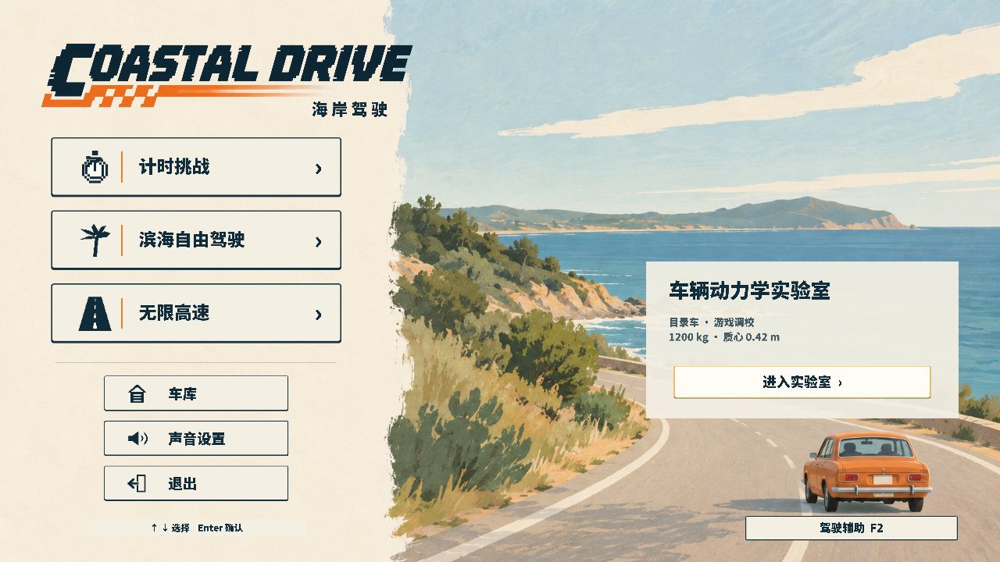
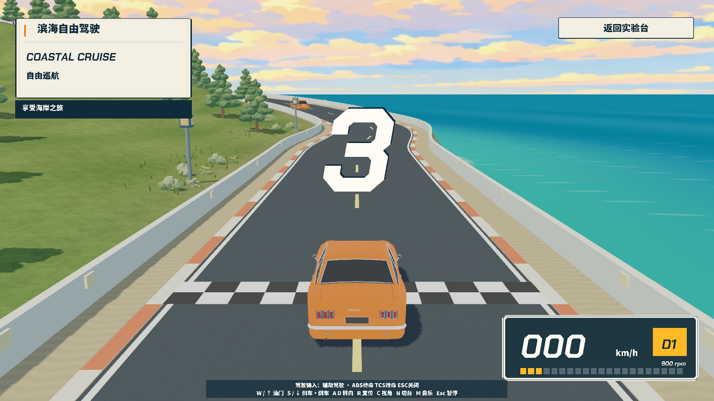
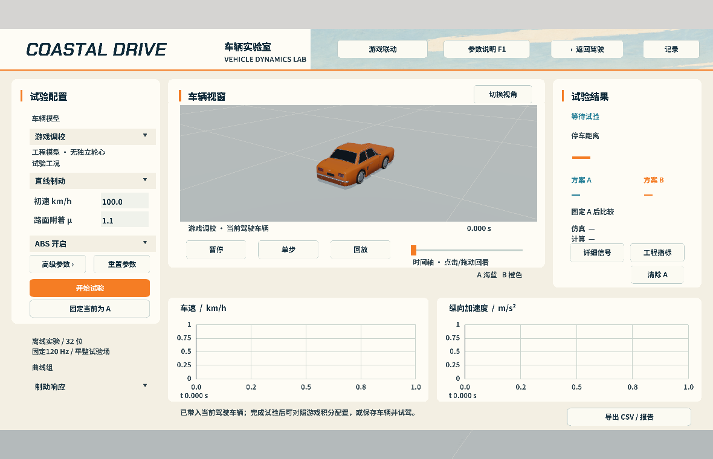

# CoastalDrive · 滨海驾驶

> **🚧 开发中 · 半成品 · 功能不齐全 · 潜在 bug 可能较多**
>
> 当前是开发试玩版，可能出现崩溃、卡顿、车辆/交通异常和界面问题；尚未完成全部物理、性能与人工体验验收。欢迎试玩和反馈，请按开发阶段的完成度预期体验。

## ⬇ 下载游戏（Windows 64 位）

### **[▶ 点击下载安装版 .exe（含卸载器）](https://github.com/wy520ccj/CoastalDrive/releases/download/v0.9.0-dev.20261017/CoastalDrive-0.9.0-dev.20261017-Windows-x64-Setup.exe)**

**[免安装版 .zip](https://github.com/wy520ccj/CoastalDrive/releases/download/v0.9.0-dev.20261017/CoastalDrive-0.9.0-dev.20261017-Windows-x64-Portable.zip)** · **[版本说明 / 所有下载文件](https://github.com/wy520ccj/CoastalDrive/releases/tag/v0.9.0-dev.20261017)** · **[安装、卸载与常见问题](docs/download.md)**

当前下载版：**0.9.0-dev.20261017**，适用 Windows 10/11 x64，需支持 OpenGL 3.3 的显卡驱动。自带运行环境，无需安装 Python 或编译器。安装版双击安装后从开始菜单启动；免安装版须完整解压，再运行`win_amd64/coastaldrive.exe`。绿色 **Code → Download ZIP** 下载的是开发源码。

## 这是什么程序

**CoastalDrive 是一个把滨海驾驶游戏与车辆动力学实验台连接起来的 Python 桌面项目。** 你可以沿海岸公路自由驾驶、参加计时挑战、在带车流的高速上行驶，也可以进入实验台修改车辆参数、运行标准化工况，再把同一辆工程车带回道路试驾。

项目目前围绕 **“配置车辆 → 做试验 → 看曲线 → A/B比较 → 实际试驾 → 返回分析”** 展开。游戏侧关注操作、车流和驾驶体验，实验台侧提供可重复的输入、记录与分析；两种工作方式在同一个窗口中切换。

适合想试玩驾驶原型、观察车辆参数影响，或阅读 Python/Panda3D 车辆仿真实现的人。[更完整的程序介绍](docs/overview.md)包含功能分区、十种试验工况、示例流程和当前开发方向。



## 驾驶游戏

| 内容 | 当前可以体验 |
|---|---|
| 滨海道路 | 自由驾驶与按顺序通过检查点的计时挑战 |
| 无限高速 | 持续生成的道路、直路/弯坡、三档车流，自由驾驶或5公里无碰撞挑战 |
| 交通车辆 | 跟车、变速、变道与碰撞交互；复杂事故恢复仍在完善 |
| 车辆与车库 | 游戏调校车辆、RWD/FWD/AWD设计参考车及GR86工程配置，车辆预览与五种车漆 |
| 画面与声音 | 海岸环境、跟车相机、仪表与诊断信息、发动机/碰撞声音及可切换驾驶电台 |
| 日常操作 | 暂停、失焦自动暂停、复位扶正、设置与成绩本地保存 |



## 车辆动力学实验台

实验台把车辆配置、工况、动画和曲线放在一个工作区。可调初速、路面附着、转角、质心高度等条件，控制暂停/单步，拖动时间轴回看；把一次结果固定为A，再运行B进行叠加比较。参数悬停或F1可查看公式、单位、用途与来源。

| 能力 | 说明 |
|---|---|
| 十种工况 | 直线制动、阶跃转向、固定转角、正弦转向、执行器输入、定圆、参考双移线、对开附着制动、单侧凸起/轮跳、单侧凸起/制动；凸起工况需匹配工程模型 |
| 工程分析 | 速度/加速度、横摆/侧偏、轮胎与载荷、悬架等曲线，以及满足计算条件时的制动/操稳/乘坐与接地指标 |
| 对比与记录 | A/B曲线、完整车辆配置、历史快照、CSV信号和HTML报告；支持载入及满足版本条件时的同源复算 |
| 游戏联动 | 对已完成试验运行同命令的游戏积分对照，或保存工程车进入滨海试驾，再恢复原实验工作区 |

例如，先运行100km/h、μ=1.1的直线制动并固定为A，再改μ=0.6运行B，比较两条速度曲线与模型停车距离；也可以修改质心高度，观察轮荷、车身运动及实际试驾的变化。[操作示例](docs/vehicle-design-loop.md)



## 物理核心与当前完成度

游戏和实验台共用 Panda3D/Bullet 权威物理核心，覆盖动力与传动、轮胎响应、悬架/轮荷及电子辅助。物理按120Hz固定步推进，界面和声音读取已完成状态。游戏沿用单次机械求解与键盘辅助；参考实验保留每拍两次机械子步与直接执行器输入，可通过联动对照观察差异。

本版已包含近期游戏联动、窗口往返、输入/时间轴修复、海岸坡面修复与菜单/加载背景更新。下载包含普通精度游戏与实验台；双精度隔离SDK仍为源码开发流程，未包含在安装包中。实验台部分工况仍可能慢于实时，复杂交通与碰撞等问题仍在排查；工程结果属于模型计算，尚未完成实车标定。

接下来优先完善参数设计与试驾闭环、建立标准工况和可解释的误差范围，继续排查模型/界面问题并验证性能与兼容性。AI训练、自动标定与玩家一键AI接管仍是后续方向，未作为本版功能提供。

[实验台说明](docs/vehicle-lab.md) · [车辆设计与试驾](docs/vehicle-design-loop.md) · [当前进度与未完成项](docs/current-progress.md) · [问题反馈](https://github.com/wy520ccj/CoastalDrive/issues)

## 基本操作

| 操作 | 按键 |
|---|---|
| 开始 / 确认 | Enter |
| 油门 | W / ↑ |
| 刹车，停车后保持进入倒车 | S / ↓ |
| 转向 | A / D / ← / → |
| 回到当前路段中心并扶正 | R |
| 切换远近摄像机 | C |
| 切换 / 开关驾驶电台 | N / M |
| 暂停 / 继续 | Esc |
| 诊断信息 | F3 |

窗口失焦自动暂停。游戏主菜单可进入实验台；试驾右上角或暂停页可返回实验台。设置、成绩、日志和默认工程数据位于`%LOCALAPPDATA%\CoastalDrive`，卸载保留用户数据，彻底清理前请先备份。

## 从源码开发

当前统一开发入口为本仓库`main`。使用Python 3.14、项目虚拟环境与Visual Studio C++构建工具：

```powershell
py -3.14 -m venv .venv
.\.venv\Scripts\python.exe -m pip install -r requirements-dev.txt
.\.venv\Scripts\python.exe setup.py build_ext --inplace --build-temp builds/native-temp
.\.venv\Scripts\python.exe src/main.py
```

配置完成后，双击根目录`试玩.cmd`运行源码游戏，`launchers/vehicle-lab.cmd`进入实验台。PyCharm解释器选择`.venv/Scripts/python.exe`，入口`src/main.py`。原生扩展须由当前源码编译，不能复制旧包内核。

[启动器与双精度入口](launchers/README.md) · [双精度SDK](docs/sim-double-runtime.md) · [检查入口](docs/tasks/README.md) · [发行构建](packaging/README.md)

## 仓库导航

| 路径 | 内容 |
|---|---|
| `src/` | 权威物理、玩法、界面、声音与环境表现 |
| `assets/game/` | 游戏运行所需模型、贴图、字体、声音及许可 |
| `art/` | 可编辑美术源文件 |
| `tools/`、`tests/` | 制作、构建、诊断及行为回归 |
| `packaging/` | Windows安装器与开发阶段提示 |
| `docs/` | 当前状态、设计、任务与证据；从[文档导航](docs/README.md)进入 |
| `launchers/` | 当前源码启动入口 |

下载产物通过 **GitHub Releases** 分发，不放入源码树；`builds/`、虚拟环境、开发SDK与本地日志不纳入Git。历史包和工作树保留在本地只读归档，说明见[历史索引](archive/README.md)，不作为当前下载入口。

## 素材与实现

素材真实来源、许可及加工过程见[素材表](docs/asset-register.csv)，各资源保留许可。驾驶电台包含Kevin MacLeod的《Bossa Antigua》《Future Gladiator》（CC BY 4.0），完整署名见[音频许可](assets/game/audio/License.txt)；菜单背景的生成来源见素材记录。

Python + Panda3D/Bullet，Controller → Control → Simulation → Snapshot → 玩法/表现/UI。Simulation是唯一物理权威，120Hz固定步。工作规则见[AGENTS.md](AGENTS.md)，阶段路线见[开发计划](docs/development-plan.md)。
