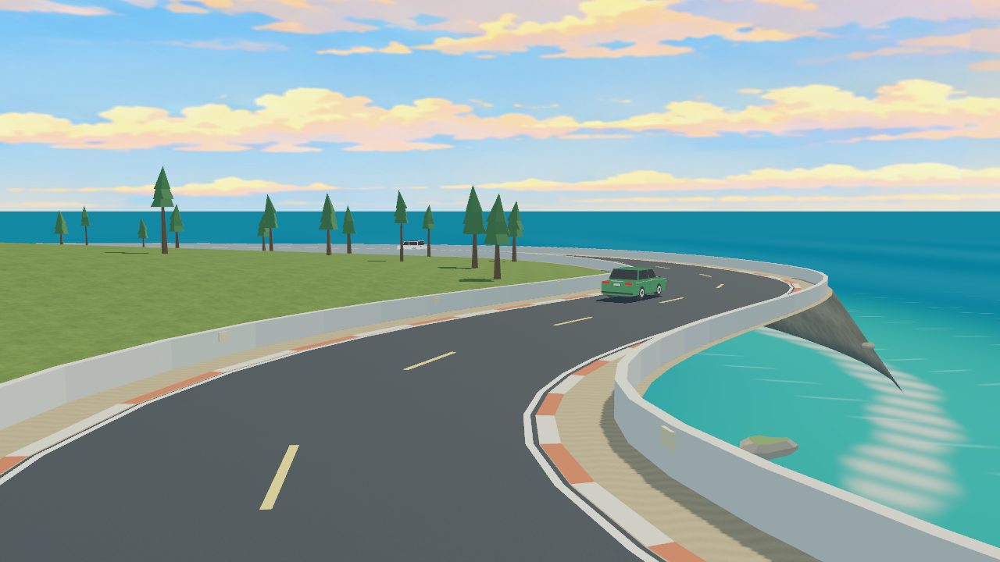
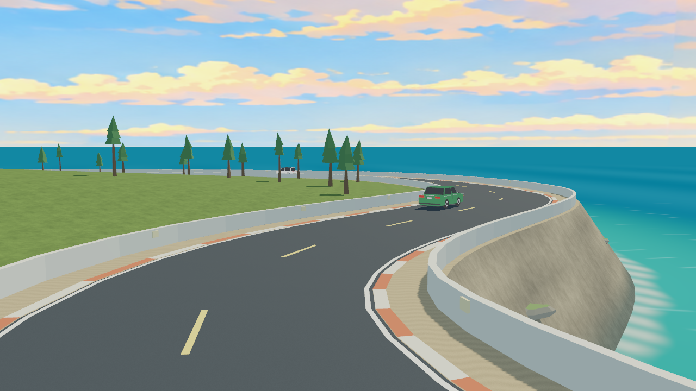

# COAST-MESH-01 坡面绕序修复证据

基线main/591a99a，2026-10-17。实际运行资产中的coast坡面6144个三角形原来全部朝下；修正绕序后同一几何从道路侧正常显示。截图均来自本项目实际离屏渲染，固定相机与场景快照相同，不是示意图；已查看前后全环20个视角。

360米修复前：

360米修复后：

[修复后全环20视角总览](after-contact.png)、[修复前镜头记录](before-report.json)、[修复后镜头记录](after-report.json)。完整前后40张原图在本地`logs/COAST-MESH-01/`；报告中的文件名相对对应的before/after目录。

[几何比较结果](geometry-comparison.json)及[比较器](check_geometry.py)核对原配方和真实GLB：全部位置、颜色、UV和24790个三角形的无向顶点记录相同，仅坡面绕序/法向改变。比较器从仓库根目录用`.venv/Scripts/python.exe docs/evidence/COAST-MESH-01/check_geometry.py`执行，基线资产只写入logs，不覆盖运行资源。

环境T0 26项、最终T1 53项与0/17/23各1200拍通过。失败过程、完整命令及范围见[任务包](../../tasks/COAST-MESH-01.md)。实际离屏画面只证明采集视角，不能代填人工驾驶/性能验收。
