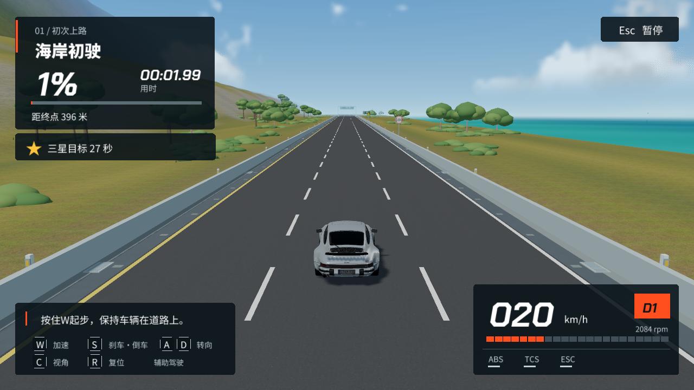
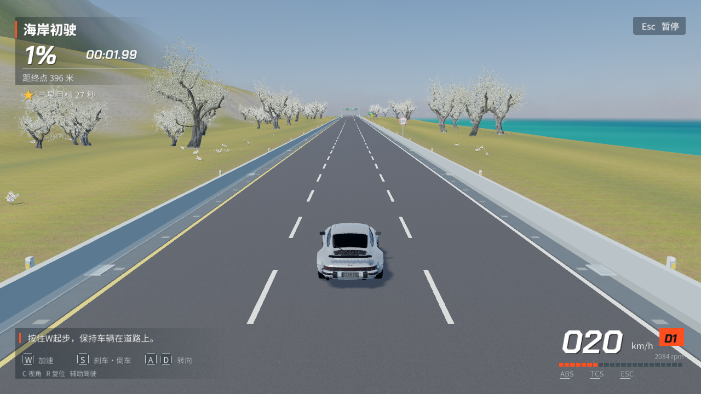
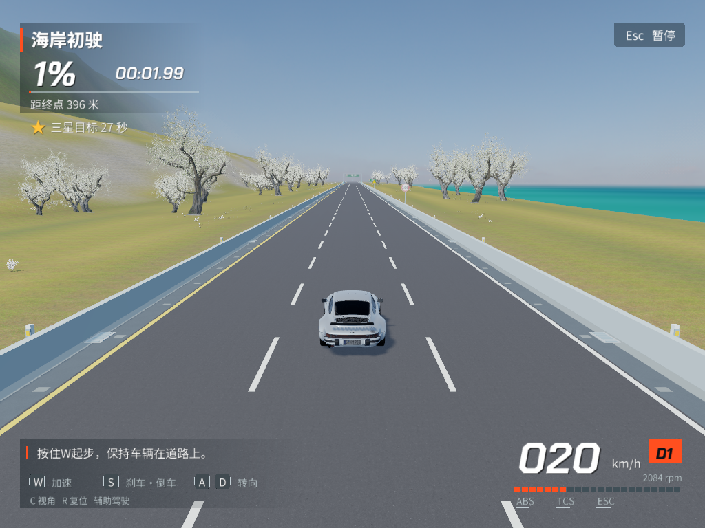
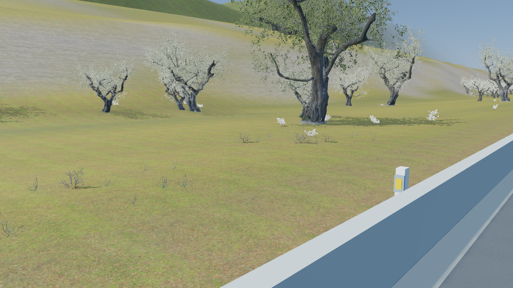

# 晴天光照、完整植被与紧凑驾驶HUD

2026-10-23，施工基线 `1b3c8a0a`，本地单线。用户已明确否定早期候选“一眼假”“阴暗”；本块只完成下一轮可运行候选，**不代表美术或总目标通过**。

## 参考与实际差距

实际查看了Xbox官方[热带海岸与岩石海岸截图](https://news.xbox.com/fr-fr/2021/07/29/decouverte-des-biomes-et-des-saisons-de-forza-horizon-5/)，研究受光/阴影、近中远层次和开阔海面。原图只作本地研究，不进入运行包；来源/SHA见 `daylight-vegetation/fh5-reference-sources.json`。随后内置ImageGen生成23晴天设计，原图/完整提示词在 `docs/design/garage-v2/23-sunny-coast.*`。21针叶与22局部换树方向已放弃；23仍是目标，不是运行截图。

本轮改动：

- 同一张Greg Zaal / Poly Haven CC0晴空HDRI用于4K天空、空气透视、环境球谐和车身反射。原HDR字节保持；运行时不卷积，128px环境立方体/粗糙度级别均离线生成。只绕竖轴对齐太阳；实拍太阳42.89°与保留的场景太阳约53.35°仍有高度角差异，没有倾斜地平线来凑方向。间接图限制太阳热点到4，直射单灯负责太阳，避免重复能量使地表泛白。
- 主车此前均匀补光仅取父灯28%，反射还是简化图；现在公路场景将同一真实环境反射显式绑定到车身和四轮，并让世界共享天空间接光。原车库预览与物理保持各自职责，未全局提高曝光。
- HUD改为靠边小组：赛况/目标330×162与330×40，仪表315×160，提示510×122，暂停126×43（941高参考坐标）。目标和仪表无整块深底，赛况/提示只留.38→0原生渐隐；原成绩/操作/辅助状态保留，长停车数字适配144宽，不挤计时。
- 真实CC0 Island Tree / Rooibos / Grass Medium替换高速树冠、灌丛和三角草；原始24文件、独立遮罩、作者API、SHA与可编辑衍生齐全。树87967三角形在近远档共享，灌木6287/1193、草833/40；全部三维，未使用平面剪贴远树。静态设施合批不递归展开这些共享网格，防止内存膨胀。
- **仍未完成**：地面自然密度与大尺度变化、山体/海面细节、植被完整PBR法线/粗糙度、抗锯齿与整体自然感。当前植被运行仅底色/遮罩，原PBR数据保留在源目录。实际与23图仍有明显差距；不把换资源或测试通过当作接近FH5画质。

## 实际程序图

8张归档原图逐一来源/SHA见 `daylight-vegetation/captures.json`：1张旧基线复用，7张本轮原图。两张驾驶HUD图来自真实240拍起步，其后仅冻结快照移动取景；弯坡图仅冻结物理的相机采集，不是实际驾驶通过。

## 验证口径

- `tools/validate.py T1 --tests tests/test_expressway.py tests/test_expressway_route.py tests/test_environment.py tests/test_ui_theme.py tests/test_career_ui.py tests/test_garage_environment.py --output logs/validation/GARAGE-DESIGN-02-daylight-T1`：**88项通过**，0/17/23各1200步通过；保存完整summary与pytest输出。涵盖直/弯/坡原道路表面、树碰撞中心/尺寸、LOD顶点表共享、装卸重定位、源遮罩、线性HDR/许可打包、HUD六赛/两画幅/真实暂停恢复和车库环境默认行为。
- 最后新增 `test_photographed_sky_mesh_and_environment_share_actual_world_directions`，`daylight-directions-T0` **1项通过**：读取实际天空网格顶点/UV，与Panda原生立方体取样比较6个世界方向，避免天空/反射翻面。此后未修改生产代码。合计89不同项分批覆盖，不称最终89项完整T1重跑。
- `check_surface_materials.py --output logs/validation/GARAGE-DESIGN-02-daylight-balanced-1280`，最终 `--output logs/validation/GARAGE-DESIGN-02-daylight-final-1024 --size 1024 768`：各4图/240新起步显示拍；路面/植被编译错误标志、固定Snapshot及主车/四轮真实环境绑定检查通过（最后一项在窄屏采集中执行）。旧整场三赛实绩明确复用，未新增完整赛事。
- 最终 `check_expressway_motion.py --shape curves/hills --frames 3 --camera static --road-view --width 1280` 各3图通过，仅静态视觉。第一次旧植被弯坡串行采集在人类否定后中断，不冒充两形态通过。
- 所有有summary的本块成功采集/显示探针已知共4080新起步显示拍，最终两画幅480拍、最后显示探针另240拍包含其中。首个高内存候选虽留下4张图，但没有完成summary，步数不补记为成功或0。headless步与初始化拍不充作玩家实际驾驶。

## 失败与被否定候选

- Fir候选形态不适合当前海岸，主站glTF底色未含单独遮罩，且粗减面破坏细叶；部分命令成功但画面被否定。Rooibos与草亦显式接回作者独立alpha，源像素未用手画或生成图替代。早期ShaderInput写进BAM导致无图形加载时ShaderAttrib未注册，改为运行时设置输入；最终无该序列化状态。
- 把完整高面数植物递归flatten进每株节点，曾观察约6.7GiB工作集并中断；改为只合批不含LOD的设施。原树细杆嫁接新冠仍显假，最终改为同来源整株落地，物理盒不跟随美术资源改变。
- 早期T0 35过2失败，是331.9°与−28.1°的测试等价角错误；早期T1 63过1失败，是测试只读局部状态、遗漏祖先遮罩，均修测试后通过，未改物理/阈值凑验收。首版HUD渐隐转换得到const顶点表，启动失败；改为显式可写副本。初Ruff两项格式问题已修。
- 云量偏多的48d HDRI使目标方向显灰，未采用；直接把未分离太阳的HDRI计入间接光使地表泛白，增加离线间接热点限制。首资产T0 4过1失败，把输入辐亮度上限误当成积分球谐系数上限；修为有限/正能量验证，原热点能量单测仍保留。不是放宽生产数值。
- 1.5%远树减面导致秃树，最终拒绝该档，近远共用保留树冠的5.5%源网格；远处遮罩阈值.12保留细叶。过往平面远树也已移除。当前细叶采样仍不够自然，不宣称美术通过。

## 开销和工作区边界

独立冻结显示探针：1280×720、同车/镜位/441tick，60暖帧+180同步显示帧，代码和原始样本归档。旧基线均值11.45ms/P95 13.05ms，最终11.43ms/P95 12.49ms；工作集1000.50→1192.19MiB，观察峰值1098.03→1338.38MiB。进程CPU均值7.90→11.55ms，单帧CPU计时有15.625ms量化。只说明本固定短窗，**不据此宣称性能提升或实际驾驶FPS/Gate**；最终内存代价明显，启动时段缓存也不同。当前树在近远共用完整网格，保覆盖的高效LOD尚需精制。

26项保持文件及运行SHA见 `preserved-sha256.json`，Git LF/工作CRLF仅归一换行比较，二进制逐字节比较。**验证之后另一个施工线新增了application/main-menu与碰撞求解修改**，本包没有改这些文件，当前Simulation不能再声称与基线完全相同；单独记录其观察SHA，不混入本包提交或沿用上述T1为它们背书。其余原车辆配置/网格、道路定义、冻结海岸源文件、启动器和路面材质保持。

本包本地施工，无推送；总目标与人工画面/驾驶趣味性验收持续开放。
