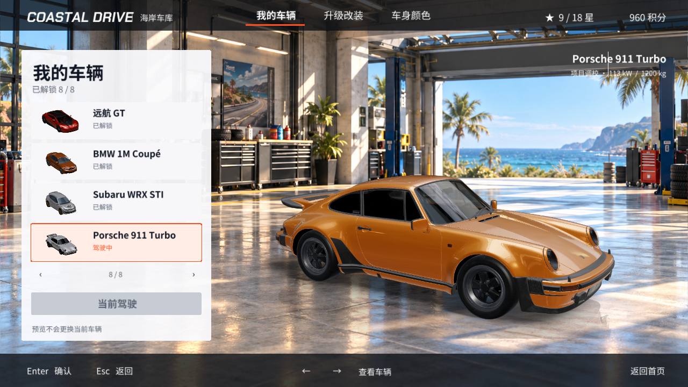
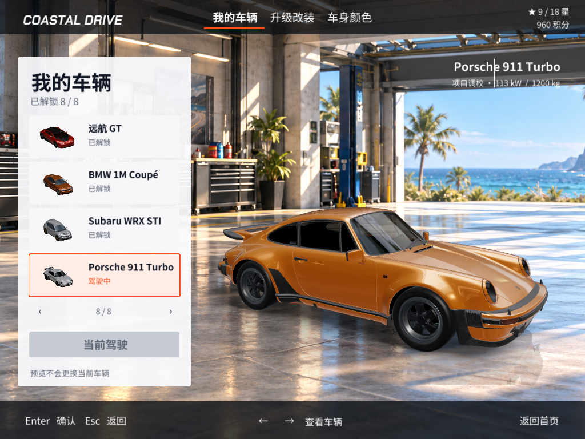
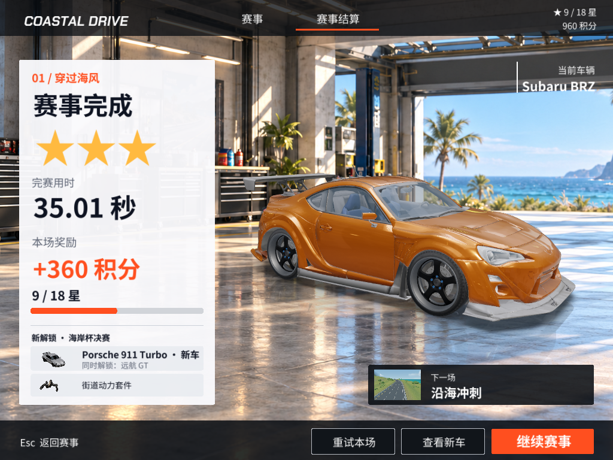

# 第八车：Porsche 911 Turbo

2026-10-23，基线 `c84e8923`，单线本地施工，不推送。新增一款现实车型及必要的长名称适配；总体任务仍 in_progress，不替代用户的画面/趣味性评价。

## 结果和来源

- 车库现8车，其中7款现实车型。1975 Porsche 911 (930) Turbo 由 Lionsharp Studios / Karol Miklas 制作，当前作者 API 和 Ai2 Objaverse 原始 GLB 嵌入信息均确认 CC-BY-4.0。原件21,969,080字节，SHA、公开下载地址、当前作者数据和署名在 `art/vehicles/sources/porsche-930/`；运行署名 `assets/game/vehicles/Porsche-930-License.txt`。模型作者许可与 Porsche AG 的车型设计权利明确区分，不宣称车厂授权。
- 保留194453源三角形、车身/内饰/灯组/轮毂/原贴图/UV及正确变换的面角法线。源可选透明覆漆产生噪点，去除并使用既有游戏车漆；去除源阴影平面、天线和挂件；前轮展示舵角归零，四轮独立由 Snapshot 驱动。体透射灯罩改为当前着色器支持的薄层透明，不用手造车体替代。
- 可编辑衍生 `art/vehicles/porsche_930.blend`，GLB16,113,312字节、BAM63,685,655字节；原件和运行纹理没有伪装成低内存资源。没有进行本车型正式GPU/运行内存或性能Gate。
- 9星解锁，与远航GT同阶段提供另一种车身/后驱选择。独立 `porsche-930` 存档键，改装、颜色、锁定预览、确认驾驶及领奖跳转复用现有真实流程。配置为1200kg、2.343m轴距、后驱、前轴静态份额40%的**项目调校**，不是原厂标定或已校准的原厂930模拟。
- 原有10套完整配置逐字段与基线相等，见 `porsche-930/baseline-configs.json`。15项保留文件SHA在同目录，权威物理/120Hz、评分门槛、旧车资源及启动器没有改动。新车初始外廓不足的装配检查失败后，只修正新车声明外廓为半长2.35m/半高.82m，并按最终配置重跑驾驶；未降低通用装配契约。

## 界面与实际观察

沿用既有车库设计和真实车模区域，未另造一套页面。4:3实图发现长车名溢出：选车卡在窄屏缩小实际车模缩略图，给20px车名和状态留空间；宽屏保留22px。9星结算的“车型 · 新车”按真实字体宽度适配，原奖励位置、次行同时解锁与零件行保持。

归档9张原始程序图及逐图SHA/来源见 `porsche-930/captures.json`。含最终两画幅选车、窄屏升级/颜色、侧向、道路及最终窄屏奖励→新车预览→返回原赛事。页面里的9星是隔离夹具，不是玩家实绩；车库流程另外实际跑240驾驶显示拍。主流程12图、首候选2图、窄屏初3图/最终3图、宽屏最终1图、奖励三轮各3图，共30次程序截图，精选9张；纯截图轮0新驾驶拍，初始化不当完整驾驶记账。

## 验证

- `tools/validate.py T0 --tests tests/test_career_garage.py tests/test_appearance.py::test_vehicle_catalog_separates_selection_from_asset_quality --output logs/validation/GARAGE-DESIGN-02-porsche-T0`：20过1新车外廓失败；修新车配置并增加来源/轮向检查后，`porsche-T0-v2`完整车库21项通过。
- `tools/validate.py T1 --tests tests/test_career_garage.py tests/test_appearance.py tests/test_career_ui.py tests/test_ui_theme.py tests/test_vehicle_designs.py --output logs/validation/GARAGE-DESIGN-02-porsche-T1`：**56项通过**，种子0/17/23各1200步通过。
- 窄屏适配后新增领奖参数用例：`porsche-name-T0` 首次Ruff因循环lambda捕获失败；v2两个用例因夹具切换选车页重置预览而失败；显式重新选择候选后v3两个用例通过。没有为夹具修改生产选择规则。
- 最后奖励名称适配后 `tools/validate.py T1 --tests tests/test_career_ui.py --output logs/validation/GARAGE-DESIGN-02-porsche-ui-final-T1`：**完整UI20项通过**，三种子各1200步通过；前批其余37项有效复用。另 `porsche-progress-T0` 成长完整7项通过。共64个不同测试分批覆盖，不称一次64项全绿。
- `tools/garage_design_check.py --output logs/validation/GARAGE-DESIGN-02-porsche-flow --car porsche-930`：实际选车/购买安装/恢复、颜色预览取消保存、转车、返回原赛事、显示资源不累积，通过；12图/240道路显示拍。末次窄屏名称只补针对UI和静态图，未重复完整驾驶。
- `tools/garage_design_capture.py --output logs/validation/GARAGE-DESIGN-02-porsche-final-1024 --car porsche-930 --stars 9 --size 1024 768 --only cars upgrade-tires paint` 及宽屏 `porsche-final-1280 --only cars`，通过。奖励采集脚本随证据保存，隔离9星夹具实际点击“查看新车”，确认前保留旧车、确认后选930，再返回slalom简报；两画幅通过。最后只对窄屏奖励标题重采，宽屏旧图不充当末版截图。
- `tools/career_check.py --output logs/validation/GARAGE-DESIGN-02-porsche-driving-final --design porsche-930 --events first-drive parking slalom`：**三赛均完成**。起步2014拍/16.783秒/3星；停车2283拍/19.025秒/2星，误差3.067811米；绕桩4201拍/35.008秒/3星。合计8498新驾驶拍，每拍独立复核规则；初版另8498拍保留，最终结论取最后配置。两轮各有201初始化拍/赛，未当驾驶拍。完整逐拍压缩记录在对应日志目录。

FR4/HR实际观察不符合本轮质量目标，XZ旧源尚未完成材质质量核对；hasapeta Veneno与其Mustang作品已区分，需登录但未取得的Mustang未接入。候选与下载过程记录在 `resource-candidates.md` 和源日志中。

未跑T2/T3、长时性能、人类驾驶验收。道路/场景细节与整体光照仍需继续，自动检查不能代签审美和趣味性。仅本地提交，无远端发布。
