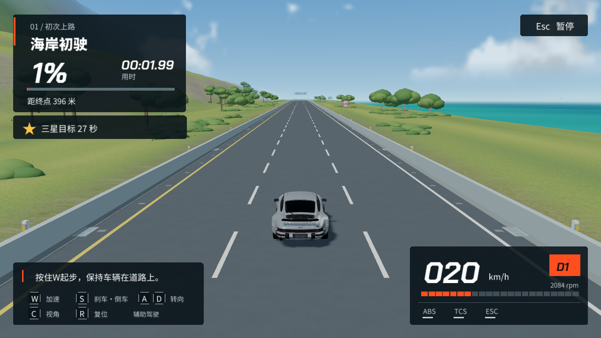
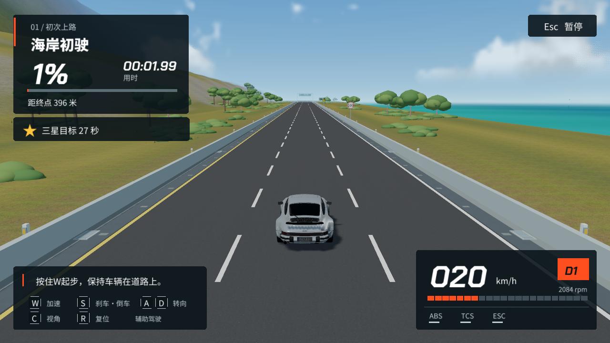
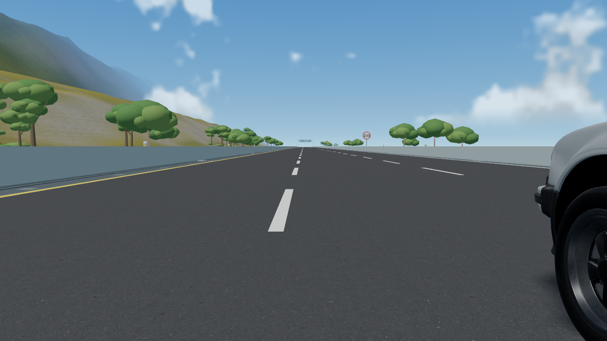
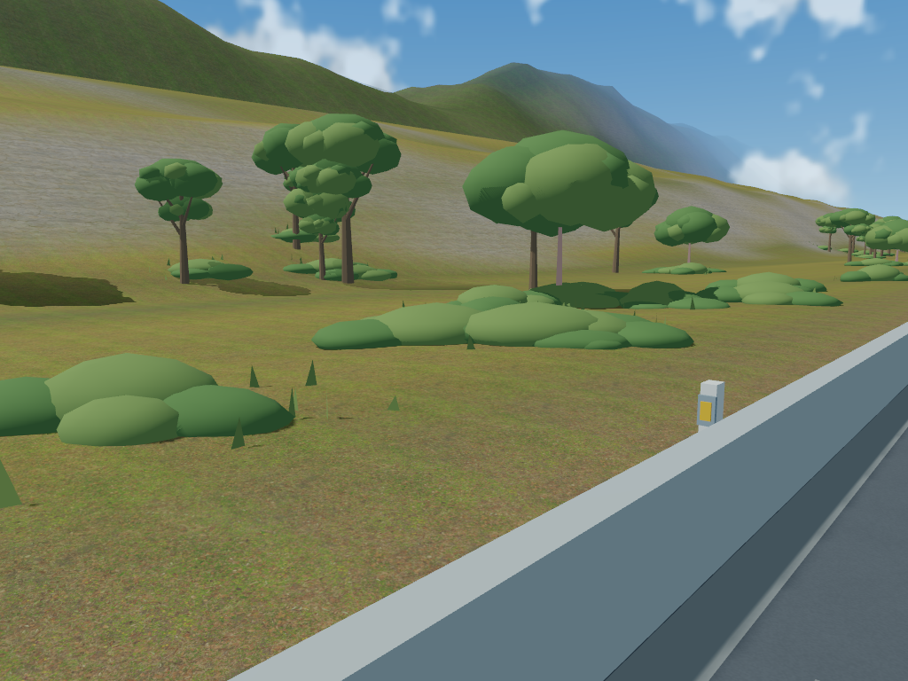

# 实际驾驶场景的实拍表面材质

2026-10-23，基线 `5d749c2f`，本地单线施工。道路与草地材质增量，不代表整体场景达到目标图或人工接受。

## 设计和实际边界

- 阅读 FH5 环境美术作者 Simon Hughes 的[材质工作流](https://simonhughes3d.artstation.com/projects/rJA6J5)（基础材质到复杂材质、稀疏使用破损变化）。本轮浏览器查看功能被关闭，作品JSON/图片请求也未取得可查看图，不把作者文字或搜索图注称为已看过的新实机截图。此前车库包的FH5研究保留；本轮直接参考输入是已有真实驾驶图。
- 内置ImageGen先生成 `docs/design/garage-v2/20-road-materials.png`，完整提示词及取舍在同名前缀txt。图中额外生成的云/山/海细节与立体草丛不进入本次实现，也不是运行效果。该设计还未全面实现，继续保留差距。
- 最终运行资源为 Poly Haven **Asphalt 03**（Charlotte Baglioni摄影，Dario Barresi加工）的2K底色/GL法线/粗糙度，以及 **Leafy Grass**（Charlotte Baglioni）的2K底色，均CC0。原始像素逐字节保存，来源URL、作者API、SHA和下载工具在 `art/expressway/sources/road-materials/`。运行许可 `assets/game/materials/License-Road-Surfaces.txt`；没有用生成截图或手画噪声冒充实拍材质。
- 实拍底色按sRGB取样，法线和粗糙度保留原线性数据与通道数；沥青在着色器做85%去色、法线XY强度.45、干路粗糙度下限.55。路面2m重复（原始实拍范围2.05m），草地2m重复；路面UV按既有曲线投影的距离/横向位置计算，每600m重置且段末保留连续坐标，避免远里程精度和边界相位跳变。
- 原生PBR继续负责太阳、阴影、反射和后处理。只在道路表面用实拍法线/粗糙度，标线、路肩、格栅继续原材质；不替换碰撞、附着、道路形状、120Hz或评分。法线切线基由原几何与UV导数计算，不添加第二套物理表面。
- 路边土带此前借用竖向岩壁纹理，因坐标比例失衡拉成条纹；改用同一草地实拍图的平面坐标和土色过渡。岩壁自身坐标保持。

## 实图

归档8张原始图（其中原版1张复用），逐图原路径/SHA见 `road-materials/captures.json`。实际树冠、草丛轮廓、天空和远景仍比较简单；本增量不能称为完成FH级场景。驾驶图所有HUD数据来自实际快照。

## 验证与失败记录

- 首T0 14项通过/13个fixture错误：误用Panda的Texture拷贝构造。改用已核对API后完整道路/高速T0 **27项通过**。最后用直接`Texture.read`装载独立资源，避免全局池保留冗余原件和修改共享纹理格式。
- `tools/validate.py T0 --tests tests/test_expressway_route.py::test_photographed_maps_keep_color_and_scalar_formats_separate tests/test_expressway_route.py::test_real_road_uv_scale_and_texture_phase_survive_segment_reset --output logs/validation/GARAGE-DESIGN-02-road-materials-format-T0-v2`：2项通过。首版相位测试1过1失败，是读取合批共享顶点表中的未引用顶点；改为只看实际primitive索引，不为测试修改几何。
- `tools/validate.py T1 --tests tests/test_expressway.py tests/test_expressway_route.py tests/test_environment.py tests/test_ui_theme.py --output logs/validation/GARAGE-DESIGN-02-road-materials-T1`：**60项通过**，种子0/17/23各1200步通过。涵盖直/弯/坡原物理显示网格、分段装卸/重定位、资源、色彩格式、UV相位等。末次只追加打包资源断言与离线下载工具/诊断签名，`road-materials-package-T0`资源打包1项通过，最终Scoped Ruff另查。
- `tools/environment/check_surface_materials.py --output logs/validation/GARAGE-DESIGN-02-road-materials-final-1280`；最终装载代码另用 `--output logs/validation/GARAGE-DESIGN-02-road-materials-final-1024 --size 1024 768`：每轮4图/240实际起步显示驾驶拍，随后冻结快照移动显示相机；编译错误标志和快照不推进断言通过。宽屏图在装载改为`Texture.read`之前、像素/格式/着色器相同；窄屏是在最终装载之后，未重复两套宽屏近景。最后静态2×3弯/坡图来自 `check_expressway_motion.py --shape curves/hills --frames 3 --camera static --road-view --width 1280`，不是驾驶证据或FPS测试。
- 候选Floor/Ground实拍偏浅棕及草地效果不符，未采用；Asphalt02裂缝重复成平行线，未采用；Asphalt03原色偏棕，最终采用运行材质去色。首轮采集漏`hud.resize`导致HUD堆叠，已修采集工具且排除该图，生产HUD未改。第三次Asphalt02灰度粗糙度被强制RGB，GPU上传断言中断；现保留原通道格式并添加单通道JPEG回归夹具。失败摘要 `road-materials/failures.json`，没有把中断报告成成功。
- 五次成功采集轮共记录**1200新起步显示驾驶拍**；失败第三轮未留下summary，不计为通过，也不虚记0拍。26张本轮GUI截图（五轮各4、弯坡各3），原版图另复用1；最终道路材质的正式宽/窄采集共480拍，旧整场三赛实绩保持复用，不重复完整驾驶。初始化与静态取景不当道路驾驶记账。
- 19项保护文件SHA在 `road-materials/preserved-sha256.json`；权威物理、原所有车辆完整配置/资源、UI与HUD代码、道路定义、冻结海岸源网格和天空保持。全路形原显示顶点/三角形由相关测试与权威网格直接比较，不拿截图代替几何证据。
- 四张2K图的原始RAM尺寸与通道数见 `road-materials/texture-memory.json`；完整mipmap理论再加约1/3。此为素材数据尺寸，不是运行内存/GPU占用或性能Gate。未做T2/T3或长时性能、人类驾驶/审美验收。

本块本地提交，无推送。总目标仍in_progress：植被/天空/远景及整体光照与目标图仍有差距，人工观感和驾驶趣味性待实际体验。
