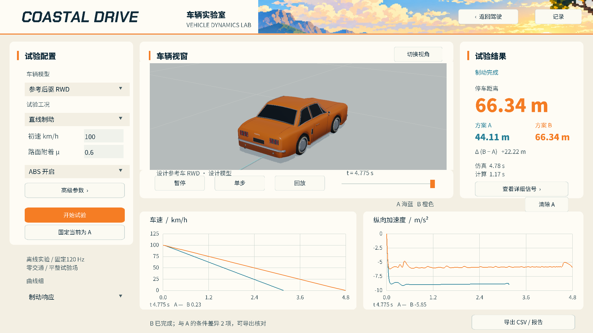

# LAB-01 / LAB-02 实现与验收证据

2026-10-13菜单反馈修订：[LAB-MENU-01](../../tasks/LAB-MENU-01.md)。menu-before.png为用户原图；menu-720/menu-1080为各五类菜单真实鼠标悬停截图和输入检查收据（每类稳定120帧、所有行中心/边缘、选择和外部关闭）。20项T1/Ruff/三种子通过，收据见menu-T1-summary.json；字体与物理模型未改，人工体验待确认。

2026-10-13字体反馈修订：[LAB-TYPE-01](../../tasks/LAB-TYPE-01.md)。正文Regular→Bold、辅助字加深、小字采样调整，Heavy标题/橙色指标保持。720/1080各5张实际GUI截图见typography-720-final/typography-1080-final，字形对比见typography-comparison.png；载入原A/B记录，不为字体重跑试验。相关T1/Ruff/三种子通过，人工清晰度确认待用户实际查看。

2026-10-13，主目录main，施工基线396084acbf22bc510b399387bd31966c8c63ffe8；源码和原有未提交悬架准备同时存在。实验室实现已本地提交24dbdc2，收尾元数据另见Git日志；不推送、不改公开试玩包。

## 当前结果

| 工况 | 配置 | 真实结果 |
|---|---|---|
| 制动A | 参考RWD / 100km/h / μ1.1 / ABS开 | 378拍，3.150s，44.113568m |
| 制动B | 同车同初值 / 只改μ0.6 | 573拍，4.775s，66.338392m，较A增加22.224823m |
| 定圆 | 参考RWD / 60km/h / R60m / 12s | 1440拍，平均路径误差0.377109m，最大0.937084m |
| 参考双移线 | 参考RWD / 60km/h / 3.5m横移 / 12s | 1440拍，平均误差0.184961m，最大0.532747m |
| 对开制动 | 参考RWD / 100km/h / 左μ1.1右μ0.3 | 501拍，4.175s，实际路径59.933598m，横摆峰值1.711512rad/s |

均为本轮模型计算，不是实车数据。起步先真实落地，再推进8个制动时间常数释放锁车压力，初始化总177拍；随后施加滚动初速并开始记录。初期带预载制动的43.578/66.016m只属于早期原型，不作为当前版本成绩。停止条件是水平速度模≤0.1m/s，距离为三维路径长度；对开横滑/旋转不按纵向速度过零误判停车。

## 有效验证

- `tools/validate.py T0 --area lab --output logs/validation/LAB-final-T0-r1`：Ruff、19项实验室检查通过。
- `tools/validate.py T1 --area lab --area research --tests tests/test_driving_mode_ui.py tests/test_driving_modes.py tests/test_world_substeps.py tests/test_vehicle_parameters.py --output logs/validation/LAB-release-T1`：Ruff、43项通过，0/17/23三种子各1200拍通过。[收据](T1-summary.json)。
- `tools/lab_ui_check.py --output logs/LAB-02/ui-1080-release --height 1080` / `--output logs/LAB-02/ui-720-release --height 720`：真实GUI完成制动A/B、暂停、恰一拍单步、时间轴、导出/载入/无世界播放、执行器输入、三项新增工况、参数及详细信号页。两档截图已查看，结果分别见[1080p](ui-1080/summary.json)、[720p](ui-720/summary.json)。
- `tools/lab_lifecycle_check.py --output logs/LAB-02/lifecycle-final`：两次游戏→实验室往返，旧世界均关闭；实验室前后GUI注册数均0，物理/绘制/实验室/PBR任务均释放。[收据](lifecycle.json)。
- UI图形最后调整仅为轨迹无照明叠加绘制与俯视适配，720/1080p双移线截图已专项重新渲染。原T1物理有效范围复用，最新Ruff/diff检查通过；图形调整未重跑整个物理长测。
- 早期T0-r1因无关工况也限制onset≤duration而失败，已改为独立有效范围并保留日志。T1-r1还发现主菜单预期仍为6项和工程导出漏列native_tire_forces，已修正；物理参数值未改。
- 初期重复写`--tests`仅保留最后一组；旧收据不当作完整附加范围。最终T1使用一次`--tests`列出全部路径，相关范围已补齐。
- 原型首帧时间滑块的程序ADJUST递归/自动暂停已修复，拖动输入与程序刷新分开；失败/中断记录在logs中保留。

## 未通过与边界

`tools/validate.py T2 --output logs/validation/LAB-stage-T2-r1 --timeout 1800`：Ruff通过，pytest 70通过/1失败即停止；后续均not_run，[T2收据](T2-summary.json)和[失败日志](T2-pytest.txt)。失败为`test_headless_cli_from_another_directory`默认海岸10000拍，四轮共同求解超过20轮，残差1.92046e-11N、法向9.09495e-13N、几何2.46916e-11Ns/Nms。

隔离本轮修改的main/simulation/driving_modes/vehicle_parameters四模块，恢复396084a版本，保留开始时已有物理工作区和同一DLL，再运行相同CLI，退出1且同一残差复现。此对照不冒充全仓HEAD冻结，原悬架工作区明确保留。[对照说明](baseline-cli.json)、[原始stderr](baseline-cli.stderr.txt)。首次对照输出因Windows编码读取失败未形成有效收据；第二次保存原始UTF-8字节后确认，不作为两次有效实验。

未调整共同求解方程、20轮上限或精度来关闭该案例。T2完整阶段、T3、13车实时120Hz和人工操作/画面体验仍未通过或待确认。当前代码可以完成实验室功能，整体物理阶段不能据此标作通过。

## 实际界面

可运行入口：`launchers/vehicle-lab.cmd`。完整原始记录/CSV/报告保留在logs/LAB-02对应UI运行目录；仓库中保留紧凑截图与收据。
