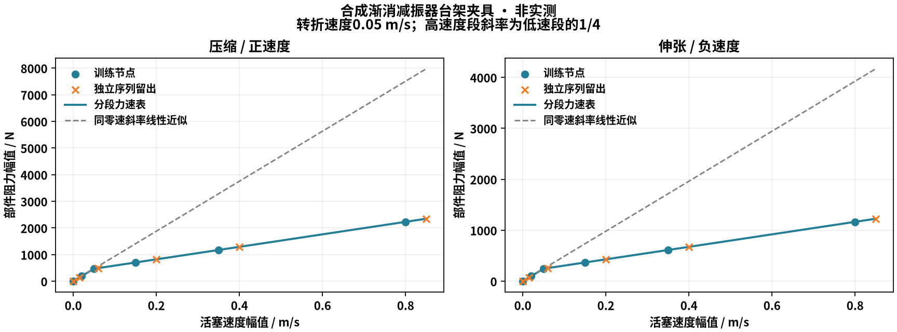

# 分段被动减振器力速曲线

2026-10-15，基线d8b892e，codex/simulation-fidelity独立树。全部输入为合成算法夹具，不是实测/供应商数据，默认/游戏/main/共享环境/公开包保持。

## 实际功能

新增四角`suspension_damper_curves`：q=0参考轮心有符号速度—阻力表，节点间线性、端段线性外推。当前安装比同时变换输入速度/反力/耗散，正常法向隐式导数含完整几何梯度；唯一34未知量残差与原生两端内部力直接消费新本构。表生效时覆盖两项常阻尼，它们只保存零速段斜率，编辑该系数不会暗改表。

台架v4沿用原始单位/温度/来源/部件ID/安装几何与独立留出；两方向零速零阻力明确给定，同速训练重复读数平均，留出不进入表节点。非被动/非单调/零速偏置数据拒绝；当前不模拟液压迟滞/频率/温度状态。旧v1/v2/v3原报告重算与旧文件原阻尼恢复分别验证。

详细[物理依据与使用](../../../nonlinear-damper.md)。GUI入口仍为高级参数“导入悬架台架”，`example-synthetic.json`是v4示例，须先导入独立轮心工程模型。F1显示实际模式的TeX公式、表与参考系数作用、来源/域外假设；旧记录不换用新公式，OEM缺失参数不作原厂/实测归属。

## 合成部件与数据适配

四轮使用相同算法夹具，压缩低速部件斜率9386.6667Ns/m、伸张4906.6667Ns/m，|vd|=.05m/s后斜率变成原1/4。两方向各6个训练速度（含零速）及6个独立序列留出速度，合并为11节点有符号表。安装几何和x0沿用上一节点，不在该组A/B改变。



同一渐消数据在原v3线性拟合下不能通过原RMS5%/峰10%门槛；v4用表可通过，未放宽阈值。错误留出力增加40%的候选仍被拒绝，且不能改变训练生成的表。图中原始活塞速度坐标和实际配置的参考轮心坐标有rd0换算，不能直接混用。

## 完整原生实体凸起A/B

`damper-curve-AB-r1`：18km/h、10mm单侧实体Box、2.4s、总质量1200kg、40kg/轮。A是B曲线的零速斜率线性近似，B是整表；完整配置只在`suspension_damper_curves`不同。两种模型其余弹簧/预压、安装曲线、质量、轮胎和试验输入均相同。A不是对非线性数据全域标定通过的部件，A记录明确标出表被覆盖。

| 120Hz完成拍指标 | A 零速线性近似 | B 分段表 |
|---|---:|---:|
| 簧上世界Z加速度RMS / m/s² | .2882081948 | .2425152352 |
| 簧上世界Z加速度峰 / m/s² | 1.118671803 | .909790243 |
| 轮心世界Z加速度峰 / m/s² | 17.46144667 | 21.92984608 |
| 最大悬架压缩 / m | .0335701214 | .0349788038 |
| FL动态轮荷比 | .0727797717 | .0633657387 |

它说明不同速度段阻力确实进入实际整车动力学，也展示乘坐振动/轮心响应/行程的取舍；不是优化结论、实测车型性能或ISO舒适等级。两组各289帧，全部文件往返/B所有快照、信号和输入命令精确复算一致；源/SDK首末相同。完整各角及改变条件见`AB.json`。

B全部完成拍采样落在该合成部件/安装域及力速表节点域内，表外计数为零。报告会把独立验证域与实际节点外推域分开；此结论只覆盖120Hz采样，不能替代子步峰值或温度/频率覆盖。

## 实际末本构与能量

`damper-curve-energy-r1`：与B实际车辆配置相同，独立真实576机械步完成，除墙钟计算时间外全部摘要相同。诊断按保存表独立分段重建实际末阻力，没有直接调用共同求解器的材料函数。实际末悬架本构力峰差2.0831373e−6N、压缩峰差1.4314626e−12m；局部冻结能量残差峰2.0691049e−10J。

原始全车能量残差累计−.0025367516J，峰4.4646296e−5J，仍非零。没有以耗散或数值几何功补平总账，也不据不同硬件节点残差变小宣称整体能量Gate通过。力速表没有额外储能，阻尼热来自每步h·Fw·qdot，独立短测核对该功率恒等式及非负性。

## 验证与归档

44项相关T0通过；124项相关T1（110.03s）、Ruff和三个固定种子通过。覆盖原线性退化、两方向/域外耗散、独立部件功率/完整隐式导数、非线性法向能量账、错误留出/原始表拒绝、实际表覆盖/历史恢复/适用域；未做T2/T3、实时性能或人工体验。

720/1080各3参数＋OEM缺失共4图通过，旧记录公式、错误留出导入不改变硬件及排版边界通过；实际查看720参考斜率图与合成力速对照图。71行TeX新增3行表插值/当前安装/功率公式。GUI检查为程序导入/显示，既有真实悬停F1路由复用，人工未验收。初嵌套if的Ruff错误在长测前修复，无物理失败被当作成功。

复现输出须新建目录：

```powershell
.venv/Scripts/python.exe tools/physics/run_sim_double.py tools/physics/damper_curve_check.py --output 新AB目录
.venv/Scripts/python.exe tools/physics/run_sim_double.py tools/damper_curve_ui_check.py --height 720 --output 新界面目录
.venv/Scripts/python.exe tools/physics/run_sim_double.py tools/physics/lab_energy_check.py --engineering 完整候选.json --duration 2.4 --output 新能量目录
```

`raw-evidence.zip`含所有原始输入/完整记录/CSV/复算/源码指纹/SDK指纹/界面截图与工具；`executed-model.zip`为实际执行且最终相同的物理源码与UI/公式资产。`manifest.json`保留逐文件/归档/图SHA，`source.json`/`runtime.json`及原记录首末指纹由归档工具核对。历史v1/v2/v3归档报告用当前实现重算通过，不改原始字节。

任务继续in_progress：当前无记忆单调被动曲线不是完整液压减振器，迟滞/温升/摩擦、完整K&C、有限姿态总能量、真实数据和人工验收仍开放。
