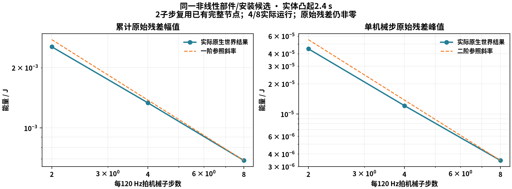

# 同源有限悬架功与步长细化

基线c967676；只增加分析工具与证据，生产物理/硬件/UI保持。参考车使用已归档非线性减振器/安装候选，18km/h、10mm单侧实体Box、2.4s。控制及记录120Hz，每拍机械子步2/4/8。137个物理来源文件与双精度SDK相同；实际配置仅子步数不同，命令一致。

| 子步 | 实际机械步 | 原始累计残差/J | 单步绝对峰/J |
|---|---:|---:|---:|
| 2，复用 | 576 | −0.00253675164 | 4.46462958e−5 |
| 4，新运行 | 1152 | −0.00133427684 | 1.21292605e−5 |
| 8，新运行 | 2304 | −0.000688590022 | 3.44524309e−6 |

累计幅值经验阶0.927/0.954，单步峰1.880/1.816。只描述本工况；初始化使用相同真实落地/释放协议，静载末状态可随步长不同，初值及拍数已保存，不是严格同初态Richardson估计。六项信号中，簧上/轮心加速度、行程、轮荷和横摆相邻网格RMS差下降；车速差0.0002313→0.0002732km/h反而上升，不能宣称所有状态收敛。初加速度未定义，保持null并排除该一个共同样本，其余288点比较，未填零。



从实际冻结末速度旋转路径独立推导悬架几何功展开，未拟合总残差。4/8子步旋转主项累计−0.00135025/−0.000697908J，展开余项峰8.70170e−9/1.18715e−9J。减振器材料热27.01099/28.98200J，端口恒等式峰2.22e−16/8.33e−17J；有符号几何功保持数值项，不改称材料耗散。[推导](../../../suspension-integration-error.md)。原始全车残差仍非零，预算恒等式不是物理闭合验收。

## 执行与验证

复用`damper-curve-energy-r1`及匹配的`damper-curve-AB-r1/B`；旧2子步没有新展开列，保留缺失。4/8各在一次真实推进中同时记录CSV与289帧完整记录，未为采样重跑。

```powershell
.venv/Scripts/python.exe tools/physics/run_sim_double.py tools/physics/lab_energy_check.py --engineering logs/SIM-UNSPRUNG-01/damper-curve-energy-input-r1/candidate-vehicle.json --duration 2.4 --substeps 4 --record --output logs/SIM-UNSPRUNG-01/energy-refinement-4-r1
.venv/Scripts/python.exe tools/physics/run_sim_double.py tools/physics/lab_energy_check.py --engineering logs/SIM-UNSPRUNG-01/damper-curve-energy-input-r1/candidate-vehicle.json --duration 2.4 --substeps 8 --record --output logs/SIM-UNSPRUNG-01/energy-refinement-8-r1
.venv/Scripts/python.exe tools/physics/energy_refinement_report.py --output logs/SIM-UNSPRUNG-01/energy-refinement-report-r2
.venv/Scripts/python.exe tools/design/plot_energy_refinement.py
.venv/Scripts/python.exe tools/physics/run_sim_double.py tools/physics/archive_energy_refinement.py
```

三项独立解析T0、三项T1/Ruff/三种子短检查通过；覆盖sin/cos旋转解析、三阶余项、独立速率差及纯平动极限。初测试夹具叉积符号错误1失败/2通过，修正后3通过；初汇总直接减null失败，按共同有效样本修正后通过。失败工具/日志保留，不涉及生产物理修复。此前124项物理T1/GUI节点复用；本轮未跑T2/T3、性能或人工验收。图已实际查看。

`report.json`/`budget.csv`为最终汇总；`raw-evidence.zip`含原始能量CSV、完整记录、执行工具、短检查与失败日志。`manifest.json`含逐文件/归档/图SHA，复用前节点`damper-curve/executed-model.zip`并逐个核验137文件。未复制SDK或伪造新生产版本。

任务in_progress/Goal active。下一协调有限构型更新、施力端口和导向反力，以多工况原始能量及状态精度验证；完整K&C、实测标定、性能与人工Gate继续开放。默认/main/共享环境及公开包保持。
