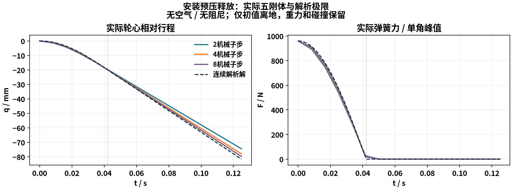

# 安装预压 / 压缩弹簧节点

2026-10-15，基线f839933，codex/simulation-fidelity独立树。原始台架输入均为解析合成夹具，不是实测。默认、主项目、共享环境及公开包保持，整体SIM-UNSPRUNG-01仍in_progress。

## 机制

`suspension_coil_enabled`显式选择独立轮心压缩螺旋材料，`suspension_spring_preloads`保存q=0的四轮等效F0。真实内部力、势能和切线来自同一非负压缩势能；松弛后不拉轮心，防倾/减振器/止挡分别保留。v2台架以安装压缩x0生成`F0=rs ks x0`、`kw=rs²ks`，当前安装被覆盖时解除其来源/适用域归属。原v1/旧工程文件保持原双向弹性/零预载与报告重算协议。

实际依据、零位/静载换算、数学和操作见[说明](../../../suspension-installation.md)。F1根据实际已运行/待运行配置选择公式；旧记录不能被新配置换公式，GR86账本缺失项明确未提供。63行TeX资产，新增3行本构/安装数学。

## 唯一原生世界：静载和实体凸起

`preload-AB-r1`：同一线性部件、总质量1200kg、每角40kg、kw=48000N/m与原压缩/伸张阻尼，A/B仅改变安装预压。两组均启用压缩螺旋模型；B每角部件75000N/m、rs=.8、x0=.016m，对应F0=960N。

| 实际读数 | A 零预载 | B 每角960N |
|---|---:|---:|
| FL初始近静态悬架压缩 / m | 0.0531302505 | 0.0331310469 |
| 簧上质心高度 / m | 0.4260015968 | 0.4460008896 |
| 整车总CG高度 / m | 0.4112394764 | 0.4285722086 |
| FL初始轮荷 / N | 2942.875934 | 2942.856352 |
| 凸起簧上加速度RMS / m/s² | 0.2642789724 | 0.2643291973 |
| 轮心加速度峰 / m/s² | 18.19562969 | 18.20099046 |

簧上车高差0.019999293m、四角行程差约−0.019999204m，对应解析`−960/48000=−.02m`；初值是既有收敛条件下的近静平衡，存在微小残余速度，不能把约.0196N/角的差说成质量或总静载增加。动态RMS相近而车高明显改变，说明预载没有被错误当作提高刚度。工况18km/h、10mm单侧实体Box、2.4s，两组各289帧，全文件往返及B所有状态/信号/命令复算相同；首末源码/SDK一致。完整各角/条件及指标见`AB.json`。

## 唯一原生世界：空中松弛解析极限

`preload-release-r2`：只在t=0设离地初值；保留实际五刚体/四导向、重力和全部碰撞，取无空气、无材料阻尼及无发动机外部驱动。不是包含空气/道路/驱动的整车工况。四角初始总安装能量38.4J，解析相对频率37.2104204rad/s，松弛时刻.042213883s。

| 每120Hz拍机械子步 | q最大连续解析误差 / m | t=.125s内部储能+相对动能 / J |
|---:|---:|---:|
| 2 | .007146306 | 30.248695 |
| 4 | .003657360 | 34.044708 |
| 8 | .001850851 | 36.145757 |

均保持零轮胎法向力，最终弹簧力为零，内部能量不超过初始38.4J；质心重力速度误差通过1e−9m/s原门槛。能量向连续无耗散极限细化，未把离散耗散称作材料热。每案例15个120Hz完成拍，实际曲线见下图及`release.json`/原CSV。



首轮`preload-release-r1`未移除三维空气阻力，却比较纯重力质心解析式，门槛失败；该轮仅保留执行工具，断言前未保存完整曲线，不列为完成数据。r2按明确被动解析协议令air_density=0后检查；生产/凸起仍保留实际空气模型。未放宽1e−9门槛。早期工具pairwise Ruff问题一并修正，不伪称原轮通过。

## 完整道路储能诊断

`preload-energy-r1`：B同一候选、同实体工况的576真实机械步完成。原始能量残差累计−.0028586386J，单步峰5.3307377e−5J；实际末悬架本构力峰差1.975550e−6N、压缩峰差1.497996e−12m，局部冻结账峰2.057394e−10J。原始残差仍非零，不据局部账或单工况宣称整体闭合，也不声称比不同硬件旧节点全面改善。

该次旧诊断工具`result.config`仍写入请求配置，实际Lab选项会关闭ESC。`summary.options.esc_enabled=false`已由该次运行保存；与B记录除墙钟计算时间外全部摘要相同。`energy-context.json`保留原请求、通过执行匹配的配置函数/已保存实际选项重建且对照B实际车辆文件的有效配置；明确标明重建，不覆盖原记录。只有ESC启用项发生该覆盖。工具现已分别写`config=run.config`与`requested_config`，没有为此重跑长工况或改写旧数据。

## 验证与复现

39项相关T0、103项最终相关T1（105.21s）、Ruff及三个固定种子通过。720/1080各四图、三字段新公式/来源、旧记录原公式、OEM账本缺失归属及边界通过；实际查看720预载与1080刚度图。最终界面补充参考零位提醒后两尺寸再次通过，物理不变。UI导入/显示为程序调用，既有悬停/F1事件证据复用，人工未验收。初`preload-T0-r1`因旧协议字典访问的Ruff建议失败，没有pytest结果，后续修正通过。

首归档因Python元组与JSON列表直接比较而断言失败；执行工具保留在`preload-archive-r1`，JSON边界归一化后再核对，未改物理文件或原数据。

命令须使用新的输出目录：

```powershell
.venv/Scripts/python.exe tools/physics/run_sim_double.py tools/physics/preload_check.py --output 新AB目录
.venv/Scripts/python.exe tools/physics/run_sim_double.py tools/physics/preload_release_check.py --output 新释放目录
.venv/Scripts/python.exe tools/physics/run_sim_double.py tools/preload_ui_check.py --height 720 --output 新界面目录
```

`example-synthetic.json`为v2合成安装输入，须先载入显式独立轮心工程配置再从高级参数导入。`raw-evidence.zip`含实际输入/完整记录/CSV/原失败/执行工具/最终工具；`executed-model.zip`为物理执行相同的最终源码与最新UI/公式。`manifest.json`保留原文件/归档/图SHA，运行时和源码分别保存，不安装共享依赖、不合main、不推送。

当前支持非负安装压缩/常运动比/线性部件；安装间隙、并圈/辅助弹簧、变运动比、外倾/前束K&C、实测、人工及整体有限姿态能量继续开放。
