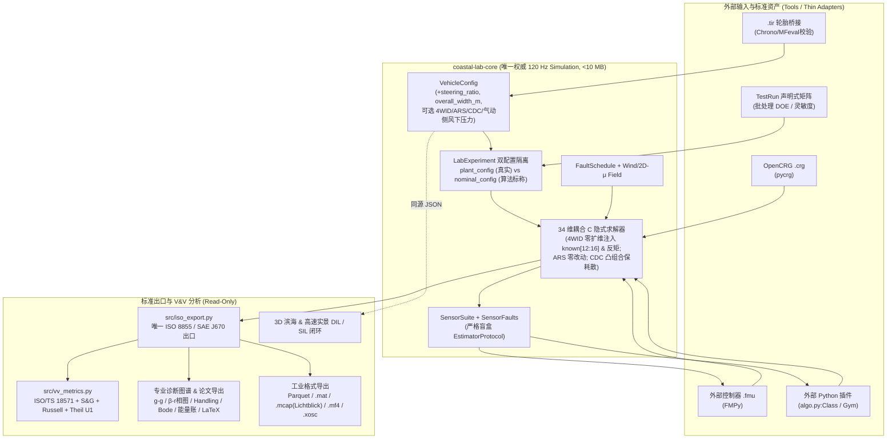

# CoastalDrive 车辆动力学试验台长期打磨规划（2026 Q4 – 2028 Q2）

> **规划基准日期**：2026-11-26（基于本地基线 `b1980b53` 与阶段 5 `SIM-FIDELITY-02` M1–M5 现状）  
> **实证证据基础**：5 路并行专题深度调研（总计 **155 条**一手核验来源、**44 份 / 103.18 MB** 本地 SHA-256 校验开放原件，零编造、零绕过付费墙）  
> **调研总索引与溯源表**：[research/lab-roadmap-2026/README.md](research/lab-roadmap-2026/README.md) · [sources-register.csv](research/lab-roadmap-2026/sources-register.csv)  
> **架构铁律**：严格遵循 `AGENTS.md`——保持 `Controller → Control/VehicleCommand → Simulation (120 Hz) → Snapshot` 唯一物理权威单向数据流；拒绝 ECS/事件总线/DI/多层 Manager/Factory 堆叠；不破坏既有游戏手感与默认车型配置字节兼容；自动测试、离屏渲染与实机人工体验分别记账。

---

## 一、战略定位：为什么不是“又一个轮子”？

通过横向拆解 10 个主流开源/商业仿真器（Project Chrono v10.0、OpenModelica v1.27、CommonRoad、TUMFTM Open-Car-Dynamics、F1TENTH、MetaDrive、CARLA、BeamNG.tech、Speed Dreams、CarSim/CarMaker/VI-CarRealTime/MATLAB VDB），我们确认开源与学术生态存在一道清晰的**结构性断层**：

- **高保真多体/方程工具（Chrono / OpenModelica / Open-Car-Dynamics）**：物理广度或单步速度极强，但部署重（PyChrono 无 PyPI wheel 强绑 Conda，Open-Car-Dynamics 绑 Ubuntu/ROS2/Eigen/Boost），缺失轻量桌面交互、教学公式溯源与真实 3D 驾驶/碰撞/交通闭环。
- **游戏/智驾感知引擎（MetaDrive / CARLA / AirSim）**：MetaDrive 与 CoastalDrive 同属 **Python + Panda3D + Bullet** 栈，但为换取 1000+ FPS 宏观交通 RL 吞吐，仅保留 Bullet 射线车模型；CARLA 默认物理高度简化且重资产。
- **商业闭源标杆（CarSim / CarMaker / BeamNG.tech）**：昂贵、闭源不可审计数值守恒，或受限于非商数据许可（BeamNG.tech 默认 CC-BY-NC v4）与非确定性跨进程复算，难以作为公开论文可复现 Artifact。

**CoastalDrive 试验台的不可替代生态位**：
> **“白盒、双精度可验证、Python 原生的车辆动力学与智能底盘控制/估计研究工作台（Open-Box Verifiable Vehicle Dynamics & Chassis Control Workbench）”**

其四大核心护城河已经成型：
1. **可审计的 34 维耦合隐式求解器 + 双精度收敛**：`unsprung_joint.py` + `mechanical_kernels.c`（单拍 13 ms，动量/力/端口残差 `1e-9 / 1e-5 / 1e-9`，单子步能量闭合 `2.10e-10 J`）配合 64 位双精度隔离运行时（`docs/sim-double-runtime.md`）。
2. **全链路防伪造可复现纪律**：`LabRecord` 源码+运行时 SHA-256 指纹与确定性复算、`coastal-tire-fit-v2` / `coastal-suspension-bench-v4` 满秩+留出验证强制门槛、65 项 STIX 源码溯源公式。
3. **《汽车理论》解析对账 + 实车留出盲测 + 观测器闭环**：`theory_baselines.py` + `gr86-2022-kc-calibrated.json` + 15 维 ES-EKF `chassis_observer.py`。
4. **工程客观指标 ↔ 3D 实时车手在环（DIL）与复杂交通（SIL）同源打通**：同一套冻结参数 JSON 既能跑离线 120 Hz 双精度分析，也能一键开上落日海岸/无限高速做主观手感与复杂交通压力测试。

---

## 二、防重造轮子宪法与一手核验纠偏清单

### 2.1 调研中发现的 8 项高危“实测纠偏”（已提前排雷）

本次一手代码审计与 PyPI/GitHub/法规核验直接避免了许多“拍脑袋设计”必然踩中的深坑：

1. **许可陷阱纠偏**：经 PyPI 与上游原始 `LICENSE` 实查，`asammdf==8.8.33` 实为 **`LGPL-3.0-or-later`**（非网传 MIT）；`CasADi==3.8.2` 为 **`LGPL-3.0`**；`FMPy==0.3.32` 为 **`BSD-2-Clause`**；`mat73` 与 `commonroad-scenario-designer` 为 **`GPL-3.0`**（严禁引入）；`UniFMU` 使用非 OSI 的 `ICAPL` 许可；`Foxglove Studio` 前端已转闭源商业化（应默认对接 BMW 主导开源的 **MPL-2.0 `Lichtblick`**）。
2. **伪轮子排雷**：PyPI `pypac` 是 HTTP 代理库而非 Pacejka 轮胎库；`pytire` 自 2022 停更且限 `<3.11`；`objective-rating-metrics` v1.3（MIT）默认假设 **10 kHz 碰撞采样率**（9 点滑窗在 120 Hz 会变成 75 ms）且强绑易在 Win/Py3.14 编译失败的 `dtwalign`——应保留 MIT 版权声明，用 30 行 NumPy/SciPy 带状 DTW 等价实现并锁死其官方算例（`0.713 / 0.815`）。
3. **Python 3.11–3.14 跨版本阻塞根因**：AST 扫描证实 `src/` **零 Python 3.12+ 独占语法**，且 PyPI 官方 `panda3d==1.10.16` 已有 `cp311–cp314` 全平台轮子；当前被困在 `3.14` 仅因 `pyproject.toml` 锁死 `>=3.14,<3.15` 与 `numpy==2.5.3`（要求 `>=3.12`），外加 4 处 Windows 专属路径/后缀假设。
4. **体积解耦红利**：核心源码 `src/`（7.40 MB）+ `vendor/bullet-2.84`（0.49 MB）+ `vehicle-configs/`（0.12 MB）合计仅 **`< 8.1 MB`**，完全可独立发布纯 BSD/Apache 许可的 PyPI 核心包 `coastal-lab-core`，与 **`743.04 MB`** 混合许可（CC-BY/SIL OFL/AI 美术）的游戏资产经 `Pooch` 彻底解耦。
5. **FMVSS 126 转向速率静默削波坑**：`VehicleConfig` 当前缺失 `steering_ratio`，且默认 `steering_rate = 50 deg/s`（轮端）在 0.7 Hz / $270^\circ\text{–}300^\circ$ Sine-with-Dwell（GR86 需 $88\text{–}98^\circ/\text{s}$ 轮端速率）下会静默削波，必须增设**法规转向机器人模式**。
6. **ISO 3888-2 车宽与曲率鸿沟**：现有 `gr86` 配置 `2 * collision_half_width = 2.030 m` 含后视镜，不可直接代入 ISO 3888-2（真实车宽 $b_v = 1.775\text{ m}$）；且 ISO 3888-2 过渡段（13.5/12.5 m）几何曲率严苛度是现有 3.5 m 样条的 **4.92×–5.74×**，单点长前视 Pure-Pursuit 会切内桩，须升级走廊约束多点前视驾驶员。
7. **ISO 8855 / SAE J670 16 项符号反转陷阱**：Panda3D 实测证实 CoastalDrive 车身系为右手 Z-Up（$+X$ 右、$+Y$ 前、$+Z$ 上），且内部 `steering`（右正）与 `yaw`（左正）异号；向 ISO 8855 转换时 `ay/beta/pitch/steering/alpha/fy` 均须取反，`body_inertia` 的 `(I_pitch, I_roll, I_yaw)` 须互换前两项——必须新建唯一只读边界模块 `src/iso_export.py` 统一出口。
8. **JOSS 2025/2026 预审时间窗红线**：JOSS 强制要求根路径 OSI `LICENSE` + **≥ 6 个月公开开发史** + 社区/外部使用实证 + `AI usage disclosure`。仓库首提交为 `2026-09-22`，故 6 个月节点为 **`2027-03-22` 后**，JOSS 投稿必须锚定 **2027-04 后**，但开源治理与公开迭代须在 **2026-12 立即启动**。

### 2.2 统一依赖分层表（`pyproject.toml` Extras 规范）

核心运行核保持**零重依赖、确定性纯洁**；一切通用数学、优化、工业格式与学习生态全部通过可选依赖按许可证清晰隔离：

| 分层 / Extra | 包含成熟开源库 | 实测许可 | 绝不重造的职责边界 |
|---|---|---|---|
| **核心 `coastal-lab-core`** | `panda3d>=1.10.16,<1.11`, `numpy>=2.0,<3`, 自研 5 个 C/C++ 严格浮点内核 | BSD / Zlib / 自研 | 120 Hz 唯一权威仿真、34 维耦合求解器、K&C、ISO 8608/2631、15 维 ES-EKF、`LabRecord` 指纹与纯 NumPy 轻基线 |
| **`[gui]`** | `panda3d-simplepbr`, `panda3d-gltf`, `matplotlib`, `pillow` | BSD / MIT / PSF | Sunset Atelier 试验台桌面 UI、STIX 公式渲染与离线出图 |
| **`[lab-math]`** | `scipy>=1.14`, `control>=0.10`（开发期可选 `pydy`） | **全 BSD-3-Clause** | 非线性最小二乘、12 阶零相移 Butterworth 滤波、Welch PSD/相干度、Bode/LQR、离线符号雅可比校验 |
| **`[lab-io]`** | `fmpy>=0.3.32`, `pycrg>=2.2`, `foxglove-sdk>=0.31`, `pyarrow>=20`（可选 `pythonfmu3>=1.3`） | **全 BSD-2 / Apache-2.0 / MIT** | FMI 2.0/3.0 控制器导入、ASAM OpenCRG 激光扫描路面、MCAP 时序+3D 联合回放（配 **Lichtblick**）、Parquet 批处理存储 |
| **`[lab-control]`** | `osqp>=1.0`, `cvxpy>=1.6`, `gymnasium>=1.0`（文档另引导 `acados` BSD-2） | **全 Apache-2.0 / MIT / BSD-2** | 实时稀疏 QP 控制分配、凸优化原型、RL/控制标准 Env 接口、嵌入式 NMPC/MHE |
| **`[openx]`** | `scenariogeneration>=0.16` | **MPL-2.0**（文件级） | 导出行业标准 ASAM OpenDRIVE (`.xodr`) 与 OpenSCENARIO (`.xosc`) |
| **`[mdf4]`** | `asammdf>=8.8` | **LGPL-3.0-or-later**（独立隔离） | 离线导出 CANape/INCA/MDA 可直读 `.mf4` 文件，动态 `import` 严禁静态拷贝 |
| **`[casadi]`** | `casadi>=3.7` | **LGPL-3.0**（独立隔离） | 离线符号自动微分、最优轨迹与 `acados` 前端建模 |
| **明确禁用黑名单** | `mat73`, `commonroad-scenario-designer`, `opendrive2lanelet`, `dtwalign`, `BeamNG.tech` 非商数据, **FSAE TTC NDA 私有数据**, 商业专有 `.tir` | GPL-3.0 / NDA / 商业专有 | 严禁任何强传染 GPL 代码、NDA 受限轮胎数据或未经授权的商业模型进入仓库或 CI |

### 2.3 明确放弃的 6 条红海赛道（战略克制清单）

1. **不做 FEA 柔性胎、软土/颗粒地形（DEM/SCM）与履带车辆**（Project Chrono 壁垒）。
2. **不做连杆级 CAD 多体铰接几何与衬套有限元**（Adams/Car 壁垒；保持 CarSim/VI-CarRealTime 验证成功的“独立轮心 + 解析/查表 K&C”甜点层）。
3. **不做软体节点-梁碰撞形变物理**（BeamNG 壁垒）。
4. **不做 UE5 照片级相机/多线 LiDAR 视觉感知训练场**（CARLA 壁垒；传感器聚焦底盘本体 IMU/轮速/转角/制动压/悬架行程/GNSS）。
5. **不做 1000+ FPS 宏观城市场景交通 RL 底座**（MetaDrive / SUMO 壁垒）。
6. **不自研通用稀疏 QP/NLP/自动微分/DAE 编译器**（直接集成 OSQP / acados / SciPy / FMPy）。

---

## 三、统一核心架构与最小正交契约演进

所有扩展严格围绕 5 条**零框架堆叠、向后字节兼容**的极简边界展开：

### 五大核心契约规范

1. **严格盲盒算法插件契约（彻底解耦 `lab_experiment.py:102` 硬编码）**：
   - `EstimatorProtocol`：`reset(initial_pose, nominal_config, sensor_config)`、`observe(sensor_frame: SensorFrame) -> ChassisEstimate`（**严禁传入真值 `Snapshot`**）；
   - `ControllerProtocol`：`reset(nominal_config, options, initial_estimate)`、`compute(estimate, base_command, elapsed, dt) -> VehicleCommand`、`telemetry() -> dict`；
   - 支持 CLI/GUI 以 `path/to/mod.py:ClassName` 或 `fmu://path/to/ctrl.fmu` 动态加载，并自动将插件源码/FMU 文件的 SHA-256 写入 `LabRecord` 指纹。
   - `LabExperiment` 显式拆分 **`plant_config`（驱动物理）与 `nominal_config`（交给算法）**，原生支持 $\pm 15\text{–}20\%$ 参数失配鲁棒性评测，消灭学术界最常见的“逆犯罪（Inverse Crime）”。
2. **唯一坐标出口（`src/iso_export.py`）**：
   - 保持内部 Panda3D 物理坐标不动；对外所有标准工况后处理、V&V 评分、FMU 端口及导出文件一律经 `to_iso8855_series()` / `to_fmvss126_channels()` 统一映射 16 项物理量与惯量主轴，并在文件头显式记录 `coordinate_frame: "ISO-8855:2011"`。
3. **34 维求解器零扩维 X-by-Wire 执行器与外扰端口**（全部默认关闭 / `None`，旧车型逐拍字节一致）：
   - **4WID 电驱与机电复合制动**：`VehicleCommand.wheel_motor_torques` + `ElectricDriveConfig`（恒转矩/恒功率外特性、一阶响应 $\tau_m$、二次损耗、单状态 $\text{SOC}$ 及高 SOC 回馈退坡），直接注入 `known[12:16]` 并施加等大反向定子反矩 `known[3:6] -= sum(T_m * axes)`，零扩维且严格闭合能量账。
   - **ARS 主动后轮转向**：`VehicleCommand.rear_steering` 复用 `SteeringRack` 接入 `suspension_kc.wheel_kinematics`，34 维主循环 0 改动。
   - **半主动悬架阻尼（CDC/MR）**：`VehicleCommand.damper_commands ∈ [0, 1]^4` 经一阶电磁阀延迟后在 `unsprung_contact`（及 C 核）对双包络阻尼表做单拍冻结凸组合，天然保耗散不等式 $\dot{q}F_d \ge 0$ 与二次 Newton 收敛。
   - **气动完善 + 2D $\mu$ 场 + 故障注入**：补齐气动下压力 $(C_{L,f}, C_{L,r})$ 与侧风侧力/压心偏置 $x_{\text{cp}}$（支撑 FSAE 与 ISO 12021 侧风）；将 `on_asphalt` 泛化为向后兼容的 `surface_friction(x, y, t)`；新增不可变 `FaultSchedule`（乘性效能 $\rho$、偏置/卡死、附加拍数延迟、上限衰退）并扩展 `SensorConfig` 支持 IMU 偏置阶跃、噪声倍增与单轮编码器断流。
4. **声明式试验矩阵与自动降维工具（借鉴 CarMaker TestRun + CommonRoad Section 10 + Chrono K&C）**：
   - 纯 JSON 声明 `{vehicle, road, maneuver_or_controller, observer, faults, mismatch, seed}` 驱动多进程无头批跑、参数 OAT/梯度灵敏度排序与 **Worst-Case 一键载入 3D GUI 逐帧复盘**；
   - 提供纯函数 `derive_reduced_control_model(vehicle_config)` 自动导出线性 2-DOF $(A, B)$ 与非线性单轨预测模型参数，消除仿真与外部 MPC/LQR 控制器间的参数漂移；
   - 新增虚拟 K&C 台架双激励模式（推杆纯运动学扫掠 vs 平台含胎面柔度加载）。
5. **全流程可审计 V&V 与多架构标定规范**：
   - 在 `src/vv_metrics.py` 中集成 **ISO/TS 18571:2024**（$0.4C+0.2P+0.2M+0.2S$）+ **Sprague & Geers** + **Russell** + **Theil $U_1$（$U^M/U^S/U^C$ 归因分解）**；
   - 按 **ISO 19364（稳态）→ ISO 22140（瞬态/频响）→ ISO 19365（正弦停滞）→ UN R140 Annex 3–5** 四级阶梯构建公开 V&V 白皮书。

---

## 四、6 阶段 18 个月施工总路线图（2026-12 – 2028-06）

严格按**单条施工线**推进，每个任务包均可独立 `T0/T1` 验收、本地提交，且节奏精准对齐 **JOSS 6 个月公开提交史门禁（2027-03-22 后）**：

| 阶段与时间窗 | 目标版本 | 核心任务包 ID | 交付核心能力 | 阶段验收 Gate 与学术/工程里程碑 |
|---|---|---|---|---|
| **Phase 0：开源治理与无头底座封口** （2026-12） | `v0.9.5-core-alpha` | `LAB-GOV-01` `LAB-CORE-01` `LAB-PLUGIN-01` | ① 根路径 `LICENSE`（BSD-3/Apache-2.0）、`CITATION.cff`、`CONTRIBUTING.md`、`CODE_OF_CONDUCT.md`、AI 披露模板；② 解耦 `lab_experiment.py:102` 外部课程硬路径，确立严格盲盒 `ControllerProtocol` / `EstimatorProtocol` 并内置参考 `ABS–DYC`；③ 修复 3 处 Windows 路径/后缀耦合，放宽 `Python >=3.11,<3.15` & `numpy>=2.0,<3`，拆分 `<10 MB` `coastal-lab-core` 并上线 Linux/Win/macOS GitHub Actions + `cibuildwheel` | **Gate-0**：Linux 无头 `window-type none` 零 X11 全通；外部任意 `.py` 控制器可注入并写入 `LabRecord` SHA-256；首版 PyPI 测试轮子与 CI 绿标上线 |
| **Phase 1：坐标封口、批处理 DOE 与 P0 国际法规工况** （2027-01 – 2027-02） | `v0.9.8` | `LAB-ISO-01` `LAB-BATCH-01` `LAB-STD-P0` | ① `src/iso_export.py`（16 项 ISO 8855 符号映射）+ `src/vv_metrics.py`（ISO/TS 18571 对齐官方 `0.713/0.815` + S&G + Russell + Theil $U_1$）+ `steering_ratio`/`overall_width_m`/机器人转向模式；② 声明式 `TestRun` 多进程无头批处理 CLI、参数灵敏度排序、Worst-Case 3D 回放与专业诊断图谱（g-g / $\beta\text{-}r$ 相图 / Handling / 能量分解 / LaTeX 表）；③ **FMVSS 126 / UN R140 Sine-with-Dwell**（SIS 0.3 g + 12 阶零相移滤波 + 三判据）+ **ISO 3888-2**（动态走廊 + 走廊约束多点前视驾驶员 + 碰桩判定）+ **ISO 4138 SIS 法** | **Gate-1**：GR86 在 ESC ON/OFF 下跑通全套 1.5A–6.5A Sine-with-Dwell 法规裁决与 ISO 3888-2 最高通过车速扫点；单命令并行跑 100 组 DOE 并输出论文级矢量图与 LaTeX 对比表 |
| **Phase 2：教学实验包、核心发布与双精度科研容器** （2027-03） | **`v1.0.0`** （首个正式版 + Zenodo DOI） | `LAB-DOCS-01` `LAB-TEACH-01` `LAB-PKG-01` | ① 上线 **Sphinx + MyST-NB + Read the Docs** 中英双语科研文档站与 CI 自动执行的 **《汽车理论》Lab 01–06 Notebook**（配 SHA-256 作业核验 CLI）；② 接入 `Pooch` 将 743 MB 游戏资产解耦至 Releases/Zenodo；③ 发布 **Linux 64 位双精度 Docker 镜像**（`STDFLOAT_DOUBLE`）与 `Gymnasium` 薄适配层 + `derive_reduced_control_model()` 自动降维工具 | **Gate-2（`v1.0.0` 正式发版）**：铸造首个不可变 **Zenodo DOI**；发布 **arXiv 技术报告** 锁定首发权；启动 1–2 门高校课程或 FSAE/FSC 车队公开试用收集真实用户实证 |
| **Phase 3：线控底盘 X-by-Wire、工业互通与 JOSS 投稿** （2027-04 – 2027-06） | `v1.1.0` | `LAB-XBW-01` `LAB-FAULT-01` `LAB-IO-01` `LAB-JOSS-01` | ① 34 维零扩维落地 **4WID 独立电驱/复合制动（含 SOC）、ARS 后轮转向、半主动 CDC 凸组合阻尼、气动下压力与侧风压心**；② 落地 `FaultSchedule`、`surface_friction(x,y,t)`、传感器故障扩展与 `plant_config`/`nominal_config` 参数失配沙盒；③ 落地工业桥接：`FMPy` 外部控制器 FMU 导入、`pycrg` ASAM OpenCRG 路面、`.tir → coastal-tire-fit-v2` 桥接器、`foxglove-sdk` MCAP（配 **Lichtblick**）+ Parquet + `.mat` + 可选 `[mdf4]`；④ 跨过 **6 个月公开开发史**门禁，补齐与 Chrono::Vehicle / LFDM (24-DOF) 背靠背精度与 RTF 对标，撰完 `paper.md`（含强制 AI Usage Disclosure） | **Gate-3**：① **正式向 JOSS 投稿**（零版面费拿下权威软件论文 DOI；若团队需 SCIE 则二选一评估 SoftwareX）；② 跑通 Simulink/C++ FMU 控制器 + OpenCRG 比利时石块路 + Lichtblick 3D 力矢量联合回放闭环 |
| **Phase 4：四架构实车标定库、完整标准工况与 `CoastalBench` 基准论文** （2027-07 – 2027-10） | `v1.2.0` | `LAB-STD-P1` `LAB-FLEET-01` `LAB-BENCH-01` | ① 补齐 **ISO 7401**（阶跃 TB 因子 + 0.1–4 Hz Chirp Bode 频响与相干度 $\gamma^2$）、**ISO 7975** 多减速度弯道制动、**NHTSA Fishhook**（侧倾角速度零交叉 + 双轮 50.8 mm 离地）、**FSAE 标准锥桶场（Skidpad/75 m/Autocross）**与虚拟 K&C 推杆/平台双模式台架；② 基于 EPA 滑行库 + NHTSA API/惯量回归先验 + **Stanford DDL VW Golf GTI 真车赛道留出（CC-BY-SA-4.0）** + **ETHZ AMZ FSAE `gotthard` (MIT)**，建成 **RWD / FWD / EV-4WID / FSAE 四架构标定库**；③ 发布 **`CoastalBench-XBW v1`**（8 组法规/故障/估计压力工况 × 9 个纯 NumPy 内置基线 + 外部 `OSQP`/`acados`/`Gym` 基线 + 5 种子排行榜 + 自动化 V&V 白皮书） | **Gate-4**：发布 `CoastalBench` 公开 Leaderboard 与一键 Docker `reproduce_paper.py`；向 **IEEE IV / ITSC / RA-L** 投稿底盘控制与 `truth vs sensor_ekf` 开放基准论文；申请 ACM/IEEE Artifact 可复现徽章 |
| **Phase 5：实车仪器化时域验证与 SIL/DIL 生态深化** （2027-11 – 2028-06） | `v1.3.0` / `v2.0` | `LAB-SIL-DIL-01` `LAB-VAL-REAL-01` `LAB-FMU-PLANT` | ① 打通外部控制器/观测器直连 CoastalDrive **3D 滨海多弯起伏道路与无限高速动态 NPC 交通**的 SIL/DIL 联合压测，支持人机共驾/一键接管与主观评价闭环；② 联合高校实验室或 FSAE/FSC 车队采集实车仪器化时域遥测（IMU/轮速/转向角/RTK-GNSS/悬架位移），按 ISO 19364/22140/19365 与 ISO/TS 18571 完成真车全时程波形验证（目标 $R > 0.85$）；③ 实验性提供 `PythonFMU3` 工作站 Plant FMU 导出与可选原生 `mf61_tir` 轮胎内核 | **Gate-5**：以完整机理方程 + 跨平台双精度收敛 + 实车全时程 V&V 白皮书冲刺 ***Vehicle System Dynamics* (VSD)** 或形成高校/车队长期复用的开源底盘基准平台 |

---

## 五、立即可启动的第一期施工蓝图（Phase 0 → Phase 1 首批 3 个高 ROI 任务包）

在用户完成 `SIM-FIDELITY-02` 桌面人工体验并本地提交当前基线后，建议按以下顺序切入首批 3 个小而精、互不阻塞、每包 1–2 周可闭环验收的任务包：

### 任务包 1：`LAB-GOV-01` + `LAB-CORE-01`（开源治理、跨平台解耦与无头 Core 包）
- **目标**：一次性扫清 JOSS、Linux 服务器、Python 3.11–3.14 与外部控制器硬耦合四大历史阻塞。
- **范围**：
  - 根路径落位 `LICENSE`（建议 `BSD-3-Clause` 或 `Apache-2.0`，与用户确认后落地）、`CITATION.cff`、`CONTRIBUTING.md`、`CODE_OF_CONDUCT.md`；
  - 解除 `src/lab_experiment.py:102` 外部课程路径硬编码，引入极简 `ControllerProtocol` / `EstimatorProtocol` 与 `module:Class` 插件加载器，并将插件源码 SHA-256 写入 `LabRecord`；
  - 修复 `src/paths.py`、`src/lab_records.py`、`src/lap_ghost.py`、`src/lab_runtime.py` 跨平台路径与动态库后缀；
  - 放宽 `pyproject.toml` 至 `requires-python = ">=3.11,<3.15"`、`numpy>=2.0,<3`，建立上述分层 `optional-dependencies`，并接入 `.github/workflows/core-ci.yml`（Linux/Windows 无头 `window-type none` 回归 + Ruff）。
- **验收**：`T1` 全绿；干净 Linux 容器零 X11 跑通 `LabExperiment` 与确定性复算；任意外部 `.py` 控制器插件闭环运行并通过指纹校验。

### 任务包 2：`LAB-ISO-01`（ISO 8855 统一出口、V&V 评分器与法规前置参数）
- **目标**：建立国际标准的坐标系、客观波形评分器与转向机器人能力，为所有标准工况与跨平台对标打地基。
- **范围**：
  - `src/vehicle_config.py` 新增向后兼容字段 `steering_ratio`、`overall_width_m`（补齐 2022 GR86 与参考车元数据），并在 `SteeringRack` 中支持法规试验专用转向机器人速率/带宽模式；
  - 新建只读模块 `src/iso_export.py` 实现 16 项 ISO 8855 / SAE J670 符号转换与惯量轴序转换；
  - 新建 `src/vv_metrics.py`（保留 VSI TU Graz MIT 归属）实现 ISO/TS 18571:2024（纯 NumPy/SciPy 带状 DTW）、Sprague & Geers、Russell 与 Theil $U_1$（$U^M/U^S/U^C$），并用官方 README 黄金算例 `0.713 / 0.815` 写死单测。
- **验收**：`T0/T1` 全绿；16 项双向自反符号单测全通；既有全部配置与历史记录逐拍零回归。

### 任务包 3：`LAB-BATCH-01` + `LAB-STD-P0`（声明式批处理 DOE 引擎 + FMVSS 126 / ISO 3888-2）
- **目标**：让试验台立刻从“单次手点 GUI 工具”跃升为“可产出论文核心实验表的批量研究平台”。
- **范围**：
  - `tools/physics/lab_batch.py`：支持纯 JSON `TestRun` 矩阵多进程并行扫点、一阶灵敏度分析、汇总 CSV/Parquet/HTML、Worst-Case 索引及出版级矢量图（g-g、$\beta\text{-}r$ 相平面、Handling Diagram、能量耗散分解）+ LaTeX 指标表导出；
  - `src/lab_maneuvers.py` + `src/lab_metrics.py` + `src/lab_scene.py`：实现 **FMVSS 126 / UN R140 Sine-with-Dwell**（SIS 0.3 g 自动标定 + 12 阶零相移 Butterworth 滤波 + 35%/20%/1.83 m 自动裁决）与 **ISO 3888-2**（按 $b_v$ 动态生成 61 m 桩桶走廊 + 松油带挡滑行 + 走廊约束多点前视驾驶员 + 四角碰桩判定与 3D 桩桶可视化）。
- **验收**：`T1` + 离屏实图核对；产出首份 GR86 `ESC ON vs OFF` 完整 FMVSS 126 法规裁决表与 ISO 3888-2 最高通过车速报告。

---

## 六、已拍板长期决策与执行锚点（2026-11-26 用户确认）

1. **核心代码开源协议（已拍板）**：`coastal-lab-core` 采用 **`Apache-2.0`**（宽松商用/学术、含明确专利授权条款，与 MetaDrive / OSQP / OpenCRG / Open-Car-Dynamics 生态对齐）。
2. **第一篇软件载体论文（已拍板）**：主攻 **JOSS (*Journal of Open Source Software*)**，严格按 6 个月公开提交史门禁倒排，锚定 **2027-04 后**正式投稿（不投 SoftwareX，避免一稿多投）；后续 `CoastalBench` 算法基准论文另投 IEEE IV / ITSC / RA-L。
3. **当前衔接顺序（已拍板）**：先完成当前试验台全量 UI 文字/控件错位精修与实机核验，随后按 Phase 0（`LAB-GOV-01` + `LAB-CORE-01` + `LAB-PLUGIN-01`）依次推进；在 2027 Q1 `v1.0.0` 发版后对接高校《汽车理论》课程实验或 FSAE/FSC 车队试用，自然满足 JOSS 社区使用实证要求。
