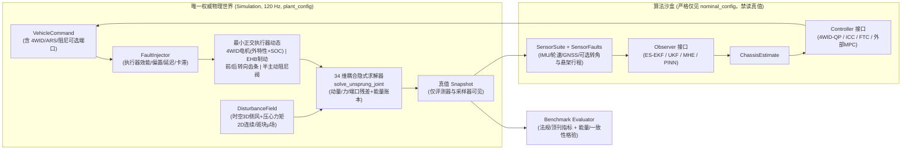

# 专题 3：现代智能线控底盘控制、状态估计与容错评测学术调研与 CoastalDrive 实验床架构建议

> 调研时间：2026-11-26  
> 适用范围：CoastalDrive 高保真车辆动力学实验台（继 `LAB-M3` 弯道制动协调控制闭环、`SIM-FIDELITY-02` 34 维耦合求解器 C 化与 15 维 ES-EKF 观测闭环之后的长期规划）  
> 溯源台账：[sources-03-control.csv](file:///b:/AI%20agent/暑期计算机程序设计/CoastalDrive/docs/research/lab-roadmap-2026/sources-03-control.csv)  
> 本地开放获取原文目录：`logs/research/lab-roadmap-2026/downloads/03-control/`（8 篇 arXiv 开放获取论文，全部完成 `%PDF` 魔数与 SHA-256 校验）

---

## 1. 学术热点图谱与顶刊审稿核心关注点

通过对近 8 年（2018–2026）底盘控制与状态估计领域顶刊（*IEEE T-VT*、*IEEE T-ITS*、*IEEE T-CST*、*IEEE/ASME T-MECH*、*IEEE T-IE*、*IEEE T-II*、*IEEE RA-L*、*Vehicle System Dynamics*、*Annual Reviews in Control*、*Automatica*、*Mathematical Programming Computation*）及 arXiv / MDPI 高被引综述与开源代码库的系统检索，现代智能线控底盘（X-by-Wire Chassis）研究高度收敛于四大技术主轴，而顶刊审稿人的核心拒稿/质询点则直接指向仿真验证平台的保真度、透明性与评测公平性。

### 1.1 四大核心学术主轴（2018–2026）

#### 主轴 A：4WID 分布式电驱与机电复合制动（纵横向 X-by-Wire 控制）

1. **分层控制已成为绝对主流范式**（Johansen & Fossen 2013; De Novellis et al. 2014; Hang & Chen 2021; Lu et al. 2024; Huang et al. 2026）：
   - **上层（运动决策 / 虚拟广义力层）**：根据参考模型（二自由度稳态/非线性单轨模型或轨迹跟踪误差）生成期望总纵向力 $F_{x,\text{des}}$ 与直接横摆力矩 $M_{z,\text{des}}$。主流方法已从经典 PID/LQR/滑模控制（SMC）演进至线性时变模型预测控制（LTV-MPC，如 Xu et al. *IEEE T-ITS* 2024）、非线性 MPC（NMPC，如 Dalboni et al. *IEEE/ASME T-MECH* 2021; Dallas et al. *Field Robotics* 2023; Bertipaglia et al. *AIM* 2024）以及引入控制障碍函数（CBF）的安全滤波架构（Chen et al. 2024）。
   - **下层（过驱动控制分配层）**：将 $(F_{x,\text{des}}, M_{z,\text{des}})$ 映射为四轮独立扭矩/滑移指令，常见二次规划（QP）或有效集（Active-Set）目标函数呈现三类标准准则的加权融合：
     - **轮胎负荷率（Workload）最小化**：最小化 $\sum_{i=1}^{4} \frac{F_{x,i}^2 + F_{y,i}^2}{(\mu_i F_{z,i})^2}$ 或纵向裕度均衡，最大化整车剩余侧向附着储备（De Novellis et al. 2014; Lu et al. 2024）；
     - **能耗联合最优（Economic TV / Energy-Efficient CA）**：显式计入轮毂/分布式电机铜损铁损、逆变器效率图 $\eta(T_i, \omega_i)$ 与轮胎滑移功率耗散 $P_{\text{slip},i} = F_{x,i} v_{x,i} \kappa_i$（Dalboni et al. 2021; Huang et al. 2026）；
     - **执行器动态与联合滑移摩擦椭圆约束**：Lu et al.（2024, `arXiv:2403.12487`）在 4WID–4WIS 极限工况的系统消融实验揭示了控制分配的**四大决定性因素**——动态垂向载荷估计精度、执行器响应动态、非线性摩擦圆约束及轮角执行精度，任何一项缺失都会在极限避障中诱发分配失稳。
2. **机电复合制动（Electro-Hydraulic Composite Braking + ABS 协同）的关键建模要素**（Zhang et al. 2012; Savitski et al. 2018; Tavernini et al. 2020; Subramaniyam & Subramanian 2021）：
   - **双通道异构动态带宽**：电驱动回馈制动具有毫秒级响应（一阶时间常数 $\tau_m \approx 5\text{–}15\text{ ms}$）和双向精确力矩可控性，但受低速反电动势衰减、峰值转矩/恒功率外特性包络 $T_{\max}(\omega)$ 以及电池荷电状态（SOC）/峰值充电功率（SoP）约束；电液制动（EHB）力矩容量大但存在管路建立延迟与阀芯非线性（$\tau_h \approx 25\text{–}60\text{ ms}$）。
   - **ABS 激活期的解耦协作（不再粗暴“一刀切”退出回馈）**：传统量产策略在 ABS 触发时直接归零再生制动以防干涉；2018–2025 顶刊共识则是利用液压维持准稳态基础制动力矩、由高频电机承担滑移率快速微调（“慢液压托底 + 快电机抑滑”），兼顾低附着制动距离缩短、轮速抖振抑制与能量回收（Savitski et al. *IEEE T-II* 2018; Subramaniyam & Subramanian *IEEE T-VT* 2021）。
   - **最低必要电池/电机复杂度**：对于底盘控制论文实验床，**无需引入复杂多阶电化学 ECM/热蔓延黑盒**，最低必要闭环要素为：① 电机四象限外特性包络 $T_{\min}(\omega) \le T_m \le T_{\max}(\omega)$ 与一阶延迟 $\tau_m$；② 效率图 $\eta(T_m, \omega)$（或二次铜损+铁损解析近似 $P_{\text{loss}} = c_0 + c_1 |T_m|\omega + c_2 T_m^2$）；③ 电池单状态 $\text{SOC}$ 积分及依赖于 $\text{SOC}$ 的最大回馈充电功率包络 $P_{\text{chg,max}}(\text{SOC})$（高 SOC 区如 $>0.90$ 线性退坡至 0，迫使控制器执行平稳电液过渡切换）。

#### 主轴 B：底盘域 XYZ 三向耦合控制（4WID + ARS + 半主动/主动悬架）

1. **垂向阻尼控制如何通过动态载荷 $F_z$ 耦合纵横向极限**（Savaresi & Spelta 2007, 2009; Savaresi et al. 2010; Zhao et al. *IEEE T-VT* 2019; Mazzilli et al. *Annual Reviews in Control* 2021; Skrickij, Shyrokau, Ivanov et al. *Sensors* 2024; Lazzarini et al. *VSD* 2026）：
   - 轮胎峰值力对垂向载荷呈**次线性载荷敏感性**（Load Sensitivity，正是 CoastalDrive 已在 `src/tire_properties.py` 中实现的 $F_{\max}(F_z) = \mu F_z (F_z / F_{z0})^{p-1},\; p = 0.90 < 1$）。依据 Jensen 不等式，轴内左右载荷转移 $\Delta F_z$ 越大，或颠簸路面下的轮荷动态波动 $\sigma_{F_z}$ 越剧烈，该轴总极限侧向/纵向合力净损失越多。
   - **半主动悬架核心控制律谱系**：
     - **Skyhook（天棚）**：按 $\dot{z}_s \cdot \dot{q} > 0$ 增大阻尼，主攻低频车身（1–2 Hz）隔振与侧倾/俯仰抑制，但可能恶化高频簧下轮跳；
     - **Groundhook（地棚）**：按 $-\dot{z}_u \cdot \dot{q} > 0$ 增大阻尼，主攻抑制簧下共振（10–15 Hz）与车轮相对动载（Tire Dynamic Load），直接保护颠簸制动和弯道接地性；
     - **Mixed SH-ADD（混合天棚-加速度驱动阻尼）**：Savaresi & Spelta（2007）证明其逼近单角半主动悬架滤波物理极限，以车身加速度/速度交叉频段切换兼顾舒适与抓地，已成为顶刊（如 Lee et al. *IEEE T-VT* 2023）的公认对比基线；
     - **虚拟惯量/数据驱动/预瞄演进**：如 VISKY（Lim et al. 2025, `arXiv:2503.12891`）引入虚拟惯量项改善高频隔振与轮跳，以及面向道路预瞄与多执行器协调的 LPV / NMPC / DRL 方案（Dalboni et al. 2021; Lazzarini et al. 2026）。
   - **侧倾/俯仰载荷分配的操纵杠杆**：通过调节前后轴外侧阻尼系数，可在瞬态入弯与弯道制动时主动重塑前后轴瞬态侧倾力矩分配比，从而在不消耗额外纵向驱动能量的前提下动态调节不足/过度转向特性（Dalboni et al. *IEEE/ASME T-MECH* 2021）。
2. **主动后轮转向（ARS / 4WS）的最小接口与控制律**（Hang & Chen 2021; Skrickij et al. 2024; Xu et al. *IEEE T-ITS* 2024）：
   - ARS 直接向后轴引入可控侧偏角增量，无需像 DYC 那样通过差动制动力消耗车速或挤占纵向摩擦圆，是高速紧急避障中抑制质心侧偏角 $\beta$ 最“干净”的横摆-侧向解耦端口。
   - 典型分层基线包括：① 车速查表比例前馈 $\delta_r = K(v_x)\delta_f$（低速反相减小转弯半径，高速同相压缩侧偏角）；② 零质心侧偏角（$\beta = 0$）模型跟踪前馈+反馈律；③ 与 4WID-DYC 协同的分域/相平面控制（小侧偏区以 ARS 为主维持效率与平顺，轮胎临近饱和区由 4WID-DYC 介入提供大横摆力矩）。

#### 主轴 C：高阶底盘状态估计与路面附着估计（TRFC / $\beta$ / Tire Forces）

| 方法谱系 | 代表文献（2017–2026） | 核心优势 | 典型短板与审稿痛点 | 在 CoastalDrive 的定位 |
|---|---|---|---|---|
| **ES-EKF / 3D 运动学 EKF** | Goblirsch et al. (*IROS* 2024, `arXiv:2408.14885`); CoastalDrive `state_estimation.py` | 无需轮胎参数、算力极低（<0.2 ms）、可融合 3D 坡度/横坡 | GNSS 失联且四轮同时大滑移时横纵向速度漂移；无法独立观测 $\mu$ | 已有 15 维 ES-EKF 基础，需补齐压力测试与激励门控 |
| **动力学 UKF / CKF / 自适应 UKF** | Bertipaglia et al. (*AVEC* 2022, `arXiv:2206.15119`; *IV* 2022); Goblirsch et al. (*VSD* 2026) | 无需求导雅可比，更好捕捉轮胎强非线性区；结合 GP 轮胎模型可缓解参数失配 | 强依赖轮胎刚度与 $\mu$ 先验；参数失配 $\pm 20\%$ 时可能发散 | 推荐作为内置对比基线 `Baseline-Est-KinDynUKF` |
| **滚动时域估计（MHE）** | Zhang et al. (*IEEE T-VT* 2019, `10.1109/TVT.2019.2909590`) | 天然支持硬物理不等式约束（$\mu \in [0.1, 1.3]$、摩擦圆边界）与异常值鲁棒代价 | 在线求解 NLP/QP 算力开销大（1–10 ms），高度依赖求解器热启动 | 通过外部 `CasADi / acados / OSQP` 适配层支持 |
| **PINN / 混合学习（UKF-INN / Physics Guard）** | Tan et al. (*Sensors* 2023); Chrosniak et al. (*IEEE RA-L* 2024, `arXiv:2312.04374`); Bertipaglia et al. (*IEEE T-VT* 2024) | 兼具强非线性拟合与牛顿-欧拉物理约束，避免纯黑盒神经网络在域外输出违背物理的离谱值 | 依赖高质量多附着/多工况训练与留出泛化测试，容易在仿真同分布数据上“过拟合” | CoastalDrive 提供真值隔离的多参数失配/多工况数据集，供外部 PyTorch/JAX 训练验证 |
| **Cause+Effect 混合 TRFC 估计** | Khaleghian et al. (2017); Singh et al. (*VSD* 2019); Volkmann et al. (2024, `arXiv:2407.11805`) | 解决纯动力学效应法（Effect-based）在直线匀速低激励下 $\mu$ 不可观的根本难题 | 需引入激励充分性判断（Persistent Excitation）与低激发态漂移冻结/贝叶斯先验融合 | 推荐在 $\hat{\mu}$ 估计中标准化“激励充分性门控 + 可选外部先验置信度接口” |

- **顶刊审稿人最看重的 6 类估计器压力测试协议**（综合 Singh et al. 2019; Chindamo et al. 2018; Puščul et al. *IEEE Access* 2024; Goblirsch et al. 2024）：
  1. **GNSS 失联/隧道与延迟抖动**：如持续 30–60 s 的 GNSS 断流 + 50–150 ms 测量延迟与多径跳变；
  2. **低附着冰面与突变路面（$\mu$-jump / split-$\mu$）**：高附着突降冰面（$0.9 \to 0.2$）、左右对开附着，考核 $\hat{\mu}$ 收敛速度与无激励期防误降；
  3. **全轮抱死/极高滑移（$|\kappa| > 0.25$）**：考核轮速更新 NIS 门控能否及时隔离失效轮速，避免把抱死轮速“拉低”车速估计；
  4. **传感器偏置阶跃与噪声恶化**：IMU 零偏突发阶跃、白噪声 $2\times\text{–}5\times$ 倍增、单轮轮速编码器断流/卡零；
  5. **模型参数失配鲁棒性（防“逆犯罪 / Inverse Crime”）**：观测器与控制器所持有的标称参数（整车质量 $m$、横摆惯量 $I_z$、质心高度 $h_g$、轮胎刚度 $C_\alpha / C_\kappa$、有效滚动半径 $r_e$）相对真实仿真体存在 $\pm 15\%\text{–}20\%$ 未知偏差；
  6. **3D 坡度/横坡与垂向颠簸**：坡道重力分量泄漏到纵向加速度、ISO 8608 随机路导致 $F_z$ 高频剧烈脉动对侧偏角和轮胎力估计的干扰。

#### 主轴 D：线控底盘故障注入、容错控制（FTC）与安全评测（ISO 26262 / SOTIF）

依据 Torben Stolte 的执行器容错车辆运动控制综述（2021, `arXiv:2103.13671`）、Guo & Chen（*IEEE T-II* 2020）、Lu & Tian（*Actuators* 2024）以及功能安全标准 **ISO 26262:2018**（随机硬件与系统失效）与预期功能安全标准 **ISO 21448:2022 (SOTIF)**（性能局限与未知危险触发条件），学术界对 X-by-Wire 容错实验床的核心诉求如下：
- **标准执行器故障统一数学表征**：$u_{\text{act},i}(t) = \rho_i(t) u_{\text{cmd},i}(t - \Delta_i) + b_i(t)$（失效能因子 $\rho_i \in [0, 1]$、加性偏置/卡滞 $b_i$、附加传输/执行延迟 $\Delta_i$），覆盖五大公认故障集：
  1. 单轮/双轮驱动电机开路失矩（$\rho_i=0$）、部分降额（$\rho_i=0.3\text{–}0.6$）或非预期恒定输出卡死；
  2. 单轮液压制动管路失压/泄漏（制动力矩上限突降 50%–100%）或连续制动热衰退；
  3. 线控前/后转向执行器附加延迟（$+40\text{–}120\text{ ms}$）、增益衰减或固定角度卡滞（Lock-in-place）；
  4. 关键传感通道故障（IMU 轴偏置跳变/冻结、单轮速丢失、GNSS 遮挡）；
  5. 强环境外扰——**ISO 12021 强侧风脉冲**（车速 100 km/h 遭遇 $15\text{–}20\text{ m/s}$ 侧风阵风，等效相对侧偏气流角约 $35.8^\circ$，引发显著侧向偏移与气动横摆力矩）。
- **容错评测双轨解耦**：同时提供“理想故障诊断标志（Oracle FDD，隔离控制分配重构能力）”与“带诊断延迟/无先验故障注入（端到端 FDD + AFTC 或 Passive FTC 评测）”，直接对应 ISO 26262 故障容错时间间隔（FTTI）与最小风险机动（MRM / DDT Fallback）安全边界。

### 1.2 为什么现有仿真平台让控制/估计学者很痛苦？

Sagmeister, Kounatidis, Goblirsch & Lienkamp（TUMFTM, *IEEE IV* 2024, `10.1109/IV55156.2024.10588858`）在发布 `Open-Car-Dynamics` 时用实车数据系统量化了**仿真保真度落差对控制算法评价结论的颠覆性影响**。当前学界在三大类仿真工具间陷入“不可能三角”：

| 平台类别 | 代表工具 | 学者痛点（审稿/工程实况） |
|---|---|---|
| **商业黑盒多体软件** | CarSim / TruckSim、IPG CarMaker、VI-CarRealTime | ① 昂贵闭源，无法公开论文可复现 Artifact；② 内部数值残差与能量守恒不可审计；③ 与 Python/PyTorch/CasADi/acados 跨进程/Simulink 联调脆弱、批处理扫描慢 |
| **自动驾驶/游戏物理引擎** | CARLA (PhysX)、Gazebo、通用 Bullet 射线车 | ① 默认射线悬架 + 简化摩擦模型，缺乏联合滑移弹性胎体、外倾推力、独立簧下轮跳与有限传动惯量；② ABS/DYC/半主动悬架等底盘控制律在低保真轮胎上表现失真，顶刊审稿人直接质疑物理可信度 |
| **自写脚本简化模型** | MATLAB/Python 3-DOF/7-DOF 方程 | ① 忽略悬架 K&C、3D 路面接触与执行器非线性；② 论文作者常用同一套轮胎/质量方程既当“真值对象”又当“控制器预测模型”，陷入严重**逆犯罪（Inverse Crime）**；③ 缺乏统一基线与标准化法规工况，各篇论文自说自话无法横向比较 |

**CoastalDrive 的独特战略护城河**：CoastalDrive 已具备 120 Hz 固定步、纯开源 Python + 原生 C 核的 **34 维簧下-径向-切向-有限传动全耦合隐式求解器**（`src/unsprung_joint.py`，动量/力/端口收敛门槛 `1e-9 / 1e-5 / 1e-9`，单步能量账误差 `~2.1e-10 J`）、悬架 K&C 外倾推力（`src/suspension_kc.py`）、ISO 8608 随机路面（`src/iso_ride.py`）及严格物理隔离的 15 维 ES-EKF 传感器闭环（`src/chassis_observer.py`、`src/sensor_sampling.py`）。只要补齐**最小正交 X-by-Wire 执行器端口、标准化故障/外扰/失配接口与公认基线套件**，CoastalDrive 就能精准击穿上述“不可能三角”，成为开源、透明、高保真且可直接承载顶刊复现实验（Artifact Evaluation）的权威底盘基准实验床。

---

## 2. CoastalDrive 最小正交执行器与扰动/故障端口设计建议

本设计严格遵守 CoastalDrive 既有架构纪律（`AGENTS.md`）：保持 `Controller → VehicleCommand → Simulation → Snapshot` 单向数据流，维护唯一权威 120 Hz 物理世界，**不堆黑盒、不引入 ECS/事件总线/重型 Manager、不扩维重构 34×34 耦合求解器主骨架**，且所有新增字段默认 `None` / 关闭标志，保证既有游戏车型与 ICE 工程配置逐拍字节兼容。

### 2.1 系统数据流与物理隔离边界

### 2.2 四个最小正交端口的精确代码落点

#### 端口 1：4WID 分布式电驱与机电复合制动端口

- **`VehicleCommand` 最小增量**（`src/vehicle_state.py`）：
  - 新增 `wheel_motor_torques: tuple[float, float, float, float] | None = None`（单位 `N·m`，正驱动、负再生制动；`None` 走原有集中式 `Powertrain` 链路）。
- **最小必要执行器配置与状态**（新增轻量模块 `src/electric_drive.py`，由 `VehicleConfig.electric_drive: ElectricDriveConfig | None = None` 启用）：
  - 四轮独立电驱参数：峰值转矩 $T_{\text{peak}}$、额定功率 $P_{\text{rated}}$（自动给出恒转矩/恒功率拐点转速 $\omega_b = P_{\text{rated}}/T_{\text{peak}}$ 与高转速包络 $T_{\max}(\omega) = \min(T_{\text{peak}}, P_{\text{rated}}/\max(|\omega|, \omega_b))$）、一阶电磁响应时间常数 $\tau_m$（默认 `0.010 s`）、低速回馈退坡速度 $v_{\text{regen,min}}$（默认 `1.5 m/s`）、二次损耗系数 $(c_0, c_1, c_2)$；
  - 最小电池能量模型：标称容量 $E_{\text{bat}}$（kWh）、初始 $\text{SOC}_0 \in [0, 1]$、最大充电功率 $P_{\text{chg,max}}(\text{SOC})$（$\text{SOC} \le 0.88$ 恒定，$(0.88, 0.98]$ 线性退坡至 0）与最大放电功率 $P_{\text{dis,max}}$。每个 120 Hz 拍按实际机械功率与电机损耗更新 $\text{SOC}$，并按比例缩减四轮总再生/驱动功率请求，防止越界。
- **与 34 维耦合求解器的零扩维无缝对接**（`src/vehicle_unsprung.py`、`src/unsprung_joint.py`、`src/unsprung_drivetrain.py`）：
  - 在 `solve_unsprung_joint` 的 16 维广义速度坐标中，`12:16` 已是四轮自旋角速度 $\omega_{w,i}$，`3:6` 已是车身角速度。
  - **关键物理细节（严格角动量与能量守恒）**：每个轮端电机向轮轴施加电磁力矩 $T_{m,i}$ 的同时，定子必须通过悬架/车架对车身施加严格等大反向的反作用力矩 $-\sum_{i=1}^{4} T_{m,i} \mathbf{a}_i$（其中 $\mathbf{a}_i = \text{hardware.axes}[i]$ 为机械轮轴单位向量）。在 `UnsprungAdvanceInput.read` 中将 `known[12:16] += T_m` 且 `known[3:6] -= sum(T_m[:, None] * hardware.axes, axis=0)`，电机做功 $W_m = \Delta t \sum T_{m,i} (\omega_{w,i} - \mathbf{a}_i \cdot \boldsymbol{\omega}_s)$ 直接计入 `UnsprungJointStep` 能量账本，**无需改动 34×34 残差维度**！
  - 纯 4WID 车型只需将原 ICE 端口（`clutch_capacity = 0, engine_torque = 0, differential_capacity = (0,0,0)`）置空即可自动退化；机械液压制动仍走既有 `brakes[0:4]` 干摩擦投影端口，与 $T_{m,i} < 0$ 在同一隐式步内精确耦合，天然实现**机电复合制动与高速 ABS–再生协同**！

#### 端口 2：主动后轮转向（ARS / 4WS）端口

- **`VehicleCommand` 最小增量**（`src/vehicle_state.py`）：
  - 新增 `rear_steering: float | None = None`（后轴中心等效转角，单位 `deg`，与前轴同符号约定：正值右转；进阶 4WIS 场景可预留 `wheel_steering_deg: tuple[float,float,float,float] | None = None`，默认 `None`）。
- **最小执行器动态与精确代码落点**：
  - 复用 `src/vehicle_steering.py` 的 `SteeringRack` 数学结构实例化 `self.rear_steering`（配置参数 `rear_steering_degrees = 6.0`、`rear_steering_rate = 25.0 deg/s`、`rear_steering_response = 12.0 rad/s`，默认 `rear_steering_degrees = 0.0` 即被动后轴）；
  - 修改 `src/suspension_kc.py:wheel_kinematics` 签名，增加默认参数 `rear_angle_deg: float = 0.0`，将第 18 行硬编码的 `base = (ack_fl, ack_fr, 0.0, 0.0)` 改为 `(ack_fl, ack_fr, rear_rl, rear_rr)`，与 K&C 静态前束、跳动转向及外倾角自然叠加；
  - `src/vehicle_unsprung.py:wheel_axes(rotation, angles)` 与 `tire_ports(...)` **现已原生支持四轮独立转角及角速度陀螺项**，故 34 维求解器主循环 **0 行改动**！

#### 端口 3：半主动悬架连续可调阻尼（CDC / MR）端口

- **`VehicleCommand` 最小增量**（`src/vehicle_state.py`）：
  - 新增 `damper_commands: tuple[float, float, float, float] | None = None`（四轮归一化阻尼指令 $u_{d,i} \in [0, 1]$，0 对应最软阻尼包络、1 对应最硬阻尼包络；`None` 时维持原被动配置）。
- **最小执行器动态与精确代码落点**：
  - 一阶电磁阀/MR 线圈动态：$\dot{u}_{d,\text{act}} = (u_{d,\text{cmd}} - u_{d,\text{act}}) / \tau_d$（$\tau_d \approx 0.012\text{–}0.020\text{ s}$，典型带宽 8–13 Hz，并按 `VehicleConfig` 参数化）；
  - 在 `src/unsprung_contact.py`（及对应 C 内核 `unsprung_normal_material`）中，为半主动模式提供双包络力速表 `(damper_curves_min, damper_curves_max)` 或双系数 `(c_min, c_max)`，阻尼力按单拍冻结的 $u_{d,\text{act},i}$ 凸组合插值：
    $$F_{d,i}(\dot{q}_i) = (1 - u_{d,\text{act},i}) F_{d,\min,i}(r_i \dot{q}_i) + u_{d,\text{act},i} F_{d,\max,i}(r_i \dot{q}_i)$$
  - **为什么必须采用凸组合包络而非直接传任意力 $F_{d,i}$**？① 只要 $F_{d,\min}$ 与 $F_{d,\max}$ 均通过现有 `damper_curve` 校验，任意 $u_d \in [0,1]$ 自动满足半主动耗散不等式 $\dot{q}_i F_{d,i} \ge 0$，绝不会违背被动物理边界凭空注能；② 对速度 $\dot{q}_i$ 和行程 $q_i$ 的切线导数同样是凸组合，直接保留 `solve_unsprung_joint` 的二次 Newton 收敛精度与能量账本闭合！
  - （可选扩展）若后续研究主动悬架（如主动液压/电磁作动器），可在 `active_suspension_enabled=True` 时通过独立有界作动力 `suspension_active_forces` 叠加到 `NormalMaterial.suspension_force` 并在能量账本单列 `active_suspension_work`，与半主动严格隔离。

#### 端口 4：标准化扰动、故障注入与参数失配端口

1. **执行器故障注入器（`src/fault_injection.py` —— 轻量不可变调度表 `FaultSchedule`）**：
   - 在 `Vehicle.prepare_command` 与实际执行器推进之间插入无状态/最小状态滤波管道，对每一通道（4 电机、4 制动、前/后转向、4 阻尼）支持按时间窗口 `[t_start, t_end)` 施加：
     - 效能缩减 `gain` $\rho \in [0, 1]$（$\rho=0$ 即开路失矩/管路完全失压）；
     - 加性偏置 `bias` 或卡死值 `lock_value`（Lock-in-place / Float）；
     - 附加延迟队列 `extra_delay_ticks`（整数拍数，120 Hz 分辨率 `8.33 ms`）；
     - 上限截断 `cap_scale`（模拟制动热衰退或电机过温限功率）。
2. **环境外扰升级（修复气动侧风缺失与二值路面局限）**：
   - **关键代码缺口指出**：当前 `src/vehicle_dynamics.py:aerodynamic_load` 仅以标量 $C_d A$ 施加中心气动阻力，**没有气动侧向力系数 $C_y(\psi_{\text{aero}})$ 与气动横摆压心偏置 $x_{\text{cp}}$ 引起的侧风横摆力矩 $M_{z,\text{aero}}$**！如果不补齐这一项，ISO 12021 侧风测试将严重低估实车的偏航失稳风险。建议在 `aerodynamic_load` 中新增可选的 `side_area`、`side_force_slope`（$C_{y,\beta}$）与 `aero_cp_offset_x`（压心相对质心纵向偏置，默认 `0.0` 保持既有标量兼容），并在 `Simulation` 中支持时变风场回调 `wind_profile(t, pos) -> Vec3`。
   - **二维连续/斑块路面附着场**：将 `Simulation.on_asphalt(x, y) -> bool` 升级为向后兼容的 `surface_friction(x, y, t) -> (mu, rolling_c)`（默认回落至原 `on_asphalt`），轻松支持低附着冰斑、对开斜切、渐进湿滑过渡等任意路面图谱。
3. **传感器故障与模型参数失配（扩展 `SensorConfig` + `LabExperiment`）**：
   - 在 `src/sensor_sampling.py:SensorConfig`（已有 `gnss_outages`）中补充：`imu_bias_steps`（时变零偏阶跃）、`noise_multipliers`（时段噪声倍增）、`wheel_dropouts`（指定轮编码器卡零/断流窗口）；
   - 在 `src/lab_experiment.py:LabExperiment` 中显式拆分 **`plant_config`（传入 `DrivingExperiment` 驱动真实物理）与 `nominal_config`（传入 `controller.reset` 与 `observer`）**，新增 `ParameterMismatchSpec`（如质量 $+18\%$、$I_z +15\%$、$h_g +10\%$、侧偏刚度 $-20\%$、滚动半径 $+3\%$），彻底消灭学术评测中的“参数同源逆犯罪”。

#### 最小正交接口汇总表

| 端口模块 | 新增字段 / 入口 | 影响的核心源码 | 对 34 维求解器的侵入度 | 默认兼容策略 |
|---|---|---|---|---|
| **4WID + 复合制动** | `VehicleCommand.wheel_motor_torques` + `ElectricDriveConfig` | `vehicle_state.py`, `electric_drive.py`(新), `vehicle_unsprung.py` | **零扩维**（注入 `known[12:16]` 与壳体反矩 `known[3:6]`） | `None` 时 100% 走原 `Powertrain` |
| **ARS 主动后轮转向** | `VehicleCommand.rear_steering` + `rear_steering_*` | `vehicle_state.py`, `vehicle_steering.py`, `suspension_kc.py` | **零改动**（`wheel_axes`/`tire_ports` 已支持四轮角） | `None` 或限幅为 0 时后轮角恒为 0 |
| **半主动悬架阻尼** | `VehicleCommand.damper_commands` + `damper_curves_min/max` | `vehicle_state.py`, `unsprung_contact.py`, `mechanical_kernels.c` | **极低**（仅法向阻尼力与导数做单拍冻结凸组合） | `None` 时走原被动阻尼曲线 |
| **执行器/传感器故障** | `FaultSchedule` + `SensorConfig` 故障窗 | `fault_injection.py`(新), `sensor_sampling.py`, `vehicle.py` | **零侵入**（作用在执行器/采样边界外层） | 空调度表时 0 额外分支开销 |
| **气动侧风与 2D $\mu$ 场** | `wind_profile` + `aero_cp_offset_x` + `surface_friction` | `vehicle_dynamics.py`, `simulation.py`, `vehicle_unsprung.py` | **零侵入**（进入 `known[0:6]` 与 `friction[0:4]`） | 标量 `wind` 与 `on_asphalt` 默认兼容 |
| **参数失配评测** | `LabOptions.plant_mismatch`（拆分 `plant_config` / `nominal_config`） | `lab_experiment.py` | **零侵入**（仅实验室宿主配置分发层） | 默认零失配 |

---

## 3. 推荐内置的“学术基线算法与评测协议包”

一篇底盘控制或估计顶刊论文能否被审稿人信服，很大程度上取决于**是否有公认、透明、实现无偏的 Baseline 对照组**以及**是否覆盖了法规与极端退化场景**。

### 3.1 零冗余的算法接入契约（延续 CoastalDrive 极简风格）

不引入任何复杂抽象基类或注册中心，仅在 `src/lab_experiment.py` 规范两个纯 Python 协议：
1. **观测器协议（`EstimatorProtocol`）**：
   - `reset(initial_truth_pose, nominal_config, sensor_config)`（仅允许用初始位姿初始化，禁止保存仿真句柄）
   - `observe(sensor_frame: SensorFrame) -> ChassisEstimate`（严禁接收 `Snapshot` 真值！）
2. **控制器协议（`ControllerProtocol`）**：
   - `reset(nominal_config, options, initial_estimate)`
   - `compute(estimate: ChassisEstimate, base_command: VehicleCommand, elapsed: float, dt: float) -> VehicleCommand`
   - `telemetry() -> dict`（记录虚拟力、分配残差、求解耗时 `solve_ms`、QP 迭代次数等可审计信号）

> [!IMPORTANT]
> 当前 `src/chassis_observer.py:adapt_snapshot` 仍把观测器估计值覆写进真值 `Snapshot` 副本后交由控制器，在 `wheel_dynamics` 上仍可读到真实接触支撑标志与载荷信息。面向权威学术基准测试，建议升级为**真值硬隔离模式（Strict Blind Sandbox）**：控制器只能读取 `ChassisEstimate` + `SensorFrame`（以及允许的标称配置），彻底杜绝任何隐式真值泄漏。

### 3.2 推荐内置的 4 大轻量化基线算法套件（纯 NumPy、零外部重依赖）

| 套件领域 | 基线代号 | 核心算法逻辑 | 对应顶刊学术出处 | 对照价值 |
|---|---|---|---|---|
| **4WID 与复合制动** | `BL-4WID-Equal` | 等比例静态扭矩分配 + ABS 触发即切断再生制动 | 工业常规基线 | 量化所有高级控制分配的底线增益 |
| **4WID 与复合制动** | `BL-4WID-ASQP` | 上层滑模/LQR 虚拟横摆力矩 + 下层双极有效集 QP（轮胎负荷率 $\sum F_{x,i}^2/(\mu_i F_{z,i})^2$ 最小化 + 再生制动优先配比），直接扩展 `LAB-M3` 的 `solve_box_qp` | Johansen & Fossen (2013); De Novellis et al. (2014); Lu et al. (2024) | 学术界最通用的 QP 控制分配强基线 |
| **4WID 与复合制动** | `BL-EHB-CoopABS` | 液压稳压托底 + 高频轮毂电机制动滑移率闭环调节 | Savitski et al. (*IEEE T-II* 2018); Subramaniyam (*IEEE T-VT* 2021) | 对比复合制动停距、滑移抖振与能量回收率 |
| **XYZ 协同控制** | `BL-ARS-ZeroBeta` | 速度查表比例前馈 + 零质心侧偏角模型跟踪反馈 ARS | Hang & Chen (2021); Skrickij et al. (2024) | 隔离纯后轮转向对高速避障侧偏角的贡献 |
| **XYZ 协同控制** | `BL-Susp-SHADD` | 四角独立 Mixed Skyhook-ADD 阻尼律（另配 Groundhook 模式开关） | Savaresi & Spelta (*ASME JDSMC* 2007); Lee et al. (*IEEE T-VT* 2023) | 半主动悬架领域最权威的经典性能上限参考 |
| **XYZ 协同控制** | `BL-ICC-Decoupled` | `BL-4WID-ASQP` + `BL-ARS-ZeroBeta` + `BL-Susp-SHADD` 无协同独立叠加 | Mazzilli et al. (*ARC* 2021); Skrickij et al. (2024) | 专门用于验证新论文“XYZ 耦合协调机制”相比各子系统独立运行的净收益 |
| **状态与附着估计** | `BL-Est-ESEKF` | 现有 15 维局部误差状态 EKF + 轮滑 NIS 门控 + 激励门控非对称 $\hat{\mu}$ 估计 | CoastalDrive `SIM-FIDELITY-02` | 工业级运动学估计下限 |
| **状态与附着估计** | `BL-Est-KinDynUKF` | 3D 运动学 EKF（姿态/坡度）级联非线性单轨轮胎 UKF（$\hat{v}_y, \hat{\beta}$）+ 激励充分性门控 TRFC | Goblirsch et al. (*IROS* 2024, `arXiv:2408.14885`); Bertipaglia et al. (2022) | 学术界模型法估计高水平标杆，供 MHE/PINN 挑战 |
| **容错控制（FTC）** | `BL-FTC-ReconfigQP` | 基于效能矩阵 $\hat{\Lambda}$ 重构控制有效矩阵 $B_{\text{eff}} = B\hat{\Lambda}$ 与约束上界的有效集 QP（支持 Oracle-FDD vs 残差检测 FDD 双模式） | Stolte (2021, `arXiv:2103.13671`); Guo & Chen (*IEEE T-II* 2020) | 评测主动容错重构与诊断延迟代价的标准基线 |

### 3.3 标准化 Benchmark 工况与评测指标协议包（`CoastalBench-XBW v1`）

| 编号 | 工况名称 | 标准依据 / 场景配置 | 必测故障 / 扰动 / 失配注入 | 核心定量评测指标 |
|---|---|---|---|---|
| `BM-01` | **正弦停滞（Sine-with-Dwell）** | FMVSS 126 / UN ECE R140（80 km/h，0.7 Hz 正弦 + 0.5 s 停滞，转角幅值阶梯扫描） | 标称 + 质量 $+15\%$ / 刚度 $-15\%$ 失配 | 1.0 s / 1.75 s 横摆衰减率（$\le 35\% / 20\%$）、1.07 s 横向位移（$\ge 1.83\text{ m}$）、峰值 $|\beta|$ |
| `BM-02` | **高速紧急双移线（DLC）** | ISO 3888-2（干地 $\mu=0.95$ @ 90–110 km/h；湿滑 $\mu=0.35$ @ 60–75 km/h） | 标称 + 执行器带宽受限对照 | 最高无碰桩通过车速、路径 RMSE、峰值 $|\beta|$、轮胎负荷率均值与峰值 |
| `BM-03` | **弯道对接/对开复合制动** | 复用 `mu_jump_cornering_braking`（$\mu: 0.9\to 0.25$）与 `split_braking`（$0.85/0.25$） | $\text{SOC}_0 \in \{0.60, 0.92\}$（检验高 SOC 退坡平滑过渡） | MFDD、制动停距、峰值 $|\beta|$、路径偏离、动能回收率 $\eta_{\text{regen}}$、纵向冲击度（Jerk RMS） |
| `BM-04` | **ISO 8608 颠簸路面制动与弯道** | 复用 `iso_rough_road`（C/D 级随机路）叠加弯道与紧急制动 | 垂向激励 + 4WID/SH-ADD 消融 | ISO 2631-1 加权 $a_{wz}$、四轮相对动载 RMS $\sigma_{F_z}/F_{z0}$、停距变化率、接地丢失占比 |
| `BM-05` | **估计器 5 维地狱压力集** | 90 s 复合驾驶循环（高速变道 + 低附着突变 + 全轮紧急制动 + 坡道） | ① 45 s GNSS 断流；② $\mu: 0.9\to 0.25$；③ 全轮抱死；④ IMU 零偏阶跃 + 3× 噪声；⑤ 质量/刚度 $\pm 20\%$ 失配 | $\hat{v}_x / \hat{\beta} / \hat{\mu}$ RMSE 与最大误差、$\hat{\mu}$ 90% 收敛时间、低激励期误漂移、NEES / NIS 统计一致性 |
| `BM-06` | **4WID 弯中单电机开路/失矩** | ISO 3888-2 变道中段 $t=t_0$ 注入前外轮电机 $\rho=0$（或卡死 $-300\text{ Nm}$） | 单/双执行器故障 + 50 ms FDD 延迟 | 航向偏差峰值、最大横向偏离、恢复稳定时间、残余横摆跟踪误差 |
| `BM-07` | **单轮制动失效 + 转向延迟** | 100 km/h 弯道紧急制动中注入单前轮制动失压 80% + 转向额外延迟 60 ms | 耦合多故障（ISO 26262 FTTI 边界） | 是否失控/冲出车道（MRM 成功率）、停距增幅、峰值侧偏角与横摆过冲 |
| `BM-08` | **ISO 12021 强侧风脉冲** | 100–120 km/h 直线及微弯行驶遭遇 $20\text{ m/s}$ 侧风（上升 0.1 s、平台 1.5 s、下降 0.1 s） | 强侧风 + 气动压心偏置 $x_{\text{cp}}$ | 2 s 末横向偏移量、峰值横摆角速度、纠偏转向/扭矩能耗、单步控制器算力耗时 P95（ms） |

---

## 4. 防重复造轮子建议（开源求解器与生态适配边界）

实测当前 CoastalDrive 的 `.venv` 运行环境仅安装 `numpy`（`scipy`、`osqp`、`casadi`、`acados_template`、`cvxpy`、`filterpy`、`torch`、`jax` 均未安装）。这一轻量化现状是宝贵资产，必须通过**清晰的“内核纯洁区 vs 可选生态适配层”边界**予以保护：

### 4.1 外部成熟开源库接入与许可边界矩阵

| 开源库 / 仓库 | 权威出处 | 开源许可 | 推荐角色与适用场景 | CoastalDrive 接入方式 |
|---|---|---|---|---|
| **OSQP** | Stellato et al. (*MPC* 2020, `10.1007/s12532-020-00179-2`) | **Apache-2.0** | 中高维稀疏 QP（LTV-MPC、多步滚动 4WID 控制分配、线性 MHE），支持热启动与无除法内循环 | 可选依赖组 `[lab-opt]`，薄适配函数 `solve_osqp_allocation`；商业/学术均零许可负担 |
| **acados** | Verschueren et al. (*MPC* 2022, `10.1007/s12532-021-00208-8`) | **BSD-2-Clause** | 毫秒级嵌入式 NMPC 与非线性 MHE（内置 HPIPM / SQP-RTI；官方 `examples/acados_python/race_cars` 是车辆 NMPC 业界标准模板） | 可选外置示例与适配层 `[lab-mpc]`；不编译进 CoastalDrive 主发布包 |
| **CasADi** | Andersson et al. (*MPC* 2019, `10.1007/s12532-018-0139-4`) | **LGPL-3.0** | 符号建模与自动微分前端，用于快速推导非线性单轨/双轨雅可比及构建 `acados` / IPOPT 问题 | 仅作为 `[lab-mpc]` 动态导入的可选建模前端，遵守 LGPL-3.0 动态链接边界 |
| **qpOASES** | Ferreau et al. (*MPC* 2014, `10.1007/s12532-014-0071-1`) | **LGPL-2.1/3.0** | 参数化热启动小规模稠密有效集 QP（4–12 维实时控制分配对照验证） | 仅作外部数值精度/速度对照基准，不必替代内置纯 NumPy 4 维 `solve_box_qp` |
| **FilterPy** | Roger Labbe (`github.com/rlabbe/filterpy`) | **MIT** | UKF（Merwe 缩放 Sigma 点）/ 粒子滤波教学原型与快速交叉校验 | 可选参考；内置 `BL-Est-KinDynUKF` 建议直接用 ~120 行纯 NumPy 实现以保持主环境零额外依赖 |
| **TUMFTM 开源仓库群** | `Open-Car-Dynamics` (*IV* 2024)、`3DVehicleDynamicsStateEstimation` (*IROS* 2024)、`GPTireUKF` (*VSD* 2026) | **Apache-2.0** | **外部标杆与交叉验证集**：用于复现对比 3D-EKF + 单轨 UKF、GP 轮胎卡尔曼滤波及仿真保真度消融 | 以独立 benchmark 适配器对接测试，绝不整包搬运覆盖 CoastalDrive 34 维求解器 |
| **PyTorch / JAX** | 通用深度学习框架 | BSD / Apache-2.0 | PINN（如 `Deep Dynamics` Physics Guard、UKF-INN）与强化学习（DDPG/PPO/TD3）底盘策略训练 | 仅在独立科研环境导入，通过标准 `ControllerProtocol` / `EstimatorProtocol` 与 CoastalDrive 交互 |

### 4.2 明确“自研留核”与“外部适配”分界铁律

1. **必须留在 CoastalDrive 核心（纯 NumPy + 现有原生 C 核，零重外部依赖）**：
   - 34 维耦合隐式求解器与能量/动量残差审计账本；
   - 最小正交执行器动态（4WID 电机外特性与 SOC、ARS 齿条、半主动凸组合阻尼阀）、气动侧风压心模型、`FaultSchedule` 与 `SensorSuite`；
   - 开箱即用的轻量基线算法（4 维有效集 `solve_box_qp`、SH-ADD、ARS、15 维 ES-EKF、纯 NumPy 单轨 UKF）以及 `CoastalBench-XBW` 工况与指标评测器。
2. **坚决不重复造轮子（通过 `optional-dependencies` 适配）**：
   - 不自写通用稀疏 QP/NLP/SQP-RTI/自动微分引擎（直接调用 `OSQP` / `CasADi` / `acados`）；
   - 不自写深度学习训练框架或高斯过程核优化器（交由外部 `PyTorch` / `GPyTorch` / `JAX` 算法包）；
   - 不把第三方大型 C++ 编译链锁死在 Windows 游戏主 `.venv` 中，确保 `game-current.cmd` 与 `vehicle-lab.cmd` 始终轻量稳定。

---

## 5. 完整文献溯源表与本地 PDF 导读索引

### 5.1 本地已归档开放获取 PDF 导读索引（8 篇，全部通过 `%PDF` 魔数与 SHA-256 校验）

全部存放于 `logs/research/lab-roadmap-2026/downloads/03-control/`：

| ID | 本地文件名 | 论文信息（已通过 arXiv API 核验） | 许可 | 大小 / SHA-256（前 12 位） | 对 CoastalDrive 实验床的核心转化价值 |
|---|---|---|---|---|---|
| `S03-01` | [lu2024_4wid_4wis_control_allocation_arxiv2403.12487.pdf](file:///b:/AI%20agent/暑期计算机程序设计/CoastalDrive/logs/research/lab-roadmap-2026/downloads/03-control/lu2024_4wid_4wis_control_allocation_arxiv2403.12487.pdf) | **Lu, Li, Yu, Lu, Tian (2024)**, *Unveiling Four Key Factors for Tire Force Control Allocation in 4WID-4WIS Electric Vehicles at Handling Limits*, `arXiv:2403.12487` | arXiv non-exclusive | 2,282,227 B / `e2a9fb1aecb7` | 直接论证 4WID–4WIS 极限控制分配的 4 大关键因子（动态载荷估计、执行器动态、摩擦圆约束、转角精度），指导第 2 章执行器延迟建模与第 3 章消融基线 |
| `S03-02` | [dallas2023_hierarchical_nmpc_tire_usage_arxiv2304.12263.pdf](file:///b:/AI%20agent/暑期计算机程序设计/CoastalDrive/logs/research/lab-roadmap-2026/downloads/03-control/dallas2023_hierarchical_nmpc_tire_usage_arxiv2304.12263.pdf) | **Dallas, Thompson, Goh, Balachandran (2023)**, *A Hierarchical Adaptive Nonlinear Model Predictive Control Approach for Maximizing Tire Force Usage in Autonomous Vehicles*, *Field Robotics* 3:222–242, `arXiv:2304.12263` | CC BY-NC-SA 4.0 | 3,606,060 B / `7f28c7b3b503` | 丰田研究院（TRI）极限轮胎力分层自适应 NMPC 标杆，阐述上层规划与底层底盘执行器解耦接口及实时摩擦自适应机制 |
| `S03-03` | [lim2025_visky_semiactive_suspension_arxiv2503.12891.pdf](file:///b:/AI%20agent/暑期计算机程序设计/CoastalDrive/logs/research/lab-roadmap-2026/downloads/03-control/lim2025_visky_semiactive_suspension_arxiv2503.12891.pdf) | **Lim, Lee, Choi, Choi (2025)**, *VISKY: Virtual Inertia Skyhook Control for Semi-Active Suspension Systems Using Magnetorheological Dampers*, `arXiv:2503.12891` | arXiv non-exclusive | 3,138,755 B / `ac202acc969d` | 2025 年最新半主动 MR 阻尼器控制算法，对比 Skyhook/Groundhook 拓展出虚拟惯量阻尼律，直接指导 `damper_commands` 端口设计与 ISO 8608 评测 |
| `S03-04` | [stolte2021_actuator_ftc_survey_arxiv2103.13671.pdf](file:///b:/AI%20agent/暑期计算机程序设计/CoastalDrive/logs/research/lab-roadmap-2026/downloads/03-control/stolte2021_actuator_ftc_survey_arxiv2103.13671.pdf) | **Torben Stolte (2021)**, *Actuator Fault-Tolerant Vehicle Motion Control: A Survey*, `arXiv:2103.13671` | arXiv non-exclusive | 1,093,373 B / `9c9659ac6d30` | 执行器容错车辆运动控制权威综述，系统建立驱动/制动/转向故障分类、过驱动冗余度矩阵及 ISO 26262 故障重构评价框架 |
| `S03-05` | [goblirsch2024_3d_state_est_tumftm_arxiv2408.14885.pdf](file:///b:/AI%20agent/暑期计算机程序设计/CoastalDrive/logs/research/lab-roadmap-2026/downloads/03-control/goblirsch2024_3d_state_est_tumftm_arxiv2408.14885.pdf) | **Goblirsch, Weinmann, Betz (2024)**, *Three-Dimensional Vehicle Dynamics State Estimation for High-Speed Race Cars under varying Signal Quality*, *IEEE/RSJ IROS 2024*, `arXiv:2408.14885` | CC BY 4.0 | 2,015,261 B / `ad1fdc51f59f` | TUMFTM 3D 质点 EKF + 单轨 UKF 级联框架，完整分析 GNSS/信号退化与 3D 坡度横坡对侧偏角估计的影响，且附开源代码 `TUMFTM/3DVehicleDynamicsStateEstimation` |
| `S03-06` | [bertipaglia2022_sideslip_model_vs_data_arxiv2206.15119.pdf](file:///b:/AI%20agent/暑期计算机程序设计/CoastalDrive/logs/research/lab-roadmap-2026/downloads/03-control/bertipaglia2022_sideslip_model_vs_data_arxiv2206.15119.pdf) | **Bertipaglia, de Mol, Alirezaei, Happee, Shyrokau (2022)**, *Model-based vs Data-driven Estimation of Vehicle Sideslip Angle and Benefits of Tyre Force Measurements*, *AVEC 2022*, `arXiv:2206.15119` | CC BY-NC-ND 4.0 | 1,160,830 B / `4017fc511249` | TU Delft 系统对照 EKF / UKF 与数据驱动神经网络估计质心侧偏角，量化轮胎力测量与自适应协方差对极限工况精度的收益 |
| `S03-07` | [chrosniak2024_deep_dynamics_pinn_arxiv2312.04374.pdf](file:///b:/AI%20agent/暑期计算机程序设计/CoastalDrive/logs/research/lab-roadmap-2026/downloads/03-control/chrosniak2024_deep_dynamics_pinn_arxiv2312.04374.pdf) | **Chrosniak, Ning, Behl (2024)**, *Deep Dynamics: Vehicle Dynamics Modeling With a Physics-Constrained Neural Network for Autonomous Racing*, *IEEE RA-L* 9(6):5292–5297, `arXiv:2312.04374` | CC BY-NC-SA 4.0 | 7,355,738 B / `564da4c004bf` | 物理约束神经网络（Physics Guard 边界层）用于极限动力学建模的顶刊代表作，定义 CoastalDrive 面向 PINN 评测的接口需求 |
| `S03-08` | [volkmann2024_trfc_bayesian_cause_effect_arxiv2407.11805.pdf](file:///b:/AI%20agent/暑期计算机程序设计/CoastalDrive/logs/research/lab-roadmap-2026/downloads/03-control/volkmann2024_trfc_bayesian_cause_effect_arxiv2407.11805.pdf) | **Volkmann, Kortmann, Mair, King (2024)**, *Friction and Road Condition Estimation by Combining Cause- and Effect-Based Methods using Bayesian Networks*, `arXiv:2407.11805` | CC BY-NC-ND 4.0 | 1,223,522 B / `5f5343ccc4e2` | 直击 TRFC 估计的“低激励不可观”痛点，提出 Cause-based 与 Effect-based 贝叶斯融合框架，指导 CoastalDrive 激励门控与外部先验接口设计 |

### 5.2 全量核验文献、标准与开源生态索引（与 `sources-03-control.csv` 严格一致）

完整字段（含全部 URL、DOI/Repo、许可、本地路径、字节数与 SHA-256）见 [sources-03-control.csv](file:///b:/AI%20agent/暑期计算机程序设计/CoastalDrive/docs/research/lab-roadmap-2026/sources-03-control.csv)，全部 **44 条**文献/标准/开源库均已通过 arXiv API、Crossref REST API 或官方仓库逐一核验，与正文引用保持 1:1 严格对应：

1. **4WID 控制分配与机电复合制动（14 篇）**：`S03-01` Lu et al. (2024, arXiv OA), `S03-02` Dallas et al. (2023, *Field Robotics* / arXiv OA), `S03-09` Johansen & Fossen (2013, *Automatica*), `S03-10` De Novellis et al. (2014, *IEEE T-VT*), `S03-11` Park et al. (2020, *IEEE T-VT*), `S03-12` Dalboni et al. (2021, *IEEE/ASME T-MECH*), `S03-13` Xu et al. (2024, *IEEE T-ITS*), `S03-14` Huang et al. (2026, *WEVJ* MDPI), `S03-15` Savitski et al. (2018, *IEEE T-II*), `S03-16` Tavernini et al. (2020, *IEEE T-IE*), `S03-17` Subramaniyam & Subramanian (2021, *IEEE T-VT*), `S03-18` Zhang, Lv et al. (2012, *Proc. IMechE Part D*), `S03-42` Bertipaglia, Sorniotti, Shyrokau et al. (2024, *IEEE/ASME AIM* / arXiv), `S03-43` Chen, Lv et al. (2024, Deep Koopman + CBF / arXiv)。
2. **底盘域 XYZ 三向耦合、ARS 与半主动悬架（8 篇）**：`S03-03` Lim et al. (2025, arXiv OA), `S03-19` Mazzilli, Sorniotti et al. (2021, *Annual Reviews in Control*), `S03-20` Skrickij, Shyrokau, Ivanov et al. (2024, *Sensors* MDPI), `S03-21` Hang & Chen (2021, *Actuators* MDPI), `S03-22` Zhao, Chen et al. (2019, *IEEE T-VT*), `S03-23` Lazzarini, Sorniotti et al. (2026, *VSD*), `S03-24` Savaresi & Spelta (2007, *ASME JDSMC*; 2009, *IEEE T-CST*; 2010 Elsevier 专著), `S03-25` Lee et al. (2023, *IEEE T-VT*)。
3. **高阶状态估计与 TRFC 估计（12 篇）**：`S03-05` Goblirsch et al. (2024, *IROS* / arXiv OA), `S03-06` Bertipaglia et al. (2022, *AVEC* / arXiv OA), `S03-07` Chrosniak et al. (2024, *IEEE RA-L* / arXiv OA), `S03-08` Volkmann et al. (2024, arXiv OA), `S03-26` Singh, Arat, Taheri (2019, *VSD*), `S03-27` Khaleghian, Emami, Taheri (2017, *Friction*), `S03-28` Chindamo, Lenzo, Gadola (2018, *Applied Sciences* MDPI), `S03-29` Puščul et al. (2024, *IEEE Access*), `S03-30` Zhang et al. (2019, *IEEE T-VT* MHE vs UKF), `S03-31` Bertipaglia et al. (2024, *IEEE T-VT* UKF-INN), `S03-32` Goblirsch et al. (2026, *VSD* GP-Tire-UKF), `S03-44` Tan et al. (2023, *Sensors* MDPI PINN+Manifold UKF)。
4. **容错控制（FTC）、安全标准与开源生态基准（10 项）**：`S03-04` Stolte (2021, arXiv OA), `S03-33` Guo & Chen (2020, *IEEE T-II*), `S03-34` Lu & Tian (2024, *Actuators* MDPI), `S03-35` Sagmeister et al. (2024, *IEEE IV* / `TUMFTM/Open-Car-Dynamics`), `S03-36` ISO 26262:2018 / ISO 21448:2022 (SOTIF) / ISO 12021 / ISO 3888-2 / FMVSS 126 标准体系，以及 `S03-37`–`S03-41` 开源求解器与代码库（`acados`、`OSQP`、`CasADi`、`qpOASES`、`FilterPy` 与 TUMFTM 开源估计套件）。
