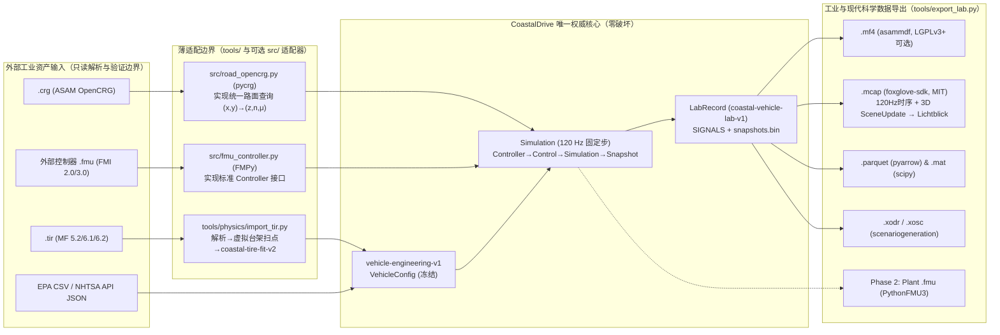

# 专题 4：汽车工业数据标准、开放实车/台架数据集与联合仿真工具链调研报告

> **调研定位**：CoastalDrive 长期规划蜂群调研团队 · 专题 4（工业数据互操作、联合仿真工具链与合法公开实车标定基准）  
> **核验日期**：2026-11-26  
> **目标运行基线**：CoastalDrive 当前运行环境经实测核验为 **Windows x64 / Python 3.14.2 / NumPy 2.5.3 / Cython 3.2.9 / Panda3D 1.10.16**（不含预装 SciPy/PyArrow），核心物理保持 **120 Hz 固定步、唯一权威 `Simulation`** 与 `Controller → Control → Simulation → Snapshot` 架构。  
> **配套产出**：溯源台账 [sources-04-data.csv](file:///b:/AI%20agent/暑期计算机程序设计/CoastalDrive/docs/research/lab-roadmap-2026/sources-04-data.csv)；本地归档开放资料目录 [downloads/04-data/](file:///b:/AI%20agent/暑期计算机程序设计/CoastalDrive/logs/research/lab-roadmap-2026/downloads/04-data/)（8 份均完成格式校验与 SHA-256 登记）。

---

## 执行摘要

CoastalDrive 试验台在 `SIM-FIDELITY-02`（M1–M5）后已建立严谨的自有工程数据协议——包括 `vehicle-engineering-v1` 分组车辆参数、`coastal-tire-fit-v1/v2` 轮胎标定、`coastal-suspension-bench-v1..v4` 悬架台架、`coastal-vehicle-lab-v1` 120 Hz 记录导出（`signals.csv` / `experiment.json` / `snapshots.bin` / `report.html`）以及 2022 Toyota GR86 留出盲测标定链路。然而，要使 CoastalDrive 从“自洽的单体教学与研究试验台”升级为**能与汽车工业工具链（Simulink / CANape / INCA / CarMaker / Lichtblick）无缝对话、且拥有多架构实车留出标定库**的开放平台，必须解决两大结构性缺口：

1. **工业格式互操作与联合仿真断层**：当前导出仅面向自研 HTML/CSV，无法直接进入 CANape/INCA/MATLAB/Foxglove(Lichtblick)，也无法直接加载外部 Simulink/C++ 控制器 FMU 或标准 `.tir` / `.crg` / `.xodr` 资产。
2. **多架构合法实车对标库缺失**：仅有 1 台 RWD 标定车（2022 GR86），缺少 FWD、EV-4WID/AWD 与 Formula Student (FSAE) 的合法公开参数与实测留出对标源。

本次联网实证调研（含 PyPI 2026-11 实时轮子/许可查询、GitHub 原始 `LICENSE` 文件核验与 8 份开放获取主资料本地校验）得出四项核心结论：
- **Python 3.14 生态已全面成熟，但存在隐藏许可陷阱**：`fmpy==0.3.32` (BSD-2-Clause)、`pythonfmu3==1.3.0` (MIT)、`pycrg==2.2.0` (Apache-2.0, 原生 `cp314` 轮子)、`scenariogeneration==0.16.7` (MPL-2.0)、`foxglove-sdk==0.31.0` (MIT, `cp310-abi3` 轮子)、`pyarrow==26.0.1` (Apache-2.0, `cp314`) 与 `scipy==1.18.1` (BSD-3-Clause, `cp314`) 均已原生支持 Windows Python 3.14；但实查发现 **`asammdf==8.8.33` 实为 `LGPLv3+`（非网传 MIT）**，**`mat73` 与 `commonroad-scenario-designer` 为 `GPL-3.0`**（且后者限制 `<3.14`），**`pypac` 是 HTTP 代理库而非 Pacejka 轮胎库**，**Foxglove Studio 前端已转闭源商业化**（应改推 BMW 主导的 **MPL-2.0 开源分支 Lichtblick**）。
- **联合仿真应“先导入后导出”**：以 `FMPy` 接入外部 Simulink/C++ 控制器 FMU 仅需约 200 行薄适配器，零侵入 `Simulation` 且收益最大；以 `PythonFMU3` 导出 CoastalDrive 为被控对象 Plant FMU 可用于同机工作站联合仿真，但受限于 CPython+Bullet 环境依赖，暂不宜承诺零依赖异机 HIL 二进制导出。
- **`.tir` 生态缺单一权威 Python 轮子，宜走“两步桥接”**：以 Project Chrono (BSD-3-Clause) 实测 `.tir` 文件与 `MFeval` / `MFeval.jl` (MIT) 方程为数值真值，先构建 `.tir → 虚拟台架扫点 → coastal-tire-fit-v2` 零物理改动桥接器，中期再按需开放可选 `mf61_tir` 轮胎本构内核。
- **存在高价值、完全合法的公开实车数据组合**：利用 **NHTSA 四代惯量库 + 官方 SafetyRatings REST API**、**美国 EPA 滑行阻力认证库（实测 `Target A/B/C` 滚阻与 $C_d A$）**、**Stanford DDL CC BY-SA 4.0 实车 VW Golf GTI 极限赛道数据集 (`purl.stanford.edu/hh613qz0317`)**、**ETHZ AMZ `fssim` MIT 许可 4WD 电动 FSAE 完整参数 (`gotthard/car.yaml`)** 与 **Car & Driver + MotorTrend 跨媒体实测指标**，可在**严格绕开 FSAE TTC NDA 红线**的前提下，构建完整的 **RWD / FWD / EV-4WID / FSAE 四架构公开标定库**。

---

## 1. 工业标准与成熟 Python 轮子选型矩阵

所有候选库的最新版本、发布日期、开源许可及 **Windows x64 + Python 3.14.2** 轮子可用性，均已于 2026-11-26 通过 PyPI JSON API 与上游仓库原始 `LICENSE` 文件实测核验（非二手文档转述）。

### 1.1 总览选型矩阵

| 工业标准 / 领域 | 推荐成熟开源库 / 工具 | 最新版本（核验日 2026-11-26） | 实查开源许可 | Win64 + Py3.14 轮子状态 | CoastalDrive 接入策略与依赖分级 | 避坑 / 淘汰项 |
|---|---|---|---|---|---|---|
| **FMI 2.0 / 3.0 控制器导入** | **`FMPy`** (`CATIA-Systems/FMPy`) | `0.3.32` (2026-09-09) | **BSD-2-Clause** | ✅ `py3-none-any` (`>=3.10`) | **Phase 1 强烈推荐**（可选扩展 `[cosim]`）：通过 `FMUControllerAdapter` 挂载至 `Controller` 层 | 避免手写 FMI XML/ctypes 加载器 |
| **FMI 2.0 / 3.0 Plant 导出** | **`PythonFMU3`** (`StephenSmith25/PythonFMU3`) / **`PythonFMU`** (`0.7.0`) | `1.3.0` (2026-11-18) | **MIT** | ✅ `py3-none-any` (`>=3.9`) | **Phase 2 实验推荐**（工作站级同环境联仿，须显式声明环境契约） | **`UniFMU`** 采用非 OSI 标准 **ICAPL** 许可且跨进程 IPC 延迟高，优先级低于 `PythonFMU3` |
| **ASAM MDF4 (`.mf4`) 工业遥测** | **`asammdf`** (`danielhrisca/asammdf`) | `8.8.33` (2026-11-16) | **LGPL-3.0-or-later**（⚠️ 非 MIT） | ✅ `cp310-abi3-win_amd64` | **Phase 1 推荐**（独立可选依赖 `[automotive-io]` 动态导入，严禁静态合入源码） | 不可在商业/闭源打包时静态链接违背 LGPLv3 替换条款 |
| **MF-Tyre `.tir` (5.2 / 6.1 / 6.2)** | **轻量自研 `.tir` 解析器 (~120 LOC)** + **Chrono `.tir` 夹具** + **`MFeval`/`MFeval.jl` 数学对账** | Chrono `main` (2026) / `TUMFTM` (2025) | **BSD-3-Clause** (Chrono) / **MIT** (`MFeval.jl`, `TUMFTM`, `OpenTire`) | ✅ 纯 Python / NumPy | **Phase 1 桥接** `.tir → coastal-tire-fit-v2`；**Phase 3 可选** 原生 MF6.1 内核 | ⚠️ **`pypac` 是 HTTP 代理库**；**`pytire==0.4.1`** 停更(2022)且限 `<3.11`；OpenModelica 不内置 Delft-Tyre `.tir` |
| **ASAM OpenCRG (`.crg`) 3D 路面** | **`pycrg`** (`ExpectedArgument/pycrg`) + `asam-ev/OpenCRG` | `2.2.0` (2026-10-27) | **Apache-2.0** | ✅ 原生 **`cp314-win_amd64`** | **Phase 1 强烈推荐**（可选 `[road-io]`）：直连 `iso_ride.py` / 解析路面查询接口 | 无需手工重编 OpenCRG C-API |
| **ASAM OpenDRIVE (`.xodr`) & OpenSCENARIO (`.xosc`)** | **`scenariogeneration`** (`pyoscx/scenariogeneration`) + **`libOpenDRIVE`** (`pageldev/libOpenDRIVE`, C++17) | `0.16.7` (2026-10-08) | **MPL-2.0** / **Apache-2.0** | ✅ `py3-none-any` (`scenariogeneration`) | **Phase 2 推荐**：`scenariogeneration` 导出标准场景；如需导入复杂 `.xodr` 网格再通过 Cython 封装 `libOpenDRIVE` | ⚠️ **`commonroad-scenario-designer==0.8.5`** 与 **`opendrive2lanelet`** 均为 **GPL-3.0** 且前者限制 `<3.14`，排除核心依赖 |
| **时序 + 3D 联合遥测回放 (MCAP)** | **`foxglove-sdk`** (`0.31.0`) / **`mcap`** (`1.6.0`) + **`Lichtblick`** 前端 | `0.31.0` (2026-11-13) / `1.6.0` (2026-10-19) | **MIT** (MCAP & SDK) / **MPL-2.0** (Lichtblick) | ✅ `cp310-abi3-win_amd64` (`foxglove-sdk`) / `py3-none-any` (`mcap`) | **Phase 1 强烈推荐**（最高展示与调试性价比）：单 `.mcap` 文件同时输出 120 Hz 全信号 + 3D 车体/轮力矢量 | ⚠️ **Foxglove Studio** 客户端已商业闭源化，文档与工作流应默认推荐 **Lichtblick** (BMW AG 维护，MPL-2.0) |
| **列式科学数据 (Parquet)** | **`pyarrow`** (`apache/arrow`) | `26.0.1` (2026-11-03) | **Apache-2.0** | ✅ 原生 **`cp314-win_amd64`** | **Phase 1 推荐**：大批量参数扫描/蒙特卡洛试验替代臃肿 CSV，写入单位元数据 | 无显著风险 |
| **MATLAB `.mat` 互操作** | **`scipy.io.savemat`** (`scipy==1.18.1`)；超大文件备选 **`h5py==3.16.0`** / **`hdf5storage==0.2.2`** | `1.18.1` (2026-08-21) | **BSD-3-Clause** / **BSD** | ✅ 原生 **`cp314-win_amd64`** | **Phase 1 推荐**：`savemat(..., do_compression=True)` 导出 `.mat` v5/v7（2 GB 内覆盖 99% 单次试验） | ⚠️ **`mat73==0.65`** 为 **GPL-3.0** 强传染许可，禁止引入 |

---

### 1.2 关键标准深度工程评估

#### （1）FMI / FMU 2.0 & 3.0：双向联合仿真可行性与工程复杂度

依据官方 FMI 3.0.2 规范（`modelica/fmi-standard`，文档 CC BY-SA 4.0，C 头文件与 XSD 为 **BSD-2-Clause**）及第 14 届 Modelica 大会总览论文 Junghanns 等 (2021, DOI `10.3384/ecp2118117`，已归档至 [fmi3-Junghanns2021-new-features.pdf](file:///b:/AI%20agent/暑期计算机程序设计/CoastalDrive/logs/research/lab-roadmap-2026/downloads/04-data/fmi3-Junghanns2021-new-features.pdf))，FMI 3.0 相比 FMI 2.0 新增了**数组变量、终端分组 (Terminals)、时钟 (Clocks) 与事件模式**，专门面向汽车虚拟 ECU（vECU）与闭环底盘控制联合仿真。

CoastalDrive 的物理核心（`Simulation`）严格满足“120 Hz 固定步、纯状态推进、零 UI/Scene/Audio 依赖”，这使 FMI Co-Simulation 接入具备天然架构优势，但**“导入”与“导出”两个方向的复杂度差异显著**：

| 维度 | 方向 A：CoastalDrive **导入**外部控制器 FMU（Simulink / C++ / dSPACE 导出） | 方向 B：CoastalDrive **导出**自身 `Simulation` 为被控对象 Plant FMU |
|---|---|---|
| **推荐工具** | **`FMPy`** (`0.3.32`, BSD-2-Clause, 原生 ctypes 调入 FMU 内 C DLL) | 短期：**`PythonFMU3`** (`1.3.0`, MIT)；长期：独立 C-API FMU 外壳 |
| **工程复杂度** | **低（~200–250 LOC，1–2 周可闭环）** | **中高（`PythonFMU3` 原型 ~350 LOC，但部署约束多；纯 C 导出需剥离 Bullet）** |
| **架构贴合度** | **完美契合**：实现 `FMUController` 遵循现有 `Controller` 接口，读取 `Snapshot` / `ChassisEstimate` → `fmi2SetReal` / `fmi3SetFloat64` → `doStep(t, dt)` → 输出 `VehicleCommand`（或分轮制动/驱动扭矩）；支持 `120 Hz` 同步步或 `20 / 50 / 100 Hz` 零阶保持分频 | **受限于运行时边界**：`PythonFMU3` 生成的 FMU 在 Simulink / FMPy 中加载时，通过 C++ 外壳嵌入本地 CPython 解释器，要求宿主机安装匹配的 **Python 3.14 + Panda3D + Bullet + `.pyd` 原生内核**；且受 GIL 约束，不适合直接烧录/部署至无 Python 环境的第三方 dSPACE/HIL 机箱 |
| **决定性校验点** | 支持 FMI 2.0 CS（Simulink 默认导出最稳妥）与 FMI 3.0 CS；校验 `modelDescription.xml` 端口名/单位映射与确定性重置 (`reset()`) | 须冻结 `dt = 1/120 s`（拒绝主控器传非法变步长或在内部固定整数子步累加），明确声明 `supports_variable_step = False` |
| **落地优先级** | **P0（最高 ROI）**：高校/企业用户最常见诉求是在 Simulink 写好 ABS/ESC/MPC/DYC 控制器，导出 `.fmu` 后直接丢进 CoastalDrive 跑闭环对标 | **P2（实验能力）**：面向同机 MATLAB/Simulink 联合仿真场景提供 `tools/cosim/export_plant_fmu.py` 与明确环境契约 |

#### （2）ASAM MDF4 (`.mf4`)：`asammdf` 生态、轻量性与 LGPLv3+ 隔离

- **行业价值**：ASAM MDF4 是汽车标定与试验工程师的“通用母语”——Vector CANape、ETAS INCA / MDA、AVL Concerto 与 MATLAB Vehicle Network Toolbox 均可零转换直读 `.mf4`，支持通道级物理单位、注释、来源设备元数据及内部 zlib/zstd 压缩。
- **与 CoastalDrive 契合度**：`src/lab_signals.py` 已将全部 120+ 路试验信号封装为强规范的 `Signal(key, label, unit, source)` 元数据目录（包含 `speed`、`ay`、`yaw`、`kappa_fl..rr`、`mz_fl..rr`、`camber_fl..rr`、`est_speed/est_beta/est_mu` 等）。使用 `asammdf` 写出标准 MDF 4.10 文件仅需约 50 行代码：将 `LabRecord.samples` 转为 `numpy` 向量，逐通道构造 `asammdf.Signal(samples, timestamps, name=sig.key, unit=sig.unit, comment=f"{sig.label} | {sig.source}")`，并把 `vehicle_config` / `source_start` SHA-256 写入 MDF 文件头注释或附件块（`Attachment`），即可在 CANape/MDA 中直接拖拽叠图对比 A/B 两次试验。
- **⚠️ 许可边界（重点核正）**：经实时查询 PyPI (`asammdf==8.8.33`) 与 `danielhrisca/asammdf` 仓库，`asammdf` 的真实许可是 **GNU LGPLv3+**（而非某些二手摘要误称的 MIT）。因此必须将其声明为**可选扩展依赖**（`optional-dependencies.automotive-io = ["asammdf>=8.8"]`），在导出模块内按需 `import asammdf`，绝不复制其代码进入 CoastalDrive 核心源码。

#### （3）轮胎属性文件 `.tir`（MF-Tyre / MF-Swift 5.2 / 6.1 / 6.2）现状核查

实网调研揭示了一个常被误解的事实：**与 `FMPy` / `asammdf` / `pycrg` 不同，Python 开源生态目前不存在单一主导、维护活跃且原生支持 Python 3.14 的完整 MF 6.1/6.2 `.tir` 评估轮子**：
- **常见误区核查**：PyPI 上的 `pypac==0.19.0`（`carsonyl/pypac`, Apache-2.0）是 **HTTP Proxy Auto-Config** 网络库，与 Pacejka 轮胎无关；PyPI 上的 `pytire==0.4.1`（MIT）自 2022-02 停更且 `requires_python: <3.11`。
- **真实可用的开源参考生态**：
  1. **Project Chrono (`projectchrono/chrono`, BSD-3-Clause)**：拥有工业界最成熟的开源 C++ `ChPac02Tire` / `ChTMeasyTire` 实现，并在仓库中自带合法 BSD-3-Clause `.tir` 样例文件。我们已下载校验其 245/40 R18 乘用车胎 [chronoveh-Sedan_Pac02Tire.tir](file:///b:/AI%20agent/暑期计算机程序设计/CoastalDrive/logs/research/lab-roadmap-2026/downloads/04-data/chronoveh-Sedan_Pac02Tire.tir)（158 行，含完整 `[UNITS]`、`[MODEL]`、`[DIMENSION]`、`[VERTICAL]`、`[LONGITUDINAL_COEFFICIENTS]`、`[LATERAL_COEFFICIENTS]`、`[ALIGNING_COEFFICIENTS]`；其中 `UNLOADED_RADIUS=0.344 m`, `WIDTH=0.245 m`, `VERTICAL_STIFFNESS=280835.3 N/m`, `FNOMIN=4850 N`, `PDX1=1.1739`, `PDY1=1.0489`, `PKX1=22.303`, `PKY1=-21.92`）。
  2. **`MFeval` (Marco Furlan, MATLAB) & `MFeval.jl` (`matheusft/MFeval_julia`, MIT)**：完整实现 MF 5.2 / 6.1 / 6.2 稳态联合滑移、倾角与回正力矩公式（遵循 ISO-W / TYDEX 符号约定），是公认的开源数值对账基准。
  3. **轻量 Python 参考仓库**：`OpenTire/OpenTirePython`（MIT，PAC2002 Python 实现但 2015 后低活跃）、`JyNing04/Pacejka-tire-model`（Apache-2.0，含 `readTIR.py` 解析器）、`TUMFTM/Tire_Parameter_and_Uncertainty_Estimation`（MIT，2025 年活跃，提供实车数据到简化 Magic Formula 的 Nelder-Mead 与 SVI 不确定度辨识）。
  4. **OpenModelica 核查**：OpenModelica 与 Modelica 标准库本身**不内置**商业 Delft-Tyre `.tir` 解析器（Delft-Tyre 属 Siemens 商业软件，商业 Modelon VDL 才提供原生桥接），社区通常通过 Python 预处理或 FMI 耦合解决。

> **对 CoastalDrive 的工程启示**：`.tir` 本质是带 `$` / `!` 行内注释的分区键值文本，解析本身仅 ~120 行纯 Python（零外部依赖）；真正的工程严谨性在于**符号体系转换（TYDEX/ISO-W ↔ CoastalDrive `drive_positive_alpha_right`）**与 **MF 5.2/6.1/6.2 方程针对 `MFeval` / Chrono 的数值交叉验证**。

#### （4）道路与场景标准：ASAM OpenCRG、OpenDRIVE 与 OpenSCENARIO

- **ASAM OpenCRG (`.crg`)**：
  - 官方仓库 `asam-ev/OpenCRG` 采用宽松 **Apache-2.0** 许可，开源全部 ANSI-C 评估库 (`crgBaseLib.h`) 与经典测试路面。我们已下载校验官方样例 [asam-opencrg-belgian_block.crg](file:///b:/AI%20agent/暑期计算机程序设计/CoastalDrive/logs/research/lab-roadmap-2026/downloads/04-data/asam-opencrg-belgian_block.crg)（1.38 MB，DaimlerChrysler Research 2005 采集的 10 m × 3.4 m 比利时石块路，**1 cm × 1 cm** 高精度规则网格）。
  - Python 生态已有极成熟的 **`pycrg==2.2.0`**（`ExpectedArgument/pycrg`, **Apache-2.0**，2026-10 更新），**直接提供 Windows x64 `cp310`–`cp314` 预编译二进制轮子**，可零编译接入 CoastalDrive Python 3.14 环境，直接把 3D 路面微纹理高程与局部坡度注入 `src/iso_ride.py` 及独立簧下轮心解析接触面！
- **ASAM OpenDRIVE (`.xodr`) 与 OpenSCENARIO (`.xosc`)**：
  - **推荐导出/场景构造轮子**：**`scenariogeneration==0.16.7`**（`pyoscx/scenariogeneration`, **MPL-2.0**，合并了历史 `pyodrx` 与 `pyoscx`，纯 Python 兼容 Py3.14），可将 CoastalDrive 试验工况（双移线、对开路面、弯道制动、高速汇入）直接生成行业标准 `.xodr` + `.xosc` 文件，与其他自动驾驶仿真器（esmini、CARLA、CarMaker）互通。
  - **推荐高性能解析器**：若未来需直接导入外部复杂 `.xodr` 道路几何，选用无外部依赖的 C++17 库 **`libOpenDRIVE`**（`pageldev/libOpenDRIVE`, **Apache-2.0**）并用项目已有 `Cython 3.2.9` 封装（或参考 `Nova-UTD/pyOpenDRIVE`）。
  - **明确规避项**：TUM 的 `commonroad-scenario-designer==0.8.5` 与旧版 `opendrive2lanelet` 虽支持 OpenDRIVE 转换，但均为 **GPL-3.0** 且前者声明 `requires_python: <3.14`，不纳入 CoastalDrive 依赖。

#### （5）科学数据与现代遥测回放：Parquet、`.mat` 与 MCAP / Foxglove / Lichtblick

- **MCAP + Foxglove SDK + Lichtblick（极高价值的“降维打击”工具链）**：
  - **协议与 SDK**：MCAP (`foxglove/mcap`, `mcap==1.6.0`, **MIT**) 是现代机器人与自动驾驶事实标准的自包含多模态日志容器；官方 **`foxglove-sdk==0.31.0`**（2026-11 发布，**MIT**，Rust 核心封装的 `cp310-abi3-win_amd64` 轮子直接兼容 Python 3.14）通过极简 API（`with foxglove.open_mcap("run.mcap"):`）即可在**同一个 `.mcap` 文件**内同步写入：
    1. 全部 120+ 路 120 Hz 时序标量通道（JSON/Protobuf schema，覆盖 `lab_signals.py` 全集）；
    2. 3D 坐标系变换（`FrameTransforms`：世界系 → 簧上车身 → 四轮轮心/转角/自转）与 3D 实体更新（`SceneUpdate`：车体盒、四轮姿态、实时轮胎力矢量箭头 $F_x, F_y, F_z$、参考轨迹、EKF 估计位姿 vs 真值位姿叠加！）。
  - **前端可视化器选型（重要许可预警）**：Foxglove Studio 桌面/网页应用已转为专有商业许可（虽有免费本地打开层，但核心代码不再开源）；**BMW Group 主导维护的社区开源分支 `Lichtblick`**（`lichtblick-suite/lichtblick`，经实查 `LICENSE` 原文为 **Mozilla Public License 2.0**）可无缝拖拽打开 `.mcap` 文件并内置 3D/Plot/Raw Messages/State Transitions 面板，完全消除对闭源客户端的绑定风险。
- **Parquet & MATLAB `.mat`**：
  - **`pyarrow==26.0.1`**（Apache-2.0，`cp314-win_amd64`）：单次 120 Hz × 120 路 × 60 s 实验约 7,200 行，CSV 需 ~10 MB，Parquet (Zstd) 仅 ~0.6 MB 且将单位/源码摘要存入 Parquet File Metadata，直接赋能 DuckDB/Pandas 跨百次工况批量回归分析。
  - **`scipy==1.18.1`**（BSD-3-Clause，`cp314-win_amd64`）：`scipy.io.savemat(..., do_compression=True)` 导出标准 MATLAB v5/v7 `.mat` 结构体（含 `signals`、`meta`、`vehicle`），零依赖 MATLAB 许可证即可交付给高校/车企 Simulink 用户；超 2 GB 极端大日志再用 BSD 许可的 `h5py==3.16.0` / `hdf5storage==0.2.2`（**严禁引入 GPL-3.0 的 `mat73`**）。

---

## 2. 合法公开实车 / 惯量 / 轮胎 / 操稳数据源地图

解决“没有真车数据验证”的关键不是寻找灰色渠道的商业车企数据，而是将**美国联邦公共领域政府数据库 + 高校开放科学仓储 (SDR / AWS Open Data / GitHub MIT-Apache) + 跨媒体实测指标**编织为分层可追溯的验证金字塔。

### 2.1 数据源全景矩阵

| 层级 | 数据源名称 | 涵盖物理量 / 数据内容 | 真实公开入口 / 标识符 | 许可与法律属性 | CoastalDrive 可用度与注意事项 |
|---|---|---|---|---|---|
| **L1：整车质量、CG 与转动惯量** | **NHTSA Light Vehicle Inertial Parameter Database**（四代编目） | 实测整备/试验质量、轴距、轮距、三维质心位置 $(x_{cg}, y_{cg}, h_{cg})$、**$I_{xx}, I_{yy}, I_{zz}, I_{xz}$ 转动惯量**、SSF、倾翻台比 (TTR) | SAE **930897** (414车) / **1999-01-1336** (496车) / **2010-01-0086** (2001–2008 NCAP) / **2021-01-0970** (再增448车，总计 >1,024车) | 底层实测属 NHTSA VRTC/NCAP 联邦项目；编目论文全文受 **SAE 版权**保护（须高校/个人合法订阅，禁止从盗版镜像爬取） | **极高价值但有关键断层**：1999-01-1336 及之前含完整 $I_{xx}/I_{yy}/I_{zz}$ 实测；2001–2020 NCAP 扩展仅测 **CG + SSF**。对现代车须用 1998 全量库建多元回归估算惯量并显式标注 `estimated_from_nhtsa_regression` |
| **L1：官方安全与侧翻 API / 合规试验** | **NHTSA SafetyRatings API / vPIC API / VRTC & OVSC 数据库** | 量产车 NCAP 侧翻评级、侧翻概率、**Fishhook Dynamic Tip/No-Tip**、FMVSS 126 Sine-with-Dwell 规程 (`TP-126-02`)、Phase IV Rollover (`DOT HS 809 513`)、Data.gov 通道 ASCII 库 | [api.nhtsa.gov/SafetyRatings](https://api.nhtsa.gov/SafetyRatings)、[nhtsa.gov/research-data/research-testing-databases](https://www.nhtsa.gov/research-data/research-testing-databases)、[catalog.data.gov](https://catalog.data.gov/dataset?q=NHTSA)、Regulations.gov Docket `NHTSA-2006-25801` | **美国联邦政府公共领域 (Public Domain, 17 U.S.C. § 105)** | 已实测通过 `api.nhtsa.gov` 拉取 3 款车 JSON（[nhtsa-ncap-rollover-api-sample.json](file:///b:/AI%20agent/暑期计算机程序设计/CoastalDrive/logs/research/lab-roadmap-2026/downloads/04-data/nhtsa-ncap-rollover-api-sample.json)）；⚠️ 实测 `nhtsa.gov` 与 `rosap.ntl.bts.gov` 网站 PDF 对脚本返回 `HTTP 403`，PDF 仅能由研究者人工通过浏览器合法下载 |
| **L1：纵向滚阻与气动阻力实测** | **EPA Annual Certification Test Car List Data Files** | 历年全部美国认证量产车的实测等效惯量车重 (`ETW`)、传动比与**道路滑行目标系数 `Target A` ($F_0$ 滚阻)、`Target B` ($F_1$)、`Target C` ($F_2$ 气动 $C_d A$)** | [epa.gov/compliance-and-fuel-economy-data/data-cars-used-testing-fuel-economy](https://www.epa.gov/compliance-and-fuel-economy-data/data-cars-used-testing-fuel-economy)（直接 CSV/XLSX） | **美国联邦政府公共领域 (Public Domain)** | **宝藏级低估数据源！**可直接精确标定任意量产车的 `rolling_coefficient` 与 `drag_coefficient * frontal_area`，与 `src/theory_baselines.py` 功率平衡和滑行对账零猜参 |
| **L2：真车极限赛道操稳遥测 (FWD)** | **Stanford Dynamic Design Lab — Vehicle Dynamics Dataset for Highly Dynamic Automated Driving** | 自动驾驶 **Volkswagen Golf GTI (FWD)** 在 Thunderhill 赛道极限操稳实测：RTK-GPS 速度/侧偏/横摆、转向/油门/制动执行器输入、轮速、实时胎温 | Stanford Digital Repository: [purl.stanford.edu/hh613qz0317](https://purl.stanford.edu/hh613qz0317) (DOI `10.25740/hh613qz0317`)；配套论文 `arXiv:2407.13760`（已下载） | **CC-BY-SA-4.0**（已核验 SDR 法律页） | **CoastalDrive FWD 架构最高价值真车对标源**：直接支持“开环重放实车控制输入 → 比对 $v_x, a_y, r, \beta$ 轨迹误差”以及刷毛轮胎模型极限侧偏验证 |
| **L2：真车超高速赛车遥测 (RWD 单座)** | **RACECAR Dataset (Indy Autonomous Challenge)** & **TUM FTM 开放工具链** | **Dallara AV-21** 在 IMS / LVMS 最高 273 km/h (170 mph)、28 m/s² 极限多模态与车辆遥测（ROS2 bag / nuScenes）；`TUMFTM/Open-Car-Dynamics`（通用方程式 + MF52）与 `TUMFTM/racetrack-database` | [github.com/linklab-uva/RACECAR_DATA](https://github.com/linklab-uva/RACECAR_DATA)、AWS Open Data、`arXiv:2306.03252`、`arXiv:2205.15979`（已下载）、`TUMFTM/Open-Car-Dynamics` | RACECAR 开放学术数据；`Open-Car-Dynamics` **Apache-2.0**；`racetrack-database` / `sim_vehicle_dynamics` **LGPL-3.0** | 可用于验证 CoastalDrive 高速气动下压力 + 倾斜弯道 (banking) + 极端侧向加速度数值稳定性；注意真实 AV-21 车队参数涉密未公开 |
| **L2：合法公开 FSAE 4WID 电动赛车参数** | **ETHZ AMZ `fssim` (`gotthard`)** + **Oxford Brookes OBR22** + **TU Delft / UPCommons 学位论文** | 完整 4WID 电动 FSAE 整车参数（`car.yaml`：$m=190\text{ kg}, I_{zz}=110\text{ kg}\cdot\text{m}^2, L=1.53\text{ m}, T=1.22\text{ m}, h_{cg}=0.262\text{ m}, r_{dyn}=0.231\text{ m}$, Pacejka $B/C/D/E$ 与气动下压力）、OBR22 轮毂电机架构、TU Delft 胎温扩展建模 | [AMZ-Racing/fssim](https://github.com/AMZ-Racing/fssim) (`car.yaml` 已下载)、`arXiv:2211.10476`（已下载）、TU Delft Repository / MDPI 2019 (Harsh & Shyrokau) | **`fssim` MIT**；OBR22 arXiv 开放；TU Delft MDPI **CC-BY-4.0** | **完美绕开 FSAE TTC NDA 红线的合法标准 FSAE 标定车基座**，直接服务高校车队与课程教学 |
| **L3：开源 `.tir` 轮胎与 `.crg` 路面基准** | **Project Chrono 轮胎库** + **ASAM OpenCRG 样例库** | BSD-3-Clause PAC2002 `.tir`（乘用车 245/40 R18、HMMWV、CityBus）与 Apache-2.0 高精度 `.crg` 路面（比利时石块路 1 cm 网格） | [projectchrono/chrono](https://github.com/projectchrono/chrono/tree/main/data/vehicle)、[asam-ev/OpenCRG](https://github.com/asam-ev/OpenCRG) | **BSD-3-Clause** / **Apache-2.0** | 已本地下载验证，零版权负担，可纳入自动化持续集成回归夹具 |
| **L3：多架构量产车留出盲测事实指标** | **Car & Driver** + **MotorTrend** 跨媒体仪器实测库 | 70–0 / 100–0 / 60–0 mph 制动距离、300 ft Skidpad 稳态 $a_y$、MotorTrend Figure-Eight 圈速与平均 $g$、0–60 mph 与 1/4 英里时间/尾速 | 公开评测文章（仅手工摘录客观测量事实数字并严格标注出处日期与测试胎型号） | 媒体图文受版权保护，**仅可引用客观测试数值事实**（严禁批量爬取文章或图片） | 延续 M4 2022 GR86 成功范式：用 2 项低维锚点标定，其余 4–5 项做**零调参严格留出盲测** |

### 2.2 NHTSA 车辆惯量数据库的实证核查结论（重点说明）

针对研究任务重点关切的 **NHTSA 实测 CG 与转动惯量数据库**，核查结果有三条对 CoastalDrive 标定方法论极其关键的事实：
1. **数据确实存在且是汽车动力学界最权威的公开实测惯量基线**：NHTSA 在东利伯蒂车辆研究测试中心（VRTC）使用 **IPMD（Inertial Parameter Measurement Device）** 与后续 S-E-A 公司的 **VIMF（Vehicle Inertia Measurement Facility）** 实测了超过 1,024 辆量产轻型车，完整序列由 4 篇里程碑论文发布：**SAE 930897**（1993, 414 车）→ **SAE 1999-01-1336**（1999, 496 车）→ **SAE 2010-01-0086**（2010, 2001–2008 NCAP）→ **SAE 2021-01-0970**（2021, 再增 448 辆 2009–2020 NCAP 车）。
2. **关键结构断层**：只有 **1999-01-1336（截至 1998 年的 496 车）** 提供了全套 **$I_{xx}$（侧倾）、$I_{yy}$（俯仰）、$I_{zz}$（横摆）及 $I_{xz}$ 惯性积实测值**；2001 年以后的 NCAP 测试扩展（2010 与 2021 报告）因 NCAP 侧翻星级评定只需要静态稳定因子 $SSF = T / (2 h_{cg})$，**仅系统测量了 CG 三维位置，未普遍测量完整惯量张量**。
3. **CoastalDrive 的正确使用方式**：
   - 相比当前 `src/vehicle_designs.py` 中对原创车使用的均质长方体近似（$I = m(a^2+b^2)/12$，往往高估约 15%–30% 的回转半径），CoastalDrive 应在标定工具中引入基于 NHTSA 496 车实测库文献发表的**分车型惯量回归先验**（以实测 $m, L, T, H$ 与电动底盘电池包低质心修正项为输入），并用 NHTSA NCAP 实测 `SSF` 反推 $h_{cg} = T / (2 \cdot SSF)$ 做硬约束；
   - 在 `vehicle-engineering-v1` 的 `metadata.provenance` 中严格区分 `nhtsa_vimf_measured`、`nhtsa_ncap_ssf_derived` 与 `nhtsa_regression_prior`，绝不把回归估算值冒充实测惯量。

---

## 3. CoastalDrive“数据输入桥接 + 多架构实车标定库”落地设计

遵循 CoastalDrive 既定工程铁律（**`Simulation` 唯一权威 120 Hz、零 UI/Scene/Audio 侵入、不堆砌 Manager/Factory/ECS 预建抽象、按需薄边界模块、不破坏既有配置字节兼容**），设计两套清晰解耦的落地方案。

### 3.1 工业数据双向桥接架构（Input & Output Bridges）

#### 分模块极简落地清单（映射至真实 CoastalDrive 文件）

1. **`.tir` 轮胎输入桥接（两阶段，绝不污染既有物理）**：
   - **Stage 1（`tools/physics/import_tir.py` + `src/tir_bridge.py`）**：
     - 解析标准 `.tir` 分区键值（验证 `[UNITS]` 统一换算至 SI，`[MODEL]` 检查 `PAC2002` / `MF61` / `MF62`）；
     - 在合法包络内（3+ 轮荷、最大/最小轮荷比 $\ge 1.5$、正负小滑移 + 峰区 + 变外倾 + 联合滑移留出点，严格满足 `src/tire_calibration.py:load_bench` 的全部校验门）评估稳态 $(F_x, F_y, M_z)$ 并完成 **ISO-W/TYDEX → CoastalDrive `drive_positive_alpha_right`** 符号映射；
     - 直接调用现有 `fit_tire()` 输出 `coastal-tire-fit-v2` 满秩（`rank=8`）标定报告与 `candidate-vehicle.json`，在 `conditions` 中明确写入 `source_kind: "synthetic"` 与 `tir_sha256`、`tir_format` 溯源，确保零改动接入现有试验台和验证体系。
   - **Stage 2（中期可选原生内核）**：仅当研究需要直接研究 MF 6.1/6.2 原始曲率 $E$、偏置 $S_H/S_V$ 或翻倾力矩 $M_x$ 时，在 `VehicleConfig` 增设显式开关 `tire_constitutive_model: Literal["coastal_brush", "mf61_tir"] = "coastal_brush"`，默认保持现有刷毛物理逐位不变，并以 `MFeval.jl` / Project Chrono 输出作为 CI 回归真值。

2. **ASAM OpenCRG 高精度 3D 路面接入（`src/road_opencrg.py`）**：
   - 依赖 `pycrg>=2.2`（Apache-2.0，Win64 Py3.14 原生轮子）；
   - 将 `.crg` 文件绑定为 `LabExperiment` 的新试验工况（如 `opencrg_road`），在 120 Hz 与子步接触层提供与 `src/iso_ride.py` 同构的解析高程与局部法向量接口 $(x, y) \mapsto (z, \nabla z, \mu)$，并把 `asam-opencrg-belgian_block.crg` 作为首个官方回归夹具，直接把 CoastalDrive 垂向动力学验证从“ISO 8608 合成随机谱”提升至“真实激光扫描路面（比利时石块/减速带/实测赛道）”。

3. **外部控制器 FMU 导入（`src/fmu_controller.py`）**：
   - 依赖 `fmpy>=0.3.32`（BSD-2-Clause）；
   - 遵循 `src/lab_experiment.py` 现有 `controller_mode` 扩展口（参考 `load_coordinated_controller()`），新增 `controller_mode="fmu"` 与 `fmu_path` 参数；
   - 定义一份简洁固定的 **CoastalDrive Chassis Control FMU 端口契约（v1）**：
     - **输入端口（Plant → Controller）**：`vx_mps`, `vy_mps`, `yaw_rate_radps`, `ax_mps2`, `ay_mps2`, `roll_rad`, `steer_deg`, `wheel_omega_fl/fr/rl/rr`, `wheel_fz_fl/fr/rl/rr`, `mu_est`（支持 `feedback_source="truth" | "sensor_ekf"` 一键切换！）；
     - **输出端口（Controller → Plant）**：`steer_cmd_deg`, `throttle_cmd`, `brake_cmd` 及可选四轮独立制动/驱动扭矩覆盖 `brake_pressure_fl/fr/rl/rr`, `wheel_torque_fl/fr/rl/rr`。
   - 控制器 FMU 按 120 Hz 或固定分频步长调用 `fmu.doStep(t, dt_ctrl)`，在 `experiment.json` 记录 `fmu_sha256`、`fmi_version` 与 `model_guid`。

4. **统一工业后处理导出器（`tools/physics/export_lab_formats.py`）**：
   - 直接消费现有 `LabRecord`（`load_record(folder)` 读入 `experiment.json` + `snapshots.bin`，**不改写核心仿真路径**），按命令参数一键生成：
     - `--mdf4`：`run.mf4`（`asammdf`，MDF 4.10 + Zstd，携带 `SIGNALS` 全部单位/来源，CANape/INCA/MDA 直开）；
     - `--mcap`：`run.mcap`（`foxglove-sdk`，MIT，同时写入 120 Hz 标量曲线 + `/tf` 四轮变换 + `/scene` 3D 车身/轮胎力矢量/参考线/EKF 对比，**Lichtblick** 拖拽即看）；
     - `--parquet`：`signals.parquet`（`pyarrow`，Zstd 压缩 + Arrow Schema 单位元数据）；
     - `--mat`：`experiment.mat`（`scipy.io.savemat`，v5/v7 压缩结构体）；
     - `--openx`：`scenario.xodr` + `scenario.xosc`（`scenariogeneration`，仅针对标准路径/制动工况导出）。

5. **可选依赖分组设计（`pyproject.toml` 建议）**：
   - 核心运行环境保持轻量（不强制绑定工业包）；
   - `[project.optional-dependencies]` 按许可清晰隔离：
     - `science-io = ["pyarrow>=26.0", "scipy>=1.18", "foxglove-sdk>=0.31", "pycrg>=2.2"]`（全 Apache-2.0 / BSD / MIT 宽松许可）
     - `cosim = ["fmpy>=0.3.32", "pythonfmu3>=1.3.0"]`（BSD-2-Clause / MIT）
     - `openx = ["scenariogeneration>=0.16.7"]`（MPL-2.0）
     - `mdf4 = ["asammdf>=8.8"]`（**LGPL-3.0-or-later 显式单独分组**，避免无意引入 Copyleft）

---

### 3.2 多架构公开实车标定库设计（RWD / FWD / EV-4WID / FSAE）

延续 M4 `tools/physics/calibrate_gr86_holistic.py` 验证成功的**“多源硬件先验 + 低维高可辨识度（满秩低条件数）标定 + 严格零调参留出盲测”**范式，规划四架构代表车型矩阵：

| 架构类别 | 代表基准车型 | 硬件/惯量/气动公开先验来源 | 轮胎 / K&C 先验来源 | 训练标定集（低维满秩 2–4 参） | 严格留出盲测集（零调参） | 需补齐的 CoastalDrive 物理支持项 |
|---|---|---|---|---|---|---|
| **1. RWD 轻量跑车（已有基线，升级扩充）** | **2022 Toyota GR86 Premium 6MT**（`gr86-2022-kc-calibrated.json`） | OEM 规格 + EPA Test Car List 滑行 `Target A/B/C`（验证滚阻与 $C_d A$）+ NHTSA 回归惯量校验 | 已落地麦弗逊/双叉臂 K&C 先验；可补入 215/40R18 同级 `.tir` 桥接对比 | C&D 实测 70–0 mph 制动 (156 ft) + 300 ft Skidpad (0.98 g)（已达 `cond=6.69`） | C&D 100–0 mph (325 ft, 当前 `-3.69%`)、1/4 mile 尾速 (101.0 mph, 当前 `101.19`)、MotorTrend Figure-Eight | 已完整支持；建议补 EPA 滑行对账核验滚阻/风阻 |
| **2. FWD 性能两厢车（含真车赛道闭环！）** | **Volkswagen Golf GTI (Mk7.5/Mk8)**（辅以 **Honda Civic Type R FL5** 做跨车验证） | OEM 规格 + **EPA Test Car List** (`Target A/B/C`) + NHTSA NCAP API + NHTSA 同级 FWD 惯量先验 | 前麦弗逊/后多连杆 K&C 先验 + **Chrono 245/40R18 `.tir` 桥接初值** | **方案 A（量产媒测）**：C&D 70–0 mph (152 ft) + Skidpad (0.94–0.95 g) **方案 B（真车赛道遥测）**：**Stanford DDL `hh613qz0317` (CC BY-SA 4.0)** 前 60% 圈次辨识路面 $\mu$ 与前后侧偏刚度 | **方案 A**：0–60 mph、1/4 mile、MotorTrend 60–0 / Figure-Eight **方案 B**：Stanford DDL **留出后 40% 圈次**开环转向/驱动输入重放，定量考核 $v_x, a_y, r, \beta$ RMSE！ | 现有 `front_drive_share=1.0` + 差速器已支持；建议补前轴扭矩转向/电子限滑差速（VAQ/XDS）参数项 |
| **3. EV-AWD / 4WID 高性能电动车** | **2022 Tesla Model 3 Performance** 或 **2024 Hyundai Ioniq 5 N**（双电机四驱，并设 4WID 虚拟分轮扭矩矢量配置） | OEM 电池/电机曲线 + **EPA Test Car List** (`Target A/B/C` 与高 `ETW`) + **NHTSA SafetyRatings API**（实测 Model 3 AWD 侧翻风险 `6.6%` No Tip / Ioniq 5 AWD `8.3%` No Tip → 反推低电池包质心 $h_{cg}$ 约束） | 高轮荷运动胎 (235/35R20 或 275/35R21) + 前双叉臂/后多连杆 K&C 先验 | C&D 70–0 mph（Model 3P 142 ft / Ioniq 5 N 153 ft）+ Skidpad（0.95–0.99 g / 0.96 g）+ 制动再生/机械复合分配 | C&D 100–0 mph、0–60 / 1/4 mile 尾速、NHTSA Fishhook `No Tip` 侧翻门槛验证 + 准稳态定圆 $K_{\text{sim}}$ | ⚠️ 需在 `powertrain` 补齐**纯电单速/无离合直驱模式、前后双电机/四轮独立轮毂电机扭矩矢量接口（含再生制动与机械制动协调）** |
| **4. FSAE 4WID 电动方程式（教学/竞赛标杆）** | **ETHZ AMZ `gotthard` (FSAE 4WID EV)** + **OBR22 架构对照** | 直接采用已本地验证的 MIT 许可 **[amz-fssim-gotthard-car.yaml](file:///b:/AI%20agent/暑期计算机程序设计/CoastalDrive/logs/research/lab-roadmap-2026/downloads/04-data/amz-fssim-gotthard-car.yaml)**（$m=190\text{ kg}, I_{zz}=110\text{ kg}\cdot\text{m}^2, L=1.53\text{ m}, T=1.22\text{ m}, h_{cg}=0.262\text{ m}, r_{dyn}=0.231\text{ m}$） | 将 `car.yaml` 合法公开 Pacejka 参数 ($B=12.56, C=-1.38, D=1.60, E=-0.58$) 生成虚拟台架扫点，经 `coastal-tire-fit-v2` 满秩映射（**零涉 FSAE TTC NDA**） | 虚拟台架扫点拟合轮胎参数 + 前后双叉臂高刚度推杆悬架运动比配置 | FSAE 标准 Skidpad (R=9.125 m 定圆时间)、75 m 直线加速、ISO 双移线与 4WID 扭矩矢量 DYC vs 无控制 A/B 对比（参考 `arXiv:2211.10476`） | ⚠️ 需补齐**高速气动下压力 $F_{\text{down}} = C_L \cdot \frac{1}{2}\rho A v^2$（按前后气动压心分配至轮荷）**及 **4WID 独立轮端电机扭矩执行器** |

> **关键架构协同发现**：多架构标定库同时反推出 CoastalDrive 物理核心下一步最具工程价值的两项小而美增量——**(a) 气动升力/下压力（$C_{L,f}, C_{L,r}$）**（支撑 FSAE 与高速 GT/IAC 验证）与 **(b) 电驱单速/双电机/4WID 独立轮端扭矩接口**（同时支撑 EV-4WID、FSAE 与外部 DYC FMU 控制器）。两者均可在 `VehicleConfig` 中设为默认关闭 (`downforce_coefficients=(0.0, 0.0)`, `electric_drive_enabled=False`)，100% 保持既有全部燃油车配置逐拍字节等价。

---

## 4. 数据许可与合规红线清单

CoastalDrive 作为准备走向开源发表与高校/社区广泛复用的科研仿真平台，必须在代码仓库、下载脚本、文档与标定配置文件中执行**“零模糊、可审计”**的数据与软件合规红线：

| 风险等级 | 涉事对象 | 合规红线与法律边界 | CoastalDrive 强制执行措施 |
|---|---|---|---|
| **🔴 严禁（零容忍）** | **FSAE Tire Test Consortium (FSAE TTC) / Calspan TIRF 数据** | 付费高校会员制（约 \$500 会员费）并签署严格保密协议（NDA）：仅限付费高校在读队员与导师在校园域内使用；**严禁商用、严禁公网 Git 仓库传播、严禁离校或非会员开源项目收录原始数据或原始 `.tir`**。 | CoastalDrive 仓库、CI 夹具与文档**绝对禁止**包含任何 TTC 原始测量 CSV 或拟合 `.tir`；仅在文档中提供*格式转换说明*供持有合法 TTC 会员资格的高校车队在本地私有目录自行导入；官方自带 FSAE 基准车统一使用 MIT 许可的 **AMZ `fssim`** 公开参数。 |
| **🔴 严禁（零容忍）** | **商业专有 `.tir` 与商业仿真器资产**（如 Siemens Delft-Tyre、CarSim、IPG CarMaker、Adams/Car 随软件分发的加密/专有 `.tir`、`.crg` 或车厂保密参数） | 受商业最终用户许可协议（EULA）保护；例如 `TUMFTM/Open-Car-Dynamics` 也明确声明真实 Dallara AV-21 车队参数涉密不可公开。 | CoastalDrive 仓库仅收录经核验为 **BSD / MIT / Apache-2.0 / CC0 / Public Domain** 的样本文件（如 Project Chrono BSD-3-Clause `.tir`、ASAM OpenCRG Apache-2.0 `.crg`）。 |
| **🔴 严禁（零容忍）** | **绕过付费墙、版权文档盗版镜像与站点访问控制** | ① SAE 论文（如 SAE 1999-01-1336、2021-01-0970）受 SAE 版权保护，不得从 Scribd/盗版站批量抓取或再分发全文 PDF；② 实测 `nhtsa.gov` 与 `rosap.ntl.bts.gov` 网站对非浏览器自动抓取返回 `HTTP 403`，严禁伪造指纹、破解反爬或绕过网关。 | 程序化取数仅走官方公开 API（如 `api.nhtsa.gov`、EPA 官方下载链接）；SAE 论文数据须由研究者通过合法机构订阅查阅后，仅在遵循版权法前提下引用客观工程事实参数并完整标注引用来源。 |
| **🟠 强隔离（许可传染防范）** | **Copyleft 开源依赖：`asammdf` (LGPLv3+)、`mat73` (GPL-3.0)、`commonroad-scenario-designer` (GPL-3.0)、`TUMFTM/racetrack-database` (LGPL-3.0)** | GPL-3.0 具有强传染性，禁止引入非 GPL 核心；LGPL-3.0 要求允许用户替换动态链接库且禁止静态拷入修改代码；`UniFMU` 使用非 OSI 标准 `ICAPL` 许可，存在商业/学术二次分发不确定性。 | ① **禁用** `mat73`（改用 BSD-3-Clause `scipy.io.savemat` / `h5py`）与 `commonroad-scenario-designer`（改用 MPL-2.0 `scenariogeneration` + Apache-2.0 `libOpenDRIVE`）；② **`asammdf`** 单独置于可选依赖 `[mdf4]` 动态导入；③ `TUMFTM` LGPL 赛道数据若使用仅作用户本地按需下载，不直接打包进核心源码树。 |
| **🟠 强隔离（ShareAlike 边界）** | **CC-BY-SA-4.0 资产**：Stanford DDL `hh613qz0317` 数据集、FMI 3.0 规范文档原文 | CC-BY-SA 4.0 要求若对**该数据集/文档本身进行演绎修改并再分发**，衍生品须沿用相同 CC-BY-SA 4.0 许可并署名（注意：使用公开数据集评估仿真器误差或引用模型统计指标，不将 CC-BY-SA 传染给独立编写的仿真代码，但禁止将修改后的原始数据未加 CC-BY-SA 声明直接混入仓库）。 | 不将大体积 Stanford 原始数据打包进 Git；通过下载脚本按 DOI `10.25740/hh613qz0317` 引导用户本地拉取缓存，并在报告中完整署名原作者与 CC-BY-SA 4.0 许可。 |
| **🟡 生态防锁定** | **Foxglove Studio 闭源客户端 vs Lichtblick (MPL-2.0)** | Foxglove Studio UI 已转商业专有许可（免费版有云端/功能限制），而数据协议 `MCAP` 与 `foxglove-sdk` 仍为宽松 MIT。 | CoastalDrive 坚持输出标准开放 `.mcap` 容器，官方文档与工具链默认对接 BMW 主导开源的 **Lichtblick (MPL-2.0)**，保持零商业厂商锁定。 |
| **🟡 工程诚实红线** | **参数溯源与真值/先验边界** | 禁止将 `.tir` 虚拟扫点拟合、NHTSA 回归估算惯量、或媒体单车指标混同为“原厂实测台架/实车整车标定”。 | 严格沿用并扩展 `vehicle-engineering-v1` 的 `metadata` 机制：每项参数与每次标定强制标注 `source_kind`（`measured` / `tir_evaluated_synthetic` / `epa_certified` / `nhtsa_ssf_derived` / `nhtsa_regression_prior` / `literature_prior`）及上游输入文件 SHA-256。 |

---

## 5. 完整溯源表与本地归档清单

### 5.1 本地已下载并校验的 8 份开放主资料（均存于 B 盘项目目录）

全部文件位于 [logs/research/lab-roadmap-2026/downloads/04-data/](file:///b:/AI%20agent/暑期计算机程序设计/CoastalDrive/logs/research/lab-roadmap-2026/downloads/04-data/)，已逐一完成非空、文件头格式（`%PDF-1.x` / UTF-8 / OpenCRG `$ROAD_CRG` / JSON schema）与 SHA-256 校验：

| 编号 | 本地文件 | 类别 | 来源与许可 | 大小 (Bytes) | 格式校验 | SHA-256 | 核心工程用途 |
|---|---|---|---|---:|---|---|---|
| `S04-01` | [chronoveh-Sedan_Pac02Tire.tir](file:///b:/AI%20agent/暑期计算机程序设计/CoastalDrive/logs/research/lab-roadmap-2026/downloads/04-data/chronoveh-Sedan_Pac02Tire.tir) | `.tir` 样例 | Project Chrono (`BSD-3-Clause`) | `12,375` | UTF-8, 158 行, `PAC2002` | `ef4c08a321d06927616416d6af2eb3c6db41fa8461927650b194c0ed79ac4af1` | 245/40 R18 乘用车 `.tir` 解析器与 `coastal-tire-fit-v2` 桥接测试夹具 |
| `S04-02` | [asam-opencrg-belgian_block.crg](file:///b:/AI%20agent/暑期计算机程序设计/CoastalDrive/logs/research/lab-roadmap-2026/downloads/04-data/asam-opencrg-belgian_block.crg) | `.crg` 路面 | ASAM OpenCRG (`Apache-2.0`) | `1,379,085` | ASCII 头含 `$ROAD_CRG`, 1cm 网格 | `cc6c1d8732c743142db06e9cfa87a32674efef4e10c9a6aee5abb94c50729e6a` | `pycrg` 接入与 3D 微纹理平顺性试验台官方样例夹具 |
| `S04-03` | [fmi3-Junghanns2021-new-features.pdf](file:///b:/AI%20agent/暑期计算机程序设计/CoastalDrive/logs/research/lab-roadmap-2026/downloads/04-data/fmi3-Junghanns2021-new-features.pdf) | 标准论文 | Modelica Conf 2021 (`CC-BY-4.0`) | `546,272` | `%PDF-1.5` | `1d2baddcfcdc43204c8d2a92bd83b68ccc051ae5ab0c46a8c816404d9cbece4c` | FMI 3.0 终端、数组、时钟与汽车 vECU 联仿架构权威设计参考 |
| `S04-04` | [amz-fssim-gotthard-car.yaml](file:///b:/AI%20agent/暑期计算机程序设计/CoastalDrive/logs/research/lab-roadmap-2026/downloads/04-data/amz-fssim-gotthard-car.yaml) | 整车参数 | ETHZ AMZ `fssim` (`MIT`) | `2,289` | UTF-8 YAML, 71 行, 内嵌 MIT 声明 | `555d3b925677cd08674b4f2b00e3f597b5c3783ef79445a645cf885547786edb` | 合法绕开 FSAE TTC NDA 的 FSAE 4WID 电动赛车公开基准参数 |
| `S04-05` | [tum-2205.15979-autonomous-motorsport.pdf](file:///b:/AI%20agent/暑期计算机程序设计/CoastalDrive/logs/research/lab-roadmap-2026/downloads/04-data/tum-2205.15979-autonomous-motorsport.pdf) | 极限操稳论文 | TUM FTM (`arXiv:2205.15979`) | `4,066,665` | `%PDF-1.6` | `92c1b50e8cf6f71dde574a9b08dd30ac6fd3f27e3d0039bf92e1432c867d6f92` | IAC 高速 Dallara AV-21（270 km/h, 28 m/s²）非线性动力学与控制对标 |
| `S04-06` | [oxford-2211.10476-fsae-4wid-architecture.pdf](file:///b:/AI%20agent/暑期计算机程序设计/CoastalDrive/logs/research/lab-roadmap-2026/downloads/04-data/oxford-2211.10476-fsae-4wid-architecture.pdf) | 4WID 论文 | Oxford Brookes (`arXiv:2211.10476`) | `1,554,701` | `%PDF-1.5` | `988bc69d920a444967f18699e59ab55aa88136880605d7e5b54399fd88ce509f` | 轮毂电机 4WID FSAE 控制、扭矩矢量与 MiL/HiL 架构参考 |
| `S04-07` | [stanford-ddl-2407.13760-nn-tire-drifting.pdf](file:///b:/AI%20agent/暑期计算机程序设计/CoastalDrive/logs/research/lab-roadmap-2026/downloads/04-data/stanford-ddl-2407.13760-nn-tire-drifting.pdf) | 轮胎建模论文 | Stanford DDL (`arXiv:2407.13760`) | `598,136` | `%PDF-1.5` | `2b040b3557a6a2e9ef3e030193acdc38af3b4f56be85b7eb4db4f89f769b79a2` | 极限漂移下刷毛轮胎模型 vs 神经网络轮胎模型实车对比参考 |
| `S04-08` | [nhtsa-ncap-rollover-api-sample.json](file:///b:/AI%20agent/暑期计算机程序设计/CoastalDrive/logs/research/lab-roadmap-2026/downloads/04-data/nhtsa-ncap-rollover-api-sample.json) | 政府 API 样例 | NHTSA SafetyRatings (`Public Domain`) | `5,480` | 有效 JSON, 3 车型记录 | `476f1ecdc4dd7db3397f8c5b6e4ce1e8a0dfd8b904b4ab6c99896ab230512cdb` | 验证官方 REST API 合规取数（Model 3 AWD 6.6% / Ioniq 5 AWD 8.3% No Tip） |

### 5.2 完整溯源台账索引

完整 28 条一手来源记录（含 `S04-01`–`S04-08` 本地归档与 `S04-09`–`S04-28` 在线核验标准/轮子/数据集/红线条目，严格按 15 列固定表头）见：[sources-04-data.csv](file:///b:/AI%20agent/暑期计算机程序设计/CoastalDrive/docs/research/lab-roadmap-2026/sources-04-data.csv)。
