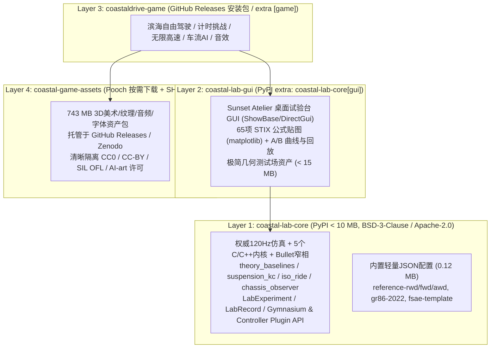

# 专题 5：学术软件发表范式、高校教学竞赛落地与开源分发架构研究报告

> **归属项目**：CoastalDrive 长期规划调研（2026-11-26）  
> **核查基线**：主仓库本地基线 `b1980b53`（含未提交的 `SIM-FIDELITY-02` M1–M5 阶段成果）、`pyproject.toml`、`setup.py`、`src/`（170 份 Python 与 24 份 C/C++/H 源码）、`docs/asset-register.csv`、实时 PyPI 元数据及 6 份合法下载校验的开放获取原始文献。  
> **溯源台账**：[sources-05-academic.csv](file:///b:/AI%20agent/暑期计算机程序设计/CoastalDrive/docs/research/lab-roadmap-2026/sources-05-academic.csv)

---

## 执行摘要

CoastalDrive 已经在底层技术上越过了普通课程作业或独立驾驶游戏的门槛：它拥有 120 Hz 唯一权威物理核心、C/C++ 加速的 34 维独立簧下质量求解器（`13.02 ms/step`，单子步能量闭合误差 `2.10e-10 J`）、双精度隔离运行时（`STDFLOAT_DOUBLE` + `BT_USE_DOUBLE_PRECISION`）、余志生《汽车理论》第 1/2/4/5 章解析基线对账、65 项 STIX 公式可视化、2022 GR86 满秩留出标定（`100–0 mph` 盲测 `-3.69%`、`1/4 mile` 尾速 `101.19 vs 101.0 mph`）、15 维传感器 EKF 观测闭环，以及带源码/运行时双端 SHA-256 指纹的 `LabRecord` 实验档案系统。

然而，对代码仓与外部发表/分发标准的实证审计暴露出**三个决定学术转化成败的结构性瓶颈**：

1. **治理与合规硬阻塞**：仓库根目录目前缺失 OSI 开源协议文件 `LICENSE`、`CONTRIBUTING.md`、`CODE_OF_CONDUCT.md`、`CITATION.cff` 与 `.github/workflows/` CI；且 Git 提交史目前仅跨度 **2.1 个月**（`2026-09-22` 至 `2026-11-26`，421 次提交，单一作者 `wy520ccj`），触及 **JOSS 最新预审红线（≥ 6 个月公开开发史 + 社区协同证据 + 强制 AI 使用披露）**。同时 `src/lab_experiment.py:102` 存在跳出仓库目录加载外部课程代码的硬耦合路径（`parents[2] / "汽车理论" / "作业"`）。
2. **打包与跨平台错配**：`src/` 与 `vendor/` 仅占 **7.89 MB**（核心车型配置仅 **0.12 MB**），却与 **743.04 MB** 的游戏 3D 美术/音频资产（含 CC-BY、SIL OFL 与 AI 生成素材）捆绑在 Windows 单平台打包体系中；更关键的是，代码 AST 扫描证实 `src/` **零 Python 3.12+ 独占语法**，PyPI 官方 `panda3d==1.10.16` 已完整覆盖 **`cp311–cp314`** 全平台轮子，仅因 `pyproject.toml` 锁死 `>=3.14,<3.15` 和 `numpy==2.5.3`（NumPy 2.5 已放弃 Python 3.11）以及 `paths.py` / `lab_records.py` / `lab_runtime.py` 三处 Windows 路径/后缀假设而被困在单一平台。
3. **教学与基准定位清晰但缺最后“标准接口”**：在高校《汽车理论》实验与 FSAE/FSC 生态中，CoastalDrive 精准切中 **OpenLAP/OptimumLap（点质量准稳态、无瞬态/K&C/控制）** 与 **Chrono::Vehicle/CarSim（多体配置极重或昂贵闭源黑盒）** 之间的**“白盒高保真瞬态试验台 + 3D 车手在环（DIL）验证”**空白；在学术论文赛道上，只需补齐 **Gymnasium/控制器插件 API + 多算法标准基线榜单（CoastalBench）+ 无头 Docker/Zenodo 复现包**，即可沿 **JOSS（软件引文锚点）→ IEEE IV/ITSC 或 RA-L（基准平台论文）→ VSD（实车遥测验证深化）** 的阶梯实现可持续高引产出。

---

## 1. 学术发表目标矩阵与 CoastalDrive 差距清单

### 1.1 四类目标载体门槛横向对照

以下矩阵依据官方指南原文（[joss-review-criteria.md](file:///b:/AI%20agent/暑期计算机程序设计/CoastalDrive/logs/research/lab-roadmap-2026/downloads/05-academic/joss-review-criteria.md)）、Elsevier *SoftwareX* 作者指南（S05-08）及 4 篇实证标杆论文（Unjhawala 2024、MetaDrive 2022、F1TENTH 2024、CommonRoad 2024/2025）核实编制：

| 评估维度 | JOSS (*Journal of Open Source Software*) | Elsevier *SoftwareX* | 顶会/顶刊 Benchmark 平台论文 （IEEE TPAMI / T-ITS / RA-L / IV / ITSC / IFAC） | *Vehicle System Dynamics* (VSD) 建模/测试床论文 |
|---|---|---|---|---|
| **核心定位** | 可引用的科研开源软件同行评审载体（审代码为主、短文为辅） | 原始软件发表（OSP），兼顾 SCI/Scopus 索引与软件架构说明 | 解决领域评估碎片化的开放基准套件、API 与多基线评测 | 力学机理保真度、子系统建模创新与实车实验对标 |
| **版面费（APC）与开放获取** | **\$0（钻石 OA，论文 CC-BY-4.0）** | **Gold OA 收费**（历史约 \$760–\$1,920 USD，以投稿当期 Elsevier 官网标价及机构转换协议减免为准） | 会议注册费 / 期刊订阅免费或 OA 可选（IEEE/IFAC） | 传统订阅免费 / OA 可选（Taylor & Francis） |
| **传统检索指标** | Crossref DOI + Google Scholar（社区重软件引用而非传统 IF） | SCIE / Scopus 全收录（近年 WoS IF 约 1.9、CiteScore 约 3.9） | 顶级工程/机器人/交通期刊与会议，学术评价权重最高 | 车辆动力学领域第一权威期刊（JCR Q1/Q2 机械与车辆核心） |
| **同行评审模式与周期** | GitHub (`openjournals/joss-reviews`) 全公开交互式 Checklist 评审；案例 `joss.06548` 约 **3.7 个月** | Editorial Manager 匿名传统评审；代码元数据与可复现审查 | 双盲/单盲传统评审；常伴随 Artifact Evaluation（ACM/IEEE 徽章） | 严格机械动力学专家评审；极度看重方程严谨性与实车数据 |
| **强制文章结构与特殊门槛** | `paper.md` 约 1000 词，**必须含 5 个强制章节**：① Statement of need、② State of the field（明确 *build vs. contribute* 理由）、③ Software design、④ Research impact statement（须给实证而非愿景）、⑤ **AI usage disclosure（2025/2026 强制项）**；不得堆砌 API 文档 | 强制 4 段主体：**Motivation and significance → Software description → Illustrative examples → Impact**（约 6 页内，摘要 ≤ 250 词）+ **C1–C9 Code Metadata 强制表** + 推荐 Code Ocean 计算胶囊 | 领域问题与现有模拟器对比矩阵（如 MetaDrive Table 1）+ 系统架构 + 标准化任务定义 + 多随机种子基线排行榜 + 消融分析 + 局限性与伦理声明 | 完整控制方程/坐标系/自由度定义 + 子模型推导 + **实车仪器化轨迹/遥测时域对比与误差量化（RMSE/包络）** + 开源复现脚本 |
| **开源治理与历史硬门槛** | **极严预审门禁**：① 根路径明文 OSI `LICENSE`；② **≥ 6 个月公开开发史与版本 Tag**；③ 单作者须有明确社区使用/合作者证据；④ 自动化测试+CI；⑤ `pip install` 可安装；⑥ 录用前铸造 Zenodo 版本 DOI | ① OSI 开源协议；② 版本化持久归档（GitHub Release / Zenodo DOI）；③ 明确编译与依赖清单；④ 独立文档与支持邮箱；**无 6 个月提交史硬拒稿门禁** | 开源仓库 + 单命令安装 + 确定性种子 + 公开基线代码/超参 + 数据/模型分层许可声明 | 公开模型参数与复现脚本，能完整复现论文中所有验证工况 |
| **代表标杆案例** | Unjhawala et al. (2024) LFDM (`10.21105/joss.06548`, UW-Madison Chrono 组)；Beckers et al. (2023) JOAN (`10.21105/joss.04250`) | Paniego et al. (2024) Behavior Metrics (`10.1016/j.softx.2024.101702`) | MetaDrive (TPAMI 2022, `arXiv:2109.12674`)；CommonRoad (IV 2017 & 2024 竞赛 `arXiv:2512.19564`)；F1TENTH (`arXiv:2402.18558`) | Chrono::Vehicle (Serban 2019, `10.1504/IJVP.2019.097096`)；Heilmeier et al. (VSD 2020) |

### 1.2 顶刊/顶会高引开源仿真基准论文“四件套”拆解

深度精读 4 份本地归档的标杆论文原文，可提炼出开源车辆测试床获得高引用的共性骨架：

1. **MetaDrive（Li et al., IEEE TPAMI 2022，[arxiv-2109.12674-metadrive.pdf](file:///b:/AI%20agent/暑期计算机程序设计/CoastalDrive/logs/research/lab-roadmap-2026/downloads/05-academic/arxiv-2109.12674-metadrive.pdf)）—— CoastalDrive 最直接的技术同构参照**：
   - **底层栈完全同源**：同样采用 **Python + Panda3D（Modified BSD）+ Bullet（Zlib）**，且在第 7 节（p. 12）树立了**“代码 Apache-2.0 与 3D 车模 CC-BY/天空盒 CC0 分层许可声明”**的教科书范式。
   - **高引动因**：`pip install` 单命令安装 + ~100 MB 轻量体量 + 无头 300 FPS 吞吐 + OpenAI Gym/Gymnasium 标准 API + 17 款模拟器横向对比表（Table 1）+ 4 类标准化任务与多随机种子基线表（Tables 2–4，含完整超参表 Table 2 与 GitHub Releases 公开的人类轨迹数据集）。
   - **留给 CoastalDrive 的高价值空白**：MetaDrive 为追求 RL 采样速度仅使用 Bullet 内置射线车模型，**完全缺乏非线性联合滑移轮胎、K&C 运动学、独立簧下 34 维求解、双精度能量账、ISO 平顺性与底盘电控（ABS/ESC/DYC）基准**。
2. **LFDM（Unjhawala, Serban & Negrut, JOSS 2024，[joss-2024-unjhawala-lfdm-vehicle-dynamics.pdf](file:///b:/AI%20agent/暑期计算机程序设计/CoastalDrive/logs/research/lab-roadmap-2026/downloads/05-academic/joss-2024-unjhawala-lfdm-vehicle-dynamics.pdf)）—— JOSS 车辆动力学写作范式**：
   - 仅 7 页便通过高标准审稿，核心结构极为克制：**清晰的系统方程与传动拓扑图（Fig. 1）→ 5 条直指痛点的 Statement of Need → 对标 Chrono::Vehicle Audi A3 数字孪生的 90 km/h 加速与 ISO 3888-2 双移线精度验证（Figs. 2–3）→ 量化计算速度表（RTF 与 1/RTF，p. 5）**。
   - 该表同时暴露出重要参照数：高保真多体 Chrono::Vehicle 在 `1e-3 s` 步长下 RTF ≈ `0.51`（仅约 2× 实时），而 CoastalDrive 34 维 C 内核 `ride_bump` 已达 `13.02 ms/step` 且常态双轨求解可实现 120 Hz 实时车手在环交互。
3. **F1TENTH Unified Benchmarks（Evans et al., 2024，[arxiv-2402.18558-f1tenth-benchmarks.pdf](file:///b:/AI%20agent/暑期计算机程序设计/CoastalDrive/logs/research/lab-roadmap-2026/downloads/05-academic/arxiv-2402.18558-f1tenth-benchmarks.pdf)）—— “真值 vs 估计”消融范式**：
   - 第 IV-A 节（p. 7–8）核心结论指出：在 μ = 0.5–1.0 与多控制频率下，**真实位姿 vs 粒子滤波估计位姿**会导致 MPCC 完赛率剧烈退化。这与 CoastalDrive M5 已落地的 **`truth` vs `sensor_ekf` 驱动 ABS+ESC / ABS–DYC** 高度同构！
   - 论文附录 A（p. 11）明确 F1TENTH Gym 仅使用源自 CommonRoad 的 7 状态单轨模型，并在第 V-A 节（p. 9）将 **3D 感知/动力学仿真、全栈噪声估计耦合评测**列为未来重点方向——恰好是 CoastalDrive 的主场。
4. **CommonRoad Competition（Huang, Althoff et al., 2025，[arxiv-2512.19564-commonroad-competition-2024.pdf](file:///b:/AI%20agent/暑期计算机程序设计/CoastalDrive/logs/research/lab-roadmap-2026/downloads/05-academic/arxiv-2512.19564-commonroad-competition-2024.pdf)）—— 榜单治理与可复现裁判机制**：
   - 采用 **Phase I（公开教学场景）+ Phase II（隐藏评测场景 + 参赛者提交 Docker 镜像）** 的双阶段赛制，配合独立的形式化可行性校验器（Drivability Checker）、唯一编号代价函数（`TR1`）和锁定硬件预算（2 核 CPU、6 小时超时），实现了跨年度算法公平对比（TUM-2024 vs SB-2023）。

### 1.3 CoastalDrive 现状实证审计与差距清单

基于对仓库文件系统、源码 AST 与 Git 提交史的直接核查，CoastalDrive 距离上述各目标载体的真实差距如下表所示：

| 审查项 | CoastalDrive 当前核实状态（2026-11-26） | JOSS 差距 | SoftwareX 差距 | 顶刊 Benchmark / VSD 差距 | 优先级与整改动作 |
|---|---|---|---|---|---|
| **1. 根路径 OSI 开源许可** | `LICENSE` / `COPYING` **缺失**（仅 `licenses/` 含 Bullet 与 CPython 第三方声明）；`assets/game/` 含 CC-BY、SIL OFL 及 AI 生成素材 | **硬阻塞（直接拒稿）** | **硬阻塞（直接拒稿）** | 公开代码必需 | **P0**：核心代码库落地 `BSD-3-Clause` 或 `Apache-2.0`（与 Panda3D/Bullet/MetaDrive 对齐），与媒体资产包许可解耦 |
| **2. 公开开发史与协同证据** | Git 史仅 **2.1 个月**（`2026-09-22` 至 `2026-11-26`，421 commits），**单一作者 `wy520ccj`**，仅 2 个 `-dev` 预发布标签 | **硬阻塞（预审门禁要求 ≥ 6 个月公开史 + 协同/用户实证）** | 无 6 个月硬门禁，但需正式语义版本 Tag | 需稳定公开版本 + 外部可复现证据 | **P0**：立即保持公仓持续迭代与语义发版（`v0.9.x → v1.0.0`），引入高校教学/车队试用记录与导师/合作者署名；JOSS 投稿锚定 **2027-04 后** |
| **3. 外部路径硬耦合（可复现断裂）** | `src/lab_experiment.py:102` 的 `load_coordinated_controller()` 硬编码读取 `Path(__file__).resolve().parents[2] / "汽车理论" / "作业" / "cornering_braking_control"` | **硬阻塞（审稿人克隆后运行 `coordinated` 必报缺失）** | **硬阻塞** | **硬阻塞** | **P0**：抽象标准 `ChassisController` 协议与插件注册入口（支持 entry points / Python 对象注入），内置开源参考 `ABS–DYC` 基线控制器 |
| **4. 跨平台与 Python 版本锁死** | `pyproject.toml` 锁死 `requires-python = ">=3.14,<3.15"` 与 `numpy==2.5.3`；`setup.py` 仅 `win_amd64`；`src/paths.py` 硬编码 `LOCALAPPDATA`；`lab_records.py:40` 仅哈希 `.pyd`；`lab_runtime.py:13` 仅哈希 `*.dll` | **高危（Linux/macOS 审稿人无法 `pip install`）** | **高危（无法构建 Linux Code Ocean / Docker 胶囊）** | **硬阻塞（集群/审稿评测均在 Linux 无头运行）** | **P0**：放宽至 `Python >=3.11,<3.15` 与 `numpy>=2.0,<3`；拆分 `coastal-lab-core`；修复 3 处 Windows 专属路径/后缀假设 |
| **5. CI/CD 与自动化测试** | 已有 **297 个测试文件**与分级 T0/T1/T2 纪律，但 `.github/workflows/` **完全缺失** | **必补（Review Checklist 要求 CI 徽章与自动化回归）** | 强推荐 | 必需 | **P0**：接入 GitHub Actions（Linux/Windows/macOS 矩阵 + `cibuildwheel` + 无头 core 测试 + Ruff） |
| **6. 社区治理与机器可读引用** | `CONTRIBUTING.md`、`CODE_OF_CONDUCT.md`、`CITATION.cff`、`.zenodo.json`、`CHANGELOG.md` **全部缺失** | **必补（社区指南与 Zenodo DOI 为必勾项）** | `CITATION.cff` + Zenodo DOI 强推荐 | 必需 | **P1**：补齐标准开源治理五件套，接入 GitHub–Zenodo 自动发版铸造版本级 DOI |
| **7. 文档网站与英文 API/示例** | 现有大量高质量中文设计文档与 65 项 STIX 公式，但缺乏面向外部科研用户的**英文/双语 API 文档站与可执行 Jupyter Notebook 教程** | **必补（API 文档 + 真实分析示例为必勾项）** | **必补（C8 开发者手册链接）** | 必需 | **P1**：建设 Sphinx + MyST-NB + Read the Docs 双语/英文科研文档站与 6 份可执行 Notebook |
| **8. 基准对比与实车遥测验证** | 已完成余志生解析对账、2022 GR86 公开杂志宏观指标留出盲测（`-3.69%` 制动、`101.19 mph` 尾速）；但**缺乏多控制/估计算法跨种子排行榜**，且**缺乏实车仪器化时域遥测（IMU/转向角/轮速波形）验证** | 已足够支撑 JOSS 精度与基准实证（需补充与 Chrono/单轨模型定量对比与 RTF 基准） | 已足够支撑 Illustrative Examples | **Benchmark 论文必补**多算法 Leaderboard；**VSD 必补**实车时域遥测对比（如与高校/FSAE 实车采集数据对账） | **P1/P2**：近期做 `CoastalBench` 6 算法 × 5 种子公开榜单与 Chrono/F1TENTH 对照；中期联合高校 FSAE 实车做时域遥测对账攻克 VSD |
| **9. AI 使用透明披露** | 项目在开发流程与部分菜单/天空美术中使用了 AI 辅助，仓库尚无对应声明 | **JOSS 2025/2026 强制章节（缺则退修/拒稿）** | 需遵守 Elsevier AI 披露政策 | 需遵守 IEEE/Taylor & Francis 披露政策 | **P1**：在 `paper.md` 专设 `AI Usage Disclosure`，详述 AI 辅助范围与物理守恒/解析对账/盲测/297 份测试的独立人工与数值核验链 |

---

## 2. 高校教学与 FSAE/FSC 工程应用场景切入点设计

### 2.1 真实痛点与现有工具缺口实证分析

综合对国内车辆工程《汽车理论》（余志生第 6 版）虚拟仿真教改文献及国际 FSAE/FSC 开源工具生态（含实证核验的 [openlap-readme.md](file:///b:/AI%20agent/暑期计算机程序设计/CoastalDrive/logs/research/lab-roadmap-2026/downloads/05-academic/openlap-readme.md) 与 `TUMFTM/laptime-simulation`）的调研，当前存在**两层结构性断层**：

#### 断层 A：高校《汽车理论》/《车辆动力学》实验教学四大痛点
1. **公式推导与非线性物理严重割裂**：教材聚焦线性二自由度稳态转向、理想制动分配与单/双质量平顺性解析式；学生推导出 $K_{\text{lin}}$ 或 $I/\beta/f/r$ 曲线后，无法直观看到轮胎进入饱和非线性区、载荷转移和悬架几何耦合后为何偏离教材曲线。
2. **昂贵试验台架无法进入本科常态实验**：悬架 K&C 试验台、轮胎六分力平带台架、四通道道路模拟机与驾驶模拟器（DIL）单套成本数百万至上千万元，本科生几乎无法亲手调参试错。
3. **商业软件“黑盒化”且授权受限**：CarSim / Adams/Car / IPG CarMaker 在课堂常沦为“鼠标点参数出曲线”的黑盒工具，学生看不见控制方程、无法校验能量守恒，也难以在个人电脑上自由带走做课后作业或毕业设计。
4. **自写 MATLAB 脚本缺乏真实车辆感与可复现验证**：学生手写简单脚本常忽略旋转质量、轮胎摩擦圆耦合、悬架行程限位和液压延迟，且实验报告缺少防伪造指纹与可复算闭环。

#### 断层 B：FSAE / FSC 大学生方程式车队工具链痛点

| 现有主流工具 | 核心能力 | FSAE/FSC 真实痛点与盲区 | CoastalDrive 精准切入点 |
|---|---|---|---|
| **OptimumLap**（商业免费版） / **OpenLAP**（MATLAB，GPL-3.0） | 准稳态（QSS）点质量圈速仿真；适合赛季初速算齿比与气动权衡 | OpenLAP 原始 README 明示仅用**简化点质量模型**且强依赖商业 MATLAB + Excel 模板；**完全忽略瞬态横摆、载荷转移滞后、悬架侧倾/K&C、轮胎松弛与松散外推失稳**；无法评估 EV 扭矩矢量（TV）/ABS/DYC 控制；公开 GT 赛道过宽导致 FSAE 车全程全油失真 | 补齐**34 维瞬态载荷转移 + 悬架 K&C + 摩擦圆联合滑移轮胎 + 120 Hz 控制闭环**，承接 QSS 初选之后的“瞬态操稳与底盘调校”阶段 |
| **TUMFTM `laptime-simulation`**（Python，LGPL-3.0） | Python 准稳态圈速、能耗评估与最小曲率赛车线规划 | 同样属于准稳态 + 预设/离线优化轨迹框架，不包含独立簧下垂向冲击、随机路面平顺性或车手在环（DIL）试驾 | 与 TUMFTM 形成上游（最小曲率路径规划）→ 下游（CoastalDrive 34 维瞬态轨迹跟踪与底盘极限验证）互补流水线 |
| **FSAE TTC 轮胎拟合工具**（MATLAB Tyre Tool / FSTire） | 从 Calspan TIRF 原始数据拟合 Pacejka `.tir` 系数 | 原始数据含热瞬变/胎压漂移导致 `lsqcurvefit` 对初值极敏感；**低载荷/大外倾区外推极易发散**；TTC 许可禁止公开传播已拟合商用参数，车队被迫重复造轮子 | `coastal-tire-fit-v2` 提供**满秩 8 维拟合 + 变外倾与 $M_z$ 独立留出校验 + 物理边界约束**，提供零商业依赖的 Python 开源拟合与校验闭环 |
| **Project Chrono (`Chrono::Vehicle` / `PyChrono`)**（BSD-3-Clause） | 工业级模板化多体动力学 + 离散元/柔性体联合仿真 | C++/JSON 多体硬点与约束副配置门槛极高，本科车队易遭遇奇异约束矩阵调试黑洞；高保真多体实算仅约 2× 实时，缺少面向本科生的公式可视化与开箱即用 DIL 调校环 | 定位在 **OpenLAP 与 Chrono::Vehicle 之间的“中高保真瞬态中间层”**：参数全部对应《汽车理论》可读物理量，无需先建复杂多体硬点即可跑通 K&C 敏感性、标定与 3D DIL 试驾 |
| **CarMaker / VI-grade**（商业工业软件） | 行业标准虚拟试驾、HIL 与 DIL 驾驶模拟器 | 依赖年度学生竞赛赞助许可审批，毕业/离队无法延续，底盘求解器闭源不可二次修改算法内核 | **永久开源免费 + 白盒 C/Python 求解器 + 同源 JSON 一键切入 3D 驾驶试车**，将专业 DIL 调校从百万级硬件下沉至普通笔记本 |

### 2.2 高校《汽车理论》6 大标准化教学实验包设计

直接复用 CoastalDrive 现已落地的 `src/theory_baselines.py`、`src/suspension_kc.py`、`src/iso_ride.py`、`src/chassis_observer.py`、`src/parameter_formulas.py`（65 项 STIX 公式）与 `src/lab_records.py`，可将整门《汽车理论》课程封装为 **6 个即开即用、含标准作业指纹验收的实验模块**：

| 实验编号 | 对应余志生《汽车理论》章节 | CoastalDrive 对应工况与源码模块 | 核心教学目标与“理论 vs 高保真”对照设计 | 自动验收产物 |
|---|---|---|---|---|
| **Lab 01** | 第 1 章 动力性 & 第 2 章 燃油经济性 | `manual`/全油加速 + `theory_baselines.py`（$\delta_k$、功率/坡度平衡、等速油耗） | 对比“仅计车轮惯量 $\delta_0$”与“含发动机/变速箱输入轴/下游转子精确 $\delta_k$”对 1 挡加速及最大爬坡度的影响；核对子步燃油消耗与等速油耗包络 | 曲线图 + 理论/仿真误差表 + `LabRecord` JSON |
| **Lab 02** | 第 4 章 汽车的制动性 | `braking` + `split_braking` + `theory_baselines.py`（`I/β/f/r` 曲线、$\varphi_0$）+ `lab_metrics.py`（MFDD） | 通过修改质心高度 $h_g$ 与前后制动力分配 $\beta$，观察同步附着系数 $\varphi_0$ 移动与前/后轮先抱死失稳现象；在 $\mu = 1.1 / 0.3$ 对开路面对比无 ABS、原生 ABS 与 ABS–DYC | MFDD 与停距 A/B 报告 + 车轮滑移率时序 |
| **Lab 03** | 第 5 章 操纵稳定性（稳态与瞬态） | `quasi_steady_circle` + `step_steer` + `double_lane_change` | 同屏对比二自由度线性不足转向梯度 $K_{\text{lin}}$ / 特征车速 $u_{\text{ch}}$ 与定圆缓增车速扫点实算的非线性 $K_{\text{sim}}$；修改前后轴侧偏刚度或 K&C 侧倾转向增益观察不足转向→过多转向临界转变 | $K_{\text{lin}}$ vs $K_{\text{sim}}$ 对账图 + 横摆增益/相位滞后指标 |
| **Lab 04** | 进阶：轮胎联合滑移与悬架 K&C | `coastal-tire-fit-v2` + `suspension_kc.py` + `cornering_braking` | 让学生用样本滑移数据亲手跑通摩擦圆联合滑移拟合与 $M_z$ 留出验证；开关 `suspension_kc_enabled` 观察外倾推力与前束变化对弯道制动稳定性的定量贡献 | 拟合残差报告 + 悬架 K&C A/B 轨迹对比 |
| **Lab 05** | 第 6 章 汽车的平顺性 | `ride_bump` + `iso_rough_road`（ISO 8608 A–D 级）+ `iso_ride.py` | 在 64 位解析板元随机路面上计算 ISO 2631-1 $W_k$ 加权加速度均方根 $a_{wz}$、车身/轮心双峰 PSD 与车轮相对动载 $D_L$；探索悬架刚度/阻尼在“舒适性（$a_{wz}$）vs 接地安全性（$p_0, D_L$）”间的帕累托权衡，同时校验 `unsprung_energy_ledger` 能量守恒 | 双峰 PSD 图 + 帕累托前沿 + 能量闭合误差证明 |
| **Lab 06** | 智能底盘综合：状态估计与 DIL 闭环 | `mu_jump_cornering_braking` + `chassis_observer.py` + 3D 滨海试驾 | 在同一工况下切换 `feedback_source="truth"` vs `"sensor_ekf"` 量化 IMU 噪声/轮速滑移对控制性能的退化；最后将调校好的车参一键载入 3D 赛道由学生亲手试驾，撰写主观手感与客观指标对照报告 | EKF 估计误差 RMSE + DIL 试驾回放与 SHA-256 防篡改提交包 |

> **教学防抄袭与自动批改红利**：借助 `LabRecord` 现有的 `source_start/end`、`vehicle_config`、`snapshot_sha256` 与学号派生 `seed`，教师可通过一行 CLI 校验学生提交的实验结果是否真由指定版本求解器复算生成，彻底杜绝“PS 改图/互相拷贝曲线”。

### 2.3 FSAE / FSC 车队四步工程切入与高 ROI 缺口补齐

为让 FSAE/FSC 车队真正把 CoastalDrive 纳入年度底盘开发流，建议按四步落地并补齐 **3 个轻量但极高杠杆的工程适配器**：

1. **四步车队工作流**：① **轮胎拟合**（导入脱敏后的 TTC 稳态切片 → `coastal-tire-fit-v2` 输出带留出校验的轮胎 JSON）→ ② **K&C 与底盘敏感性扫描**（在无头批处理中以几秒级耗时扫完悬架刚度、防倾杆分配、质心高度与 K&C 增益组合，筛选稳态与弯道制动帕累托最优集）→ ③ **赛道标定与留出验证**（用实车测试日 MoTeC/AIM CSV 数据驱动 M4 风格的满秩 Gauss-Newton 标定，并在留出弯道/制动段做盲测，消除仿真与实车相关性鸿沟）→ ④ **控制开发与车手 DIL 盲测**（为 FSAE-EV/FSD 车队提供 `truth` vs `sensor_ekf` 控制器验证，并让车手在 3D 赛道对比 A/B 调校手感）。
2. **建议优先新增的 3 个轻量适配器（低代码量、高车队转化率）**：
   - **FSAE 标准锥桶场地模板**（在 `lab_maneuvers.py` 增加 15.25 m 半径 Skidpad 八字环、75 m Acceleration 直线加速与可导入 CSV 锥桶坐标的 Autocross 小赛道，直接破解“GT 大赛道失真”痛点）。
   - **标准轮胎/遥测 I/O 桥接器**（提供只读解析 Pacejka `.tir` 关键子集与常见 CSV/MoTeC 导出遥测对齐脚本，不捆绑任何专有数据，完全兼容 TTC 保密规则）。
   - **四轮独立电驱（4WID-EV）执行器扩展接口**（在现有 `driveline` / `torque` 接口上预留四角独立电机力矩限幅与电池功率上限钩子，直击 FSC 电动组与无人组核心需求）。

---

## 3. 工程分发与架构解耦蓝图

### 3.1 仓库资产与耦合度实证体检

对 CoastalDrive 仓库的实时扫描揭示了极佳的底层解耦潜力：

- **体积严重不对称**：核心源码 `src/` 仅 **7.40 MB**、内嵌 Bullet 窄相源码 `vendor/bullet-2.84/` 仅 **0.49 MB**、工程车型 JSON `assets/game/vehicle-configs/` 仅 **0.12 MB**（核心物理合计 **< 8.1 MB**）；而游戏运行资产 `assets/game/` 高达 **743.04 MB**（车辆模型 220.05 MB、高速场景 210.96 MB、音频 101.09 MB、海岸环境 80.71 MB、UI 75.57 MB、材质 36.52 MB、天空 15.30 MB），外加 `art/` 971.12 MB。PyPI 单文件硬限为 **100 MB**，必须物理拆包。
- **依赖边界清晰**：全仓 170 份 Python 源码中，仅 **9 个模块**（`coastal_collision.py`, `iso_ride.py`, `lab_experiment.py`, `simulation.py`, `streamed_road.py`, `suspension_contacts.py`, `unsprung_body.py`, `vehicle.py`, `vehicle_collision.py`）依赖 `panda3d.bullet`；仅 UI/渲染层 46 个模块依赖 `ShowBase`/`DirectGui`/`simplepbr`/`gltf`。核心物理层早已严格遵守 `AGENTS.md` 红线（物理不依赖 UI、Scene 或 Audio）。
- **Python 3.11–3.14 兼容实证**：AST 扫描证实 `src/` 下 **0 处** Python 3.12+ 专属语法（无 PEP 695 `type` 语句、`itertools.batched` 等）；2026-11-26 实时查询 PyPI API 证实 **`panda3d==1.10.16` 已官方发布 `cp311`/`cp312`/`cp313`/`cp314` 全平台轮子**（涵盖 `win_amd64`、`manylinux2014_x86_64`、`manylinux2014_aarch64`、`macosx_11_0_universal2`），但 **`numpy==2.5.3`（PyPI 最新 2.5.5）明确声明 `requires_python >= 3.12`**——因此只需将 `pyproject.toml` 放宽为 `requires-python = ">=3.11,<3.15"` 且 `numpy>=2.0,<3`（在 py3.11 自动解析 NumPy 2.2/2.3，在 py3.12–3.14 解析 NumPy 2.5+）即可无缝覆盖 3.11–3.14！
- **仅 4 处显式 Windows 耦合待修**：
  1. `src/paths.py:13`：`LOCALAPPDATA` 硬编码 → 改为标准 `platformdirs.user_data_dir("CoastalDrive")`（或按 `sys.platform` 分流 `XDG_DATA_HOME` / `~/Library/Application Support` / `LOCALAPPDATA`）。
  2. `src/lab_records.py:40` 与 `src/lap_ghost.py:75`：源码指纹仅扫描 `.pyd` → 扩展为 `(".py", ".c", ".cpp", ".h", ".pyd", ".so", ".dylib")`。
  3. `src/lab_runtime.py:13`：运行库哈希仅扫 `*.dll` → 按平台扫描 `*.dll` / `*.so*` / `*.dylib`。
  4. `src/lab_experiment.py:102`：外部相对路径加载课程控制器 → 改为可插拔控制器接口 + 内置参考控制器。

### 3.2 四层解耦包架构（Core / GUI / Game / Assets）

建议采用 **单仓多包（Monorepo + Workspace）或同仓可选依赖 + Pooch 外部资产注册表** 的演进路线，既不破坏现有桌面游戏构建（`tools/build_release.py` + Inno Setup），又立刻释放轻量科研库：

**分层解耦带来的四大收益**：
1. **秒级科研安装**：`pip install coastal-lab-core` 下载量 < 10 MB，仅依赖 `panda3d>=1.10.16,<1.11` 与 `numpy>=2.0,<3`，无需 `panda3d-simplepbr`、`panda3d-gltf`、`matplotlib` 或 743 MB 美术素材，直接可在 Linux 服务器、SLURM 集群、GitHub Actions 和 Google Colab 中运行。
2. **彻底理顺开源法律边界**：`coastal-lab-core` 中 100% 为纯代码与物理参数（项目代码 `BSD-3-Clause`/`Apache-2.0` + `vendor/bullet-2.84` `Zlib` + `Panda3D` `Modified BSD`），**彻底剥离** CC-BY 音频、SIL OFL 字体、AI 生成纹理及非 OEM 近似车型 GLB，使 JOSS / SoftwareX / 企业与高校法务审查一路绿灯。
3. **Pooch 资产按需分发（S05-13，JOSS `10.21105/joss.01943`）**：游戏端与 3D 展示资产通过 `pooch.create(path=pooch.os_cache("coastaldrive"), base_url=..., registry={...sha256...})` 按版本自动下载、校验并本地缓存，完美绕过 PyPI 100 MB 限额与 Git 仓库膨胀。
4. **向后兼容现有开发与玩家体验**：Windows 玩家仍通过 Inno Setup 安装包（含全部离线资产）零配置游玩；现有 `src/` 模块通过 `src/coastal_lab/` 命名空间重整或渐进式 façade 导出，保持 `launchers/game-current.cmd` 与 `launchers/vehicle-lab.cmd` 无缝运行。

### 3.3 Panda3D 无头 Linux 与跨平台 C/C++ 构建方案

#### A. Panda3D 在无头 Linux 服务器 / Docker / CI 的两级运行模式
1. **纯仿真无头模式（`coastal-lab-core` 默认，零 X11/OpenGL 依赖）**：
   - CoastalDrive 的 `LabExperiment` 与 `Simulation` 仅调用 `panda3d.core`（数学/变换/节点）和 `panda3d.bullet`（`BulletWorld` 刚体世界），**根本无需初始化 `ShowBase` 或 `GraphicsEngine`**！在导入前配置 `loadPrcFileData("", "window-type none")` 与 `loadPrcFileData("", "audio-library-name null")`（若用到节点图），在最小 `python:3.12-slim` Linux 容器中**零图形驱动依赖即可原生运行**，彻底规避 X11 问题。
2. **离屏渲染/截图回归模式（`coastal-lab-gui` 与论文配图 CI）**：
   - 核验社区与 Panda3D 官方实践表明：PyPI 标准 `manylinux` 轮子的 `libpandagl.so` 默认链接 X11/GLX，直接设 `p3headlessgl` 在无自编轮子的环境下常报 `EGL_NOT_INITIALIZED`。
   - **成熟双解方案**：① **CI 快速落地（零自编）**：在 Ubuntu Runner / Docker 中安装 `mesa-utils libgl1-mesa-dri xvfb`，以 `xvfb-run -a -s "-screen 0 1280x720x24" pytest -m ui` 稳定跑通现有 5 张试验台离屏实图校验与 `window-type offscreen`；② **无 X11 集群/GPU 高吞吐渲染**：按 `makepanda.py --everything --no-x11 --wheel` 构建启用 EGL（`p3headlessgl`）的专用 Docker 镜像供大规模视觉 RL 渲染使用。

#### B. 5 个 C/C++ 扩展的跨平台构建：`setuptools` vs `scikit-build-core` 与 `cibuildwheel`
CoastalDrive 当前 `setup.py` 已定义 5 个原生扩展（`physics_packet_kernels.c`、`mechanical_kernels.c`、`wheel_contact_kernels.c`、`convex_cast_kernels.cpp`+Bullet 2.84、`radial_contact_kernels.cpp`+`BT_USE_DOUBLE_PRECISION=1`），且**已内建跨平台严格浮点确定性编译参数**：
- Windows MSVC：`["/fp:strict", "/utf-8"]`
- Linux/macOS GCC & Clang：`["-fno-fast-math", "-ffp-contract=off"]`

**构建后端选型建议**：
- **短期（`v1.0.0-core`，最低迁移风险）**：保留 PEP 517 下的 **`setuptools`（现代 `pyproject.toml` 元数据 + 极简 `setup.py` 仅保留 `ext_modules`）**，剥离耦合在 `setup.py` 中的 Panda3D `build_apps`（移至独立的 `packaging/freeze_windows.py`）。理由：5 个纯 C/C++ Python C-API 扩展无复杂第三方 CMake 外部依赖链，保持与现有 `setup.py` 编译参数逐字一致即可立刻接入 `cibuildwheel`。
- **中长期（若引入 C++ SIMD / OpenMP / 独立 C++ 静态库或双精度 Bullet 源码联编）**：平滑迁移至 **`scikit-build-core` + `CMakeLists.txt`**，可统一管理 `BT_USE_DOUBLE_PRECISION` 变体编译、跨平台编译器特性检测与 `force-include` 资产映射。
- **跨平台二进制轮子 CI（`pypa/cibuildwheel`）**：在 `.github/workflows/wheels.yml` 配置 `CIBW_BUILD: "cp311-* cp312-* cp313-* cp314-*"`（跳过 32 位与 musllinux 初期目标），覆盖 `ubuntu-latest`（`manylinux_2_28_x86_64` + `aarch64` via QEMU/ARM runner）、`windows-latest`（`win_amd64`）和 `macos-14`（`macosx_arm64`/`universal2`），并在每个轮子内执行 `CIBW_TEST_COMMAND: "pytest {project}/tests/core -q"` 与确定性浮点回归断言。

#### C. 双精度（64-bit `STDFLOAT_DOUBLE`）科研运行时的跨平台分发策略
这是 CoastalDrive 区别于普通游戏物理的杀手锏（`docs/sim-double-runtime.md` 已验证 2/4/8 子步能量残差按步长一阶/二阶收敛、自由落体峰差 `2.01e-14 m/s`），但 PyPI 官方 `panda3d` 轮子为 32 位 `LPoint3f`。建议采取**“双轨分发”**：
1. **标准 PyPI 轨（`pip install coastal-lab-core`）**：直接复用 PyPI 官方 32 位 `panda3d==1.10.16`，覆盖 95% 教学、控制、FSAE 调校与 RL 场景（`radial_contact_kernels` 内部 C++ 已独立开启 `BT_USE_DOUBLE_PRECISION=1`）。
2. **双精度科研容器/Conda 轨（`ghcr.io/wy520ccj/coastal-lab-double:v1.0`）**：在 GitHub Actions 中以开源 Dockerfile 从 Panda3D 1.10.16 + Bullet 2.84 官方源码自动编译 `STDFLOAT_DOUBLE=1` + `USE_DOUBLE_PRECISION=ON` + `-fno-fast-math -ffp-contract=off` 的 Linux 64 位双精度容器镜像（并附带构建日志与二进制 SHA-256 清单），彻底替代当前仅限 Windows CPython 3.14 的本地 `runtime.zip` 归档，成为论文数值收敛性与 Code Ocean / Artifact 评审的黄金可复现环境！

### 3.4 科研文档与可执行教程体系选型

对照 pyOpenSci（S05-16）与 JOSS 文档标准，对比 **Sphinx + MyST-NB** 与 **MkDocs Material**：

| 维度 | **Sphinx + MyST-Parser + MyST-NB + PyData Theme**（**推荐**） | MkDocs + Material + mkdocstrings |
|---|---|---|
| **数学公式与编号引用** | 原生 MathJax/KaTeX + 交叉编号方程，完美承接 CoastalDrive 65 项 STIX 公式与余志生解析推导 | 支持 MathJax，但跨页公式编号与 BibTeX 学术引用较弱 |
| **可执行 Notebook 集成** | **MyST-NB + Jupytext** 在 CI 构建期真实运行 `.py`/`.md` 同步的 Notebook，自动生成并校验最新图表，防止教程腐烂 | 需借助第三方插件（`mkdocs-jupyter`），对计算缓存与学术引用链支持弱于 MyST |
| **科学 Python 生态互链** | `intersphinx` 原生直连 NumPy / SciPy / Gymnasium / Panda3D 类型文档，与 `sphinx.ext.autodoc` + `napoleon` 深度契合 | `mkdocstrings` 简洁美观，但科研库互链与复杂数值签名的生态深度略逊 |
| **托管与版本归档** | Read the Docs 免费支持多版本文档（`latest` / `v1.0` / `stable`）+ PDF 导出 | GitHub Pages 部署极快，多版本需配合 `mike` |

**落地结构（遵循 Divio 四象限模型）**：
- **Tutorials（上手教程）**：6 份由 Jupytext 管理、CI 自动执行的 Jupyter Notebook（对应第 2.2 节 Lab 01–06），附带 *"Open in Colab / Binder"* 徽章，零本地配置即可在浏览器跑通 120 Hz 仿真与解析对账。
- **How-To Guides（工程实战）**：如何导入 FSAE 轮胎切片、如何编写自定义 `ABS/ESC/MPC` 控制器插件、如何在无头 Linux Docker 批量跑参数扫描、如何复算带指纹的 `LabRecord`。
- **Explanation（机理与设计）**：34 维独立簧下质量方程与能量账闭合、游戏/试验台双轨求解设计权衡、单/双精度数值收敛分析、65 项 STIX 公式总表。
- **Reference（API 参考）**：由 NumPy 风格中文/英文双语 docstring 自动生成的全量 API 文档（`coastal_lab.Experiment`, `VehicleConfig`, `TheoryBaselines`, `ChassisObserver`, `LabRecord`）。

---

## 4. 学术影响力与社区可复现路线

### 4.1 从 `LabRecord` 到 ACM/IEEE Reproducibility Artifact 体系

CoastalDrive 现有的 `src/lab_records.py`（`SCHEMA = "coastal-vehicle-lab-v1"`）与 `src/lab_runtime.py` 已经具备极罕见的底层可复现基因（自动记录 `source_start/end`、`runtime_start/end`、`math_scalar_bits`、`snapshot_sha256`、`vehicle_config`、`python`、`hardware`）。只需在之上补齐 **四层标准化封装**，即可直接冲击 **ACM Artifact Review and Badging v1.1** 的全部三类核心徽章（*Artifacts Available* + *Artifacts Evaluated – Reusable* + *Results Reproduced*）及 IEEE *Code Available / Code Reviewed* 标识：

1. **版本固化与永久标识**：根目录新增 `CITATION.cff` 与 `.zenodo.json`；在 Zenodo 绑定 GitHub 仓库，每次打正式语义标签（如 `v1.0.0`）自动铸造不可变 **版本级 Zenodo DOI**（论文中严禁仅引用可变分支 URL）。
2. **一键复现脚本（`reproduce_paper.py`）**：提供单命令入口在固定随机种子与 Docker 镜像（`ghcr.io/wy520ccj/coastal-lab-double:v1.0`）内自动重跑论文全部表格与图表，输出与论文核对的 `summary.json` 及 `LabRecord` 指纹包（单机 CPU 耗时控制在 15 分钟内，适配审稿人复验耐心上限）。
3. **跨平台指纹一致性审计**：修复 `.so`/`.dylib` 库哈希，区分“同平台同精度逐拍确定性复算（bit-exact）”与“跨架构（x86 vs ARM）有界误差复现（如能量残差 `< 1e-9 J`、指标相对误差 `< 1e-6`）”，在校验器中给出明确可解释的分级结论。
4. **开放参考数据与参数包**：在 Zenodo 同步发布去敏的 `coastal-reference-vehicles-v1`（RWD/FWD/AWD 参考车、GR86 标定前后配置、FSAE 教学参考车）与基准回放集，供他人直接复用与二次引用。

### 4.2 CoastalBench：差异化基准套件与 Leaderboard 设计

切忌在“宏观交通流”（已被 MetaDrive / SUMO / CommonRoad 占领）上硬碰硬，而应打 CoastalDrive 最不可替代的护城河——**高保真非线性车辆动力学、极限底盘控制与带噪状态估计基准（CoastalBench）**：

- **4 大标准赛道（共 12 个确定性核心基准场景）**：
  1. **Track A · 极限附着制动与偏航稳定（Split-μ & μ-Jump Braking）**：直线满制动、对开附着制动（$\mu = 1.1/0.3$）、定圆弯道制动、阶跃转向同步制动、对接附着弯道制动；评估指标：MFDD、停距、最大质心侧偏角 $|\beta|_{\max}$、横摆失稳率、能量闭合残差。
  2. **Track B · 观测器受限闭环控制（`truth` vs `sensor_ekf` Degradation）**：在相同场景下以真值反馈与 15 维带噪 IMU/轮速/GNSS 观测闭环分别评测控制器，直接量化控制算法对估计误差和时延的鲁棒性（呼应 F1TENTH 2024 的核心学术痛点）。
  3. **Track C · 非平坦 3D 路面平顺与接地安全（ISO 8608 & Unilateral Bump）**：单侧凸起制动 + ISO A–D 级随机路面；评估 $a_{wz}$、车轮离地率 $p_0$、相对动载 $D_L$ 与制动距离的联合权衡（传统 2D 单轨模拟器完全无法评测的空白赛道！）。
  4. **Track D · 车辆参数辨识与留出泛化（System ID & Calibration）**：给定隐藏实车/高保真参考轨迹，考察辨识算法在低数据预算下拟合轮胎与 K&C 参数并在未见工况（留出盲测）的预测 RMSE。
- **官方基线库与 Leaderboard 机制**：
  - 首发内置 5–6 个开源基线：无控基线（Open-loop）、规则式原生 `ABS+ESC`、协调式 `ABS–DYC`（解耦内置版）、LQR/MPC 轨迹与横摆控制器、以及 Gymnasium 接口驱动的 `SAC`/`PPO` 强化学习基线（各跑 5 随机种子报告 `mean ± std` + 单步计算耗时 RTF）。
  - 借鉴 CommonRoad（S05-05）经验，采用 **GitHub PR + 自动化 GitHub Actions / Docker 校验流水线** 维护公开网页 Leaderboard：提交者提供容器镜像或控制器包，CI 自动运行公开 Phase I 与隐藏种子/路况 Phase II，验证 `LabRecord` 指纹通过后自动更新榜单。

### 4.3 分阶段版本发布与学术发表节奏图（2026 Q4 – 2027 Q4）

严格对齐 **JOSS 6 个月公开开发史红线**（当前起始提交 `2026-09-22` → 满足 6 个月节点为 **`2027-03-22` 后**），建议执行如下稳健节奏：

| 阶段与时间窗 | 目标版本号 | 核心工程与治理里程碑 | 学术与教学/竞赛产出节点 |
|---|---|---|---|
| **阶段 I：开源治理与 Core 解耦** （2026-12 – 2027-01） | `v0.9.5-core-alpha` | ① 根目录补齐 OSI `LICENSE`、`CONTRIBUTING.md`、`CODE_OF_CONDUCT.md`、`CITATION.cff`；② 解耦 `lab_experiment.py` 外部课程路径；③ 修复 3 处 Windows 路径/后缀耦合；④ 拆分 `coastal-lab-core` 并支持 `Python 3.11–3.14` + `numpy>=2.0,<3`；⑤ 跑通 Linux/Windows/macOS GitHub Actions + `cibuildwheel` 与无头 `window-type none` 测试 | 发布首版 PyPI `coastal-lab-core` 测试轮子与双精度 Linux Docker 镜像；开放公开 Issue/Discussion 积累外部反馈 |
| **阶段 II：文档站、教学包与基准首发** （2027-02 – 2027-03） | `v1.0.0`（首个正式稳定版 + Zenodo DOI） | ① 上线 Sphinx + MyST-NB Read the Docs 双语文档与 Lab 01–06 可执行 Notebook；② 接入 Pooch 剥离 743 MB 游戏资产；③ 完成 `CoastalBench` Track A–C 基准套件、Gymnasium API 与 5 类控制/RL 基线多随机种子跑表；④ 落地高校课程试点或 1–2 支 FSAE/FSC 车队试用并记录公开反馈 | ① 铸造 `v1.0.0` Zenodo 版本 DOI；② 发布 **arXiv 技术报告/预印本**（提前锁定首发权并收集引用）；③ 公开《汽车理论》6 讲开放实验包 |
| **阶段 III：JOSS 正式投稿与顶会基准投稿** （2027-04 – 2027-06） | `v1.0.x` / `v1.1.0` | ① 已自然跨过 JOSS **≥ 6 个月公开提交史** 预审门禁，且具备公开发版、CI、外部教学/车队试用实证与合作者/导师评审；② 撰完符合 2025/2026 规范的 `paper.md`（含完整 *Build vs. Contribute* 论证与 **AI Usage Disclosure**）；③ 补齐与 Chrono::Vehicle / F1TENTH 单轨模型的定量精度与 RTF 对照实验 | ① **主投 JOSS**（免费、高效率拿下软件权威 DOI 引文锚点）；② 若团队需传统 SCI 指标或有经费，可按需评估 **SoftwareX**（注意与 JOSS 避免一稿多投，二者选其一作为纯软件论文载体）；③ 以 **CoastalBench（含 `truth` vs `sensor_ekf` + 3D 路面控制基准）** 投稿 **IEEE IV / ITSC / RA-L** |
| **阶段 IV：实车遥测对账与高阶期刊冲刺** （2027-07 – 2027-12） | `v1.2.0` | ① 联合高校实验室或 FSAE/FSC 车队采集实车仪器化时域遥测数据（IMU、转向角、轮速、GPS、悬架位移）；② 在瞬态双移线、阶跃转向与颠簸制动工况上完成时域波形 RMSE 与包络验证；③ 举办首届小型高校/FSAE 线上控制器与标定挑战赛（Phase I/II Docker 评测） | ① 投稿 ***Vehicle System Dynamics* (VSD)** 或 ***IEEE T-ITS***（以“34 维能量守恒求解器 + 实车遥测验证 + 极限底盘控制测试床”为核心贡献）；② 申请 ACM/IEEE Reproducibility Artifact 徽章 |

> **防重复发表关键红线提醒**：**JOSS** 与 **Elsevier SoftwareX** 同属“纯软件描述论文（Software Paper）”，**不得**将同一版本的软件架构描述同时投给两家期刊；正确策略是“**1 篇软件本体论文（首选免费透明的 JOSS；若单位硬性考核 SCIE Impact Factor 且有 APC 预算则选 SoftwareX）+ 1 篇方法/基准评测论文（IEEE RA-L / IV / ITSC / T-ITS）+ 1 篇实车实验验证与机理研究论文（VSD）**”，三者研究问题、实验贡献与文本完全独立，彼此形成良性引用闭环。

---

## 5. 完整溯源表与本地归档清单

### 5.1 本地下载归档的 6 份开放获取原始资料校验清单

所有文件均通过合法公开开放获取源（GitHub Raw、JOSS CC-BY-4.0 官网、arXiv 开放预印本）下载至 [downloads/05-academic/](file:///b:/AI%20agent/暑期计算机程序设计/CoastalDrive/logs/research/lab-roadmap-2026/downloads/05-academic/)，已完成非空校验、PDF/UTF-8 格式校验及 SHA-256 摘要核算：

| ID | 文件名（点击打开） | 原始权威来源 / 标识符 | 许可 | 字节数 | SHA-256 | 核心用途 |
|---|---|---|---|---:|---|---|
| `S05-01` | [joss-review-criteria.md](file:///b:/AI%20agent/暑期计算机程序设计/CoastalDrive/logs/research/lab-roadmap-2026/downloads/05-academic/joss-review-criteria.md) | `openjournals/joss` `docs/review_criteria.md` | CC-BY-4.0 / MIT | 16,742 | `a2755899145c02e5e09e7adafaded07e1ceeb740e8a1a80725eee5e8a4ddcbdb` | 核实 JOSS 2025/2026 审稿门槛（6 个月开发史、单作者要求、AI 披露等） |
| `S05-02` | [joss-2024-unjhawala-lfdm-vehicle-dynamics.pdf](file:///b:/AI%20agent/暑期计算机程序设计/CoastalDrive/logs/research/lab-roadmap-2026/downloads/05-academic/joss-2024-unjhawala-lfdm-vehicle-dynamics.pdf) | Unjhawala et al. (2024), JOSS 9(99), 6548 (`10.21105/joss.06548`) | CC-BY-4.0 / MIT | 2,934,148 | `3e7afff49a379b7fca7f707231fcf436d9ba71fc87c9947a912c4661bfe4c5a7` | JOSS 车辆动力学发表标杆；含 Chrono::Vehicle 精度与 RTF 实测基准 |
| `S05-03` | [arxiv-2109.12674-metadrive.pdf](file:///b:/AI%20agent/暑期计算机程序设计/CoastalDrive/logs/research/lab-roadmap-2026/downloads/05-academic/arxiv-2109.12674-metadrive.pdf) | Li et al. (2022), IEEE TPAMI (`arXiv:2109.12674`) | arXiv / Apache-2.0 | 10,473,784 | `ae04f7e4a3976f977ccff136a218d0daca5a84224f68ded684a6a734f8a87e2e` | Panda3D+Bullet 同构顶刊基准范式、多任务基线表及代码/资产分许可模板 |
| `S05-04` | [arxiv-2402.18558-f1tenth-benchmarks.pdf](file:///b:/AI%20agent/暑期计算机程序设计/CoastalDrive/logs/research/lab-roadmap-2026/downloads/05-academic/arxiv-2402.18558-f1tenth-benchmarks.pdf) | Evans et al. (2024), Stellenbosch & TUM (`arXiv:2402.18558`) | arXiv | 3,595,727 | `040b8fae665613c2efdae1992e0df38b95f3fee6ceca7ac0b481897da0ab269d` | 经典控制 vs DRL 统一评测、真值 vs 估计消融与 3D 高保真缺口佐证 |
| `S05-05` | [arxiv-2512.19564-commonroad-competition-2024.pdf](file:///b:/AI%20agent/暑期计算机程序设计/CoastalDrive/logs/research/lab-roadmap-2026/downloads/05-academic/arxiv-2512.19564-commonroad-competition-2024.pdf) | Huang, Althoff et al. (2025), TUM (`arXiv:2512.19564`) | arXiv | 1,959,361 | `32d88f99877d8fe86e3f144775446b5519ef4c673735ebbcac39f38bd484a2e0` | Phase I/II 竞赛架构、Docker 提交、形式化可行性校验与跨年榜单范式 |
| `S05-06` | [openlap-readme.md](file:///b:/AI%20agent/暑期计算机程序设计/CoastalDrive/logs/research/lab-roadmap-2026/downloads/05-academic/openlap-readme.md) | `mc12027/OpenLAP-Lap-Time-Simulator` `readme.txt` | GPL-3.0 | 5,550 | `d08d2452acad3bc95fd7cc98957f293e53239cb5e549c99eaa94fbb73f19d5f4` | 实证核验 FSAE 开源圈速工具的点质量模型、MATLAB 依赖与功能边界 |

### 5.2 全部在线核验与辅助溯源索引（完整 17 条见 CSV）

完整 17 条结构化溯源记录（含 `S05-07` 至 `S05-17`：JOAN JOSS 2023、Elsevier *SoftwareX* 作者指南与 *Behavior Metrics* 2024、Chrono::Vehicle 2019、CommonRoad IV 2017、TUMFTM `laptime-simulation`、Pooch JOSS 2020、PyPI `panda3d==1.10.16` 与 `numpy 2.5.5` 实时元数据、`cibuildwheel`/`scikit-build-core`、pyOpenSci 文档规范及 ACM Artifact Badging v1.1）已严格按固定 15 列字段归档至 [sources-05-academic.csv](file:///b:/AI%20agent/暑期计算机程序设计/CoastalDrive/docs/research/lab-roadmap-2026/sources-05-academic.csv)。
